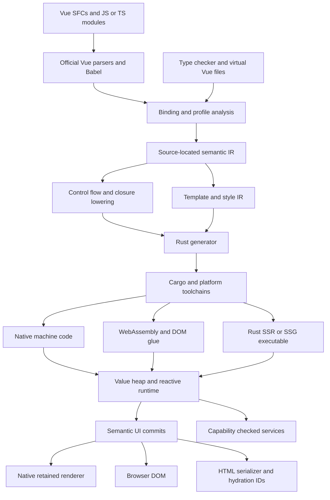
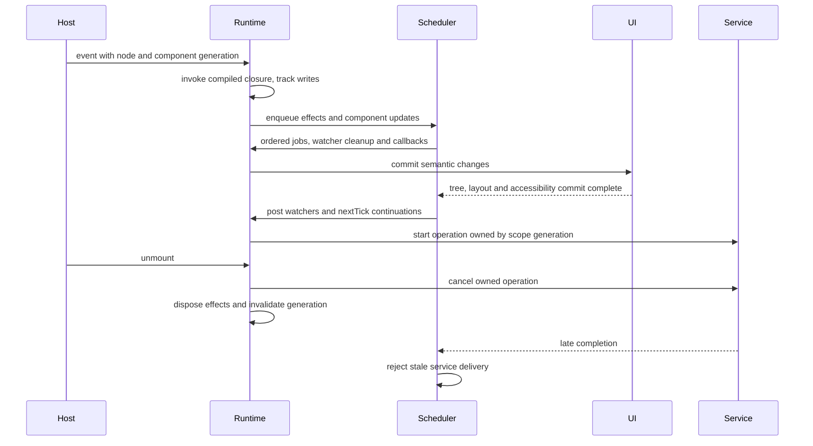

# Design: Vue native framework

## 1. Overview and feasibility decision

This document implements the contract in `requirements.md` conceptually; none of the proposed subsystems exists yet unless marked **inspected**. **Verified** means documentation or source was inspected, not that the framework passed a test. **Proposed** means a design choice. **Estimate** means a planning range. **Gate** means evidence is required before dependent work starts. All external documentation was consulted on October 8, 2026 Pacific; live links must be snapshotted with the implementation's lockfiles.

**Recommendation:** retain Vue's official SFC/template parsers and Babel initially; introduce semantic IR; generate native Rust functions using a managed JavaScript-value runtime. Adopt a closed, documented language/API profile and reject unsupported behavior. Use a retained semantic UI tree with a **custom-drawn native renderer**, OS integration for windows/menus/dialogs/input/accessibility, and a separate **DOM renderer on the web**. Investigate Blitz as the preferred native adapter before committing to it. Keep egui as a prototype/reference backend during evaluation. A production renderer selection is conditional on explicit gates, not settled by this document.

This changes the prototype's central architecture. Direct substitution of JavaScript expressions with Rust fields/operators cannot supply ordinary JavaScript identity, asynchronous behavior or Vue effects. It also changes its web strategy: a WASM canvas demo is useful graphics evidence but does not supply normal web semantics, text selection, SEO or accessible forms.

### 1.1 Language architecture alternatives

| Alternative | Benefits | Costs / conflicts | Decision |
|---|---|---|---|
| Static AOT subset mapped mostly to Rust structs and ownership | Small runtime; good optimization potential; follows prototype | Mutable aliases, escaping closures and dynamic shapes require restrictions; TypeScript structural types do not prove ownership; copying objects changes semantics | Reject as the general authoring contract. Permit proven internal specialization after differential tests |
| AOT subset plus managed dynamic values in Rust | Native application functions; shared identity and JS errors independent of Rust lifetimes; no engine fallback | Build a language runtime: heap, coercion, property access, closures, promise jobs and modules. GC and dynamic dispatch have real performance costs | **Recommended, subject to language/GC gates** |
| Embedded QuickJS or Boa + native renderer | Much more JS semantics reuse; easier npm/composable support; potentially reuse Vue reactivity itself | App code remains interpreted/bytecode-executed even inside a compiled binary. Host bridges, scheduling, GC and package restrictions remain; JIT unavailable or constrained on some platforms | Useful oracle/comparison. Conflicts with the strict AOT app-logic goal; adoption requires an explicit product-contract change |
| Browser/webview shell | Existing Vue/DOM/CSS behavior and tooling | Does not meet native renderer/AOT goal | Excluded; never an automatic fallback |

[QuickJS documentation](https://bellard.org/quickjs/) describes an interpreter with cycle handling and executable packaging; executable packaging alone is not ahead-of-time machine-code translation of application functions. [Boa](https://github.com/boa-dev/boa) is an embeddable JavaScript engine written in Rust, which likewise does not make user JavaScript AOT Rust. The [ECMAScript value model](https://tc39.es/ecma262/multipage/ecmascript-data-types-and-values.html) and [abstract operations](https://tc39.es/ecma262/multipage/abstract-operations.html) are semantic references, not implementation shortcuts. Pin a specification edition when creating fixtures; the live draft currently contains later work.

**Go/no-go implication:** if the dynamic runtime cannot meet correctness, collection latency or staffing limits, stop the broad framework program. The alternatives are a visibly narrower compiled language or a separately named engine-backed product. Do not continue by quietly changing “JavaScript” into Rust-like semantics.

## 2. Affected areas and subsystem ownership

Paths in the “proposed” column do not exist yet. Preserve existing test fixtures before restructuring; do not bulk-import the ZIP over the workspace.

| Subsystem | Inspected area → proposed area | Responsibility / requirements |
|---|---|---|
| Frontend | `compiler/compile.mjs` → `compiler/{sfc,bindings,profile,ir,lower,emit,diagnostics}/` | Official parsing, macro handling, semantic checking, source mapping; R02–R03, R07, R10 |
| Build/CLI | `compiler/cli.mjs`, `package*.json` → `tooling/cli/`, `tooling/build/` | Graph, cache, locked toolchains, staging, commands; R10–R12 |
| Values | New `crates/value/` | Heap, JS operations, closures, completions, module records; R02 |
| Reactive runtime | New `crates/reactivity/`, `crates/runtime/` | Effects, scheduler, instances, scopes, async ownership; R04–R06 |
| UI protocol | New `crates/ui/` | Stable node IDs, semantic nodes, events, focus and commits; R06–R09 |
| Native adapter | Generated egui calls → `crates/renderer-native/` | Retained backend adapter; no application or reactive ownership; R08–R09 |
| Web adapters | `generated/index.html`, WASM host → `crates/renderer-dom/`, `crates/renderer-ssr/`, `tooling/web/` | DOM command batches, HTML output, hydration; R18 |
| Hosts | `generated/src/{main,lib}.rs` → `hosts/{windows,macos,linux,ios,android,web}/` | Event loops, native SDK glue and app lifecycles; R13–R18, R21 |
| Services | New `crates/services/`, `packages/platform/` | Capabilities, networking, files, storage, navigation, jobs; R19–R22 |
| Tooling | New `tooling/{editor,debug,inspector}/` | Source-first author experience; R11 |
| Qualification | `tests/compiler.test.mjs`, `generated/tests/runtime.rs`, ZIP tests → `tests/{language,vue,ui,platform,security,fixtures}/`, `benches/` | Behavioral tests and evidence; R01, R23–R24 |
| Examples/release | `examples/Counter.vue`, ZIP `Quote.vue` → `examples/{counter,quick-quote,fieldboard}/`, `docs/`, `release/` | Apps, compatibility docs, notices and release recipes; R25–R26 |

Each crate is a logical boundary, not a requirement to start with many packages. Keep small related modules together until compilation or ownership justifies a separate crate. There is no Go package to modify; Rust and JavaScript tests are appropriate here.

## 3. Control flow and architecture





### 3.1 Compiler pipeline

1. Discover a static import graph under the project root and approved dependency roots. Resolve lockfile versions, `exports`, platform conditions and type imports. Parse assets/styles as data. Never execute app modules during analysis. Optional preprocessing is isolated, versioned and explicitly trusted.
2. Parse SFCs with `@vue/compiler-sfc`, templates with official Vue AST tooling, and JS/TS with Babel. Retain filename, source content hash, block offsets, byte spans, UTF-16 editor positions and macro expansion origins. Official parsing does not by itself implement Vue transforms or runtime semantics.
3. Bind lexical scopes, imports, closure captures, module cells and template identifiers. Lower macro intent using the pinned official SFC behavior as a reference; do not treat macro names as arbitrary callable functions. Preserve reactive props destructure semantics and imported-type dependencies.
4. Run type checking through Vue virtual files and the qualified TypeScript API. Type errors are useful diagnostics; the language profile checker independently inspects runtime AST and dependencies. JavaScript is accepted without mandatory annotations. `any` selects dynamic operations, not unchecked Rust layouts.
5. Produce **HIR** with explicit binding/heap locations, source IDs, JS value types and completion semantics. Template IR contains components, props, event closures, keyed ranges and source spans. Style IR contains only validated contract features.
6. Produce **MIR** with explicit evaluation order, short-circuit blocks, closure environments, abrupt completions, module initialization and async state machines. Every temporary live across a safepoint must be traced/rooted. Do not perform constant folding using Rust or host JS operations unless edge behavior matches the reference.
7. Emit readable Rust with stable mangled identifiers (Rust keywords must not ban valid JS identifiers). Emit source-correlated diagnostics metadata, symbol names and bridge schemas. Use `Result`/completion flow for app exceptions; no panics for ordinary JS throws.
8. Generate host projects/assets from versioned templates, stage in a new output directory and atomically replace only tool-owned output after success. Never overwrite user sources; use content manifests to distinguish generated files.

Build HIR/MIR/template/style schemas as versioned internal contracts with feature sets and content hashes. A schema mismatch is a hard build error, not a best-effort decode. Rust source output is not a stable public ABI. Use a versioned C ABI only at Swift/ObjC/JNI boundaries; no Rust enum layout crossing FFI.

### 3.2 Managed values, closures and collection

**Proposed:** a single-threaded runtime realm on each app's UI lane, with a traced, nonmoving logical heap addressed by generational IDs. Primitive values inline; objects/functions/arrays/collections/closures/promises refer to heap entries. Captured mutable locals are shared cells. Copying a `Value` holding an object copies a handle, preserving identity and aliases. Lexical environments implement temporal dead zones and per-iteration `let` captures. A scope does not own every object it has ever touched: an externally retained closure can legally keep values alive after its creating component unmounts.

Evaluate [gc-arena](https://github.com/kyren/gc-arena) before building a collector. Its fit with generated async frames, rooting, native handles and debug inspection is **unproven**. The candidate must demonstrate cycles, mutation barriers, reentrancy and bounded collection pauses. If integration requires unsound rooting or long stop-the-world scans, fail the gate and compare an alternative collector. Reference counting alone leaks cyclic JS graphs; an arena freed wholesale at component disposal breaks escaping closures.

Borrowing is an implementation detail. Heap APIs must release Rust borrows before calling application callbacks, getters, coercion or host reentry. Root temporaries across calls and collection safepoints. Collection only at explicit safe points; no finalizer executes app code. Explicit disposal closes files/network resources; collection is a last-resort reclamation mechanism. Pending host jobs retain only registered roots and generation-checked delivery handles. Worker messages transfer bounded serializable data, not shared mutable JS heap handles.

### 3.3 Reactive/component execution

Cache raw→proxy wrappers by raw object identity and mode. Track `get`, `has`, key iteration, array length/index and collection entry/iteration dependencies separately. Match Vue's deep ref unwrapping rules rather than universally unwrapping. Branching effects remove old subscriptions; computed nodes cache values and compare according to reference behavior. Readonly mutation diagnostics are distinct from TypeScript `readonly` annotations.

Instantiate components with props/attrs/slots, an injection parent and effect scope, stable component ID and generation. Setup runs once per instance; templates create compiled render effects. Node identity includes component identity, keyed sibling identity and compiler location, never just the array index or current render position. Removal disposes effects, directives, refs and service leases. `KeepAlive` deactivation is not unmount; explicit cache limits are documented application policy.

The scheduler uses reference-compatible job ordering, not a simplistic “all pre, then all renders” global queue. Assign stable component order; model parent-before-child updates, per-component pre jobs, post jobs, deduplication and recursive scheduling. `flush: 'sync'` remains synchronous; do not yield midway and claim equivalence. Microtasks and `nextTick` must preserve the pinned traces, including work added during a flush. Native `nextTick` means committed host tree/layout/accessibility state, **not physical display presentation**; on web it means DOM patch completion, not browser paint. Infinite user loops and self-triggering updates require diagnostics/watchdog termination; they cannot be made safe by silently skipping writes. Production ceilings are explicit policy with a resource error.

### 3.4 Async state, cancellation and errors

Compile `async` to resumable Rust state machines, rooted across suspension; implement JS promise resolution/thenable assimilation and reaction ordering explicitly. A Rust `Future` is a host operation, not automatically a JS promise. Results return through the runtime job queue. Error propagation, `try/finally`, thrown non-Error values and unhandled rejections retain source stacks.

Services started with component ownership carry `(scope_id, generation, operation_id)`. Disposal requests cancellation and invalidates delivery. The operation may already have executed externally; cancellation does not undo a sent HTTP request or saved file. “Latest result wins” requires a request sequence guard in the composable, separately from disposal. Ordinary promises are not forcibly cancelled, because that would change JS behavior; their retained closures may update a live app store, while effects for disposed components stay stopped. Error boundaries use `onErrorCaptured` propagation and app error handlers. Rust panics are framework failures: catch at unwind-safe host entrypoints where supported, mark the realm unusable, preserve committed data and restart. Never unwind across FFI, continue through poisoned invariants, or promise recovery from OOM/abort/WASM traps.

### 3.5 Incremental builds and compiler language

Cache by normalized source bytes, imported runtime **and type** graph, macro/compiler/IR versions, lockfile, config, target features, SDK/toolchain identity, environment allowlist and assets. Track reverse edges; invalidate dependents of exported types, CSS imports and generated declarations. Stage results atomically; interrupted jobs cannot publish a cache entry. Hash names deterministically, avoid absolute paths/timestamps, sort unordered traversals and remap source roots. Do not cache secrets. Test cold versus incremental output equivalence and case-sensitive/case-insensitive path behavior.

Keep the build frontend in JavaScript/TypeScript through the first production profile. The official SFC compiler and editor integration are JS-oriented; moving them to Rust early creates a second compatibility project. Consider a Rust port only when profiles show frontend cost materially blocking agreed budgets or deployability, and a parallel parser/macro corpus reaches exact parity. Port one stage behind the versioned IR; retain differential tests. A Rust compiler implementation is not required for Rust-compiled apps.

## 4. Data and persistence (R20)

No migration is required for current prototype data: neither example stores data. Framework reactivity, caches and component scopes are in memory. Build artifacts use content-addressed files, not a new server or database. No vector, FTS, chat/session, or retrieval subsystem is justified.

**Proposed native persistence:** a serialized worker connection per logical database, parameterized SQL, explicit transactions, migrations with version/checksum journal, busy timeouts and cancellation. Use a maintained Rust SQLite binding after license/FFI review. Bundle or pin SQLite consistently; enable foreign keys; select WAL only for local filesystems and tested workloads. Migrations create a recoverable backup when necessary and never silently downgrade. Atomicity assumptions must be tested on actual filesystems; see [SQLite atomic commit](https://sqlite.org/atomiccommit.html).

**Proposed web persistence:** settings/document KV uses IndexedDB by default. SQL is an optional worker-based SQLite WASM/OPFS adapter, separately qualified; no pretend SQL implementation over KV. Capability detection can return `Unavailable`, not silently downgrade durability. [SQLite's persistence documentation](https://sqlite.org/wasm/doc/trunk/persistence.md) describes OPFS/worker and browser-specific constraints. Test quotas, private browsing, storage eviction, multiple tabs and required isolation headers for the chosen VFS. Request durable storage where available; require export/recovery for user data that browsers can evict.

Quick Quote's proposed app-owned database has `quotes(id TEXT PRIMARY KEY, customer TEXT, description TEXT, revision INTEGER, updated_at INTEGER)` and `quote_items(id TEXT PRIMARY KEY, quote_id TEXT REFERENCES quotes(id), position INTEGER, quantity_decimal TEXT, unit_price_minor INTEGER, kind TEXT)`, plus a schema journal. Index `quote_items(quote_id, position)` for line retrieval and `quotes(updated_at, id)` for the recent list. Money/rounding policy belongs in the app's tested decimal logic, not a compiler special case. The existing float sample remains a legacy fixture. Persist form drafts on a bounded debounce and flush on explicit save; a suspension callback alone is not a durable-save strategy. Export versioned JSON/CSV; defer PDF as an optional separately licensed service.

Config: proposed data-only `vue-native.config.json` with `schemaVersion`, `profile`, targets, entry, capabilities, budgets and web mode. Unknown fields/versions fail with locations. Safe defaults: no general filesystem/network/notification access; development inspector loopback-only; no telemetry. Precedence is CLI > documented `VUE_NATIVE_*` overrides > project config > versioned defaults. Limit env overrides to build target/cache/log settings; do not permit env to silently expand shipped capabilities. Public build variables require a `PUBLIC_` allowlist and are disclosed as embedded values. Secrets are runtime store handles or signing credentials injected only at release steps. Upgrade command previews a schema migration and preserves a backup; compatibility profile never changes silently.

## 5. Interfaces and types

These are boundary sketches, not implemented APIs or a frozen ABI. Rust is appropriate internally; TypeScript is necessary for the requested author-facing interface.

```rust
enum Value {
    Undefined, Null, Bool(bool), Number(f64),
    String(StringId), Symbol(SymbolId), Heap(HeapId),
}
struct HeapId { slot: u32, generation: u32 }
struct SourceSpan { file: FileId, start_byte: u32, end_byte: u32 }
enum Completion { Normal(Value), Return(Value), Throw(JsException), Break(LabelId), Continue(LabelId) }
struct DeliveryToken { scope: ScopeId, generation: u64, operation: OperationId }
trait Renderer {
    fn commit(&mut self, changes: &[UiMutation]) -> Result<CommitId, HostError>;
    fn measure(&mut self, node: NodeId) -> Result<LayoutBox, HostError>;
    fn dispose(&mut self, root: NodeId);
}
// Heap accesses are short lived; compiled callbacks may trigger collection or reentry.
fn invoke(cx: &mut Runtime, callee: FunctionId, this: Value, args: &[Value]) -> Completion;
fn deliver(cx: &mut Runtime, token: DeliveryToken, result: ServiceResult) -> DeliveryStatus;
```

`UiMutation` is a typed semantic protocol (create/remove/reorder/set property/text/listener/focus), not arbitrary HTML or native method names. Native and DOM adapters share nodes and contracts; pixel output differs. Node IDs are generation checked. Accessibility updates carry semantic roles and stable IDs in the same commit. FFI uses fixed-width tags, length-delimited buffers, explicit ownership/free functions and version negotiation, never borrowed Rust strings across callbacks.

```ts
// Proposed built-in package: compiler-recognized API, not a Rust authoring requirement.
type ServiceError = { code: 'Denied' | 'Revoked' | 'Unavailable' | 'Cancelled'
  | 'Timeout' | 'Quota' | 'Conflict' | 'InvalidData' | 'Io'; message: string }
interface FileHandle { readonly id: string } // opaque scoped capability, not a path
interface HttpOptions { signal?: AbortSignal; timeoutMs?: number; maxBytes?: number }
interface ScopedServices {
  http: { get(url: string, options?: HttpOptions): Promise<Response> }
  files: { chooseSave(options: { suggestedName: string }): Promise<FileHandle | null>
    writeAtomic(file: FileHandle, bytes: Uint8Array): Promise<void> }
  settings: { get<T>(key: string): Promise<T | undefined>; set<T>(key: string, value: T): Promise<void> }
}
```

Host operations reject promises with structured service errors, preserving JS exception semantics. Absence (`undefined`), denied access and user cancellation are distinguishable. Streams expose pull-based readers; an async iterator API may be built in without supporting user-defined generator syntax. No synchronous network/DB calls on the UI lane.

## 6. Failure modes and safeguards

| Failure | Observable outcome / safeguard | Test owner |
|---|---|---|
| Invalid config, macro or unsupported transitive code | Source diagnostic, no half-written output, import chain shown | T03, T10–T12 |
| Semantic mismatch or collector rooting error | Gate failure with minimized oracle case; stop feature promotion | T02, T04–T05 |
| Reentrant callback / panic | Release heap borrows before calls; root temporaries; terminate damaged realm safely | T02, T22 |
| Stale network result or removed UI node | Generation-checked service delivery discarded; normal JS continuation behavior retained | T05, T06, T19 |
| Unbounded traversal, effects, input or decompression | Explicit resource error with source/operation identity; bounded buffers and watchdog | T22–T23 |
| GPU/surface/device loss | Suspend rendering, recreate resources; preserve app state; accessible error if unavailable | T08, T13–T18 |
| IME or accessibility mismatch | Target remains experimental; native text adapter or narrower release required | T09 |
| Disk full, migration interrupted, corrupted record | Prior committed data retained; backup/recovery workflow; never silently reset database | T20, T26 |
| API/permission/notification delivery failure | Typed denied/unavailable/retryable status; no guarantee of OS delivery | T19–T21 |
| Browser SSR hydration mismatch | Source-correlated diagnostic; safe subtree remount with input/focus recovery or explicit failure | T18 |
| Update trust/compatibility failure | Keep known-good binary and readable data; reject artifact; show recoverable status | T22, T25 |

## 7. Testing strategy and evidence model

Use `node:test` for the existing frontend and Rust's built-in `#[test]`/integration tests for runtime/hosts. Go's `testing` package does not fit this repository. Keep golden IR/diagnostic snapshots where format is the contract; supplement generated-source goldens with compile-and-execute cases. A source substring is not evidence of JavaScript behavior. Every new test must identify an observable invariant, credible regression and owning boundary; avoid duplicating a single scenario at every layer.

| Family | Primary owning boundary and required evidence |
|---|---|
| T01 baseline | Archived fixture hashes, command output and explicit claims ledger; dynamic-argument negative control |
| T02 language | Same input program in Node/reference engine and compiled runtime; ordered trace of values, identity tokens, exceptions and jobs; selected licensed Test262 cases; heap property tests and Miri where applicable |
| T03 authoring | SFC/macro/type fixtures with source diagnostics, JS/TS equivalence, editor virtual-file mapping |
| T04 reactivity | Pinned Vue oracle versus Rust traces: dependencies, computed executions, collection mutation, raw/proxy identity, scope leaks |
| T05 scheduling | Explicit scheduler traces for nested parent/child jobs, promises, cleanup, nextTick, disposal and cancellation races; fake clock only for time, not mocked semantics |
| T06 components | Parent/child execution with props/emits/slots/injection/keys/lifecycle/ref disposal; live component counts after unmount |
| T07 templates | User-visible output/events and rejection cases per inventory row; escape adversarial text |
| T08 graphics | Layout dimensions/hit testing, reference-browser subset cases, bounded pixel tolerances, assets, font/RTL corpus and GPU recovery |
| T09 accessibility | Semantic trees plus real keyboard/IME/AT workflows, with OS/AT versions and human findings |
| T10 compiler | Diagnostics/sourcemaps, semantic IR goldens, differential generated execution, malformed-source fuzzing and deterministic build comparisons |
| T11 tooling | Clean-room create/check/dev/build/upgrade, HMR disposal/state migration, offline build and cache mutation tests |
| T12 packages | Exact package version + transitive graph + selected documented API use cases; reject unqualified imports |
| T13–T17 hosts | Per-target real-machine/device qualification described below, debug and release |
| T18 web | Real Chromium/Firefox/WebKit, SSR HTTP/HTML, JS-disabled content, pre-hydration editing, isolation, loading/quota failures |
| T19 services | Local controlled HTTP/WebSocket fixtures, TLS/redirect/abort/backpressure and cross-target behavior |
| T20 storage | Actual SQLite/IndexedDB/OPFS, migration fixtures, kill-point crash recovery, disk/quota and handle revocation |
| T21 integration | Window, permission, route/deep-link, notification and OS background lifecycle tests |
| T22 security | Fuzz compiler/FFI/assets/bridges, syscall/capability denial, malicious dependency/build fixture, updater attacks |
| T23 benchmarks | Named hardware, raw samples, release flags, baselines, profiler traces and sustained energy tests |
| T24 qualification | CI evidence manifests, negative controls, upgrade/offline/signing matrix completeness |
| T25 release | License/SBOM review, independent unsigned reproducibility, signature verify, upgrade/rollback/key rotation rehearsal |
| T26 apps | End-user workflows and independent expected data; no app-name branches in compiler/runtime |

Identity traces assign deterministic ordinal IDs instead of serializing pointers. Compare numbers with explicit NaN/signed-zero representation; compare strings as UTF-16 code units; compare maps/sets by observable order. Do not normalize away differences that are the contract. Vue public behavior is the oracle; private internal ordering is tested only where observable. Maintain dev versus production expectations for warnings and debug hooks. Property tests cover random object graphs, keys, mutation sequences and scope trees. Fuzzing includes deeply nested SFC/TS/CSS, lone surrogates, huge numeric literals, archive traversal, image decompression and malicious hydration payloads. Native memory sanitizers, Miri and platform crash tools complement safe Rust tests; they do not prove all FFI safe.

## 8. Compatibility inventory

This is the enumerated **proposed production profile**, not a supported-features announcement. Status: **P** planned faithful behavior within the language profile; **A** explicit adaptation; **W** web-only extension; **X** excluded with an error; **E** experiment, not promised for production. Prototype column: **C** counter subset, **Q** additional ZIP subset, **—** absent. Even C/Q is not general semantic qualification. “All” means native + web, with the specific boundaries below. Each row gives implementation and an observable test scenario. Unlisted overloads/standard-library methods default to **unsupported**, never automatic engine fallback. T-family ownership is defined above; implementation promotion must expand grouped API names into separately enumerated manifest entries.

### 8.1 JavaScript language and values (R02, R05, R10)

The native/web shared profile uses the same Rust value operations. [ECMAScript types](https://tc39.es/ecma262/multipage/ecmascript-data-types-and-values.html), [abstract operations](https://tc39.es/ecma262/multipage/abstract-operations.html) and [Test262](https://github.com/tc39/test262) provide the reference contracts. These rows are proposed compiler policies, not claims that the specification requires a particular Rust implementation.

| ID / construct | Status; prototype | Contract / implementation | Tests and exclusions |
|---|---|---|---|
| L01 lexical bindings/control flow | P; C only const refs | `let/const/var`, block/function scope, TDZ versus var hoisting, if/switch/loops, break/continue/return; explicit MIR | T02 scope/shadow/loop-order/TDZ/var-before-initialization; reject `with`, sloppy scripts and Annex B legacy forms |
| L02 functions/closures | P; C zero-argument named handlers only | Parameters/defaults/rest, arrow lexical `this`, ordinary call `this`, captured mutable cells, recursion | T02 alias capture, per-loop capture, callback reentry, escaping closure; no ownership annotations |
| L03 identity/aliasing | P; — | Heap identity for objects/functions, distinct proxy wrapper IDs, shared references | T02 shared mutation, cycles, strict equality and collection keys; no copy-on-call semantics |
| L04 objects/properties | P subset; — | Plain/null-prototype objects, dynamic own data keys, accessors in object literals, spread/destructure/delete/has/own enumeration order | T02 getter side effects/order and integer/string/symbol keys; property descriptor mutation excluded |
| L05 prototypes/classes | X general; — | Built-in prototype behavior for supported methods only; no user class/new-function constructors, prototype replacement, `__proto__` mutation, reflection-based extension | T02 precise class/prototype errors; **major npm limitation**; do not freeze ordinary objects and claim unrestricted JS |
| L06 null/undefined | P; — | Separate tags; missing keys→undefined; optional chaining/nullish coalescing preserve evaluation order | T02 missing versus explicit null, optional argument effects, serialization |
| L07 truthiness/coercion | P bounded domain; C booleans only | Implement JS primitive ToBoolean/ToNumber/ToString, strict/loose equality and operand-returning logical operators | T02 `0`, `-0`, NaN, empty string, null, undefined, `[]`; user custom coercion/unsupported prototypes rejected |
| L08 numbers/operators | P; C partial f64 | IEEE-754 double, signed zero/NaN/infinity, integer bitwise conversion, exponent/remainder; JS decimal parsing/printing/`toFixed(0..100)` | T02 threshold/exponent/tie/negative-zero cases; replace Rust Display/format shortcuts. BigInt X |
| L09 strings | P; C Rust String subset | UTF-16 code-unit semantics including lone surrogates; method allowlist; encode/replacement rules only at host boundary | T02 indexing/length/slice/iteration emoji/combining/surrogates; renderer uses grapheme clusters separately |
| L10 arrays | P; — | Sparse slots distinct from undefined, length semantics, supported iteration/mutation/callback methods | T02 holes/splice/sort/comparator exceptions and iteration mutations; no accidental Rust Vec semantics |
| L11 Map/Set | P; — | Insertion order, SameValueZero keys, object key identity, mutation during iteration | T02 NaN/-0/object keys and delete/reinsert; WeakMap/WeakSet/WeakRef/finalizers X initially |
| L12 symbols | P subset; — | Unique symbols, registry symbols and supported iterator symbols for injection/keys | T02 uniqueness/module registry; unsupported well-known symbol protocols fail at use |
| L13 exceptions | P; — | `throw`, `try/catch/finally`, non-Error thrown values, source stack; explicit abrupt completion | T02 finally overrides return/throw; no Rust unwinding for JS errors |
| L14 promises | P; — | Pending/fulfilled/rejected, then/catch/finally/all/allSettled/race/any, thenable assimilation and microtask jobs | T05 recursive thenables, multiple resolutions, unhandled rejection timing; hostile thenables bounded by explicit watchdog |
| L15 async/await | P functions; — | Compiled suspension frames retain locals/roots and completion stack | T05 rejection/finally/cancellation races; user generators and async generators X; top-level SFC await E with Suspense |
| L16 modules | P ESM; C only vue named imports | Static ESM, live binding cells, namespace reads, cycles/TDZ, singleton per realm | T02 cyclic initialization/order; CommonJS/require, Node built-ins and module-level top-level await X initially |
| L17 dynamic imports | P literals; — | Static graph, deferred ESM evaluation returning promises; native and first production web profile link application code ahead of time in one binary/module | T05 namespace identity, evaluation once and rejection/order; physical WASM code splitting E; computed specifiers, remote native code and runtime compilation X |
| L18 standard libraries | P explicit registry; — | JSON, selected Math/Number/String/Array/Object operations; Uint8Array/ArrayBuffer for IO with specified bounds | T02 each overload incl JSON errors/order; Date/Intl/RegExp broad parity E, other typed arrays/DataView X until inventoried |
| L19 nondeterminism | A; — | Built-in clock/random providers and `@vue-native/platform` locale/crypto services; real outcomes treated as external inputs | T02 seeded test provider, T22 cryptographic APIs; Math.random never used for secrets; SSR time/random state serialized or opt-in client-only |
| L20 metaprogramming | X; — | `eval`, Function constructors, user Proxy, arbitrary Reflect, dynamic codegen and native addons rejected | T10 transitive/dynamic reachability errors; internal reactive proxy model does not expose general JS Proxy |
| L21 method allowlist governance | P; — | Versioned compiler/runtime declaration manifest for every standard method/overload; fail unknown calls when closed-world resolution proves forbidden; dynamic call target checked at runtime | T02 unqualified property call gets source error, never a native panic; implementation must not declare all JS library coverage |

TypeScript can improve inference and optimization candidates, but structural typing and `as` casts do not establish unique ownership, absence of aliases or valid network data. Fast unboxed representations require a proven semantic equivalence path and deoptimization/boxing at dynamic boundaries; do not make them a first-milestone dependency.

### 8.2 SFC syntax, compiler macros and TypeScript (R03)

Source inventory: [SFC specification](https://vuejs.org/api/sfc-spec.html), [script setup](https://vuejs.org/api/sfc-script-setup.html), [TypeScript everyday types](https://www.typescriptlang.org/docs/handbook/2/everyday-types.html), [generics](https://www.typescriptlang.org/docs/handbook/2/generics.html), [narrowing](https://www.typescriptlang.org/docs/handbook/2/narrowing.html), [modules](https://www.typescriptlang.org/docs/handbook/modules/reference.html), [enums](https://www.typescriptlang.org/docs/handbook/enums.html) and [tsconfig](https://www.typescriptlang.org/tsconfig/). Types/macros are build-time facilities; they are not runtime exports.

| ID / feature | Status; prototype | Implementation / target behavior | T03 acceptance scenario / exclusion |
|---|---|---|---|
| S01 template + setup JS/TS | P all; C limited | Block offsets, duplicate block errors, comments, whitespace and inferred component names | Equivalent JS/typed SFC behavior; Unicode diagnostic span |
| S02 normal script | P restricted; — | Module-scope imports/named exports alongside setup; disallow conflicting default Options API objects | Singleton module init vs per-instance setup; `data/methods/mixins` rejected |
| S03 external blocks | P template/style src; — | Static project-root resolution and dependency edges | File edits invalidate users; setup `src` and prohibited combinations rejected according to Vue restrictions |
| S04 preprocessors/custom blocks | X default, E trusted plugins; — | No arbitrary transforms installed implicitly | Precise lang/custom-block error; later transforms must supply chained source maps |
| S05 imports | P; C unaliased ref/computed only | Aliases, `.vue` components, namespace imports, local code/assets and qualified npm; static graph | Rename import; missing transitive module; package conditions and casing |
| S06 defineProps / withDefaults | P macro; — | Runtime/type forms, imported type resolution, hoisting, validators/default factories | Defaults per instance; missing vs undefined, boolean casting, invalid hoist; no arbitrary type evaluator |
| S07 reactive props destructuring | P macro transform; — | Pin 3.5 semantics, defaults and reference rewrites within setup | Destructured prop used by watcher updates correctly; invalid watch-source warning |
| S08 defineEmits | P macro; — | Runtime declarations/validators and typed overloads/named tuples | Correct payload, validation warning, undeclared listener fallthrough |
| S09 defineModel | P macro; — | Named/multiple models, defaults, required, get/set transformers and modifiers | Parent-child update order, absent parent default behavior, trim/number custom model |
| S10 defineExpose | P macro; — | Explicit public instance projection | Closed by default; parent ref sees exposed/unwrapped values only |
| S11 defineOptions | P limited macro; — | `name` and `inheritAttrs` metadata only; unsupported option keys error | Name diagnostics and attr fallthrough; Options API escape rejected |
| S12 defineSlots | P type macro; — | Slot names/props type checking; no runtime emitted object fabrication | Invalid slot payload/name mapped to template |
| S13 setup generics | P type feature; — | Generic SFC virtual declarations, inference/explicit arguments | Generic props/slots inference in consumer; runtime behavior identical after erasure |
| S14 top-level await | E; — | Requires async setup/context restoration and experimental Suspense boundary | Rejection, unmount-before-resolve and context restore; production error until separate experimental qualification |
| S15 TS primitive/union/intersection/literal/tuple types | P build-time; C `lang=ts` only | Qualified TS checker; erase annotations; runtime uses Value domain | Union narrowing, nullable props, tuple index errors; annotations never native layout promises |
| S16 interfaces/aliases/generics/overloads | P build-time; — | Structural checks and overload declarations; one runtime implementation | Overload resolution, constraints and recursive type timeout diagnostics |
| S17 keyof/typeof/indexed/mapped/conditional/template types | P checker subject to macro resolver limits; — | Type checker owns types; Vue macro AST conversion has narrower limits | Unsupported whole conditional props object reports macro limitation, not accepted stale metadata |
| S18 `as`, satisfies, const/non-null assertions | P erased; — | Validate then erase; boundary validation unchanged | Unsound cast still receives JS error/validation failure, never unsafe Rust cast |
| S19 type-only imports/exports, `.d.ts`, JSDoc | P; — | Erased edges still in type-cache graph; native profile ambient libraries | Changed imported type invalidates; declaration doesn't authorize unavailable runtime package |
| S20 enums/const enums/namespaces/parameter properties | X initially; — | Runtime-producing TS forms need explicit lowering, not blind erasure | Per-construct source error; use union constants/functions instead |
| S21 classes/decorators/JSX/TSX | X production profile; — | Runtime semantics/compiler transforms not implemented | Source errors even if TypeScript accepts; template SFC alternative |
| S22 type utility and augmentation APIs | P types only, limited; — | PropType, MaybeRef, MaybeRefOrGetter, ExtractPropTypes, ExtractPublicPropTypes, ComponentCustomProps, profile-specific CSSProperties | T03 utility inference; ComponentCustomProperties/Options cannot enable excluded Options API or arbitrary globals |
| S23 TS build config | A; — | Strict checks, ESM resolution, native libs omit DOM/Node; web extension has separate lib set | Native `document` error, web import permitted only in explicit extension; unknown compiler-affecting config rejected |
| S24 explicit resource management | X initial profile; — | `using`, `await using`, Disposable/AsyncDisposable runtime protocols require additional completion lowering; do not erase them | T03 reject declarations with spans; use supported try/finally and explicit service disposal. See [TypeScript 5.2 resource management](https://www.typescriptlang.org/docs/handbook/release-notes/typescript-5-2.html) |
| S25 additional type/module forms | P erased type features, X runtime legacy modules; — | TS utility types, readonly/unique symbol/const type parameters, type predicates and assertion signatures checked; `import =`/`export =` runtime forms excluded; ambient globals cannot grant host capabilities | T03 inference/narrowing/erasure fixtures and incompatible module diagnostics; newer TS runtime syntax stays excluded until manifest revision |

### 8.3 Reactivity, scheduling, helpers and lifecycle (R04–R06)

Inventory sources: [reactivity core](https://vuejs.org/api/reactivity-core.html), [utilities](https://vuejs.org/api/reactivity-utilities.html), [advanced APIs](https://vuejs.org/api/reactivity-advanced.html), [watchers](https://vuejs.org/guide/essentials/watchers.html), [helpers](https://vuejs.org/api/composition-api-helpers.html), [lifecycle](https://vuejs.org/api/composition-api-lifecycle.html), [injection](https://vuejs.org/api/composition-api-dependency-injection.html), [general API](https://vuejs.org/api/general.html). Unless noted, P applies to all targets and is absent from the prototype.

| ID / runtime API | Status; prototype | Implementation contract | Required differential / host case |
|---|---|---|---|
| V01 ref | P; C primitive subset | Deep wrapping, `.value`, Object.is-style change behavior; template unwrapping context | T04 same write, NaN/-0, nested refs and instance separation |
| V02 shallowRef / triggerRef | P; — | Identity-only outer tracking; explicit trigger | T04 nested mutation inert, trigger reruns effect |
| V03 reactive | P; — | Deep cached wrappers; arrays/Map/Set instrumentation | T04 add/delete/iterate/length, collection ref non-unwrapping |
| V04 readonly | P; — | Deep readonly wrapper and dev warning/no mutation | T04 writes through readonly, original mutation visibility |
| V05 shallowReactive / shallowReadonly | P; — | Root-only wrapping; preserve nested identity | T04 nested ref/object untouched |
| V06 computed | P; C uncached pure getter | Cached lazy getter, writable setter, old-value parameter, computed stability | T04 read twice once, branch changes, equal results, writable round trip |
| V07 isRef / unref / proxyRefs | P; — | Introspection and one-level unwrapping; proxyRefs unwraps top-level ref keys, writes go through `.value`, nested refs stay refs (decision 13) | T04 plain/ref/computed values; proxyRefs unwrap, write-through and nested refs |
| V08 toRef / toRefs / toValue | P; — | Property-linked refs, normalization/getter forms and optional keys | T04 bidirectional property alias; missing property; getter evaluation |
| V09 isProxy / isReactive / isReadonly / isShallow | P subject to pinned-export audit; — | Wrapper mode flags; no guesses based on Rust type | T04 nested readonly/reactive wrappers and raw values |
| V10 toRaw / markRaw | P; — | Raw identity escape, excluded wrapping flag | T04 raw alias writes don't spuriously notify; identity hazards preserved/documented |
| V11 customRef | P; — | Compiled factory closures receive track/trigger hooks | T04 debounced ref with explicit timer service; disposal and repeated reads |
| V12 effectScope / getCurrentScope / onScopeDispose / effect / stop | P; — | Nested/detached scopes, stop semantics and warning rules; effect and stop follow the production effect semantics, where lazy is ignored (decision 13) | T04 detached scope survives parent; explicit stop cleans subscriptions; effect runner stop and untracked runs |
| V13 watchEffect / watchPostEffect / watchSyncEffect | P; — | Track synchronous reads only, appropriate flush lane and cleanup | T05 dependency after await not tracked; sync vs post ordering |
| V14 watch | P; — | Ref/getter/reactive/multi-source, old/new values, immediate/once/deep including numeric depth | T05 nested traversal cycles, deep same-object identity, source arrays |
| V15 watch handles | P; — | stop/pause/resume and scope auto-stop | T05 writes while paused coalesce as reference; stop prevents queued delivery |
| V16 onWatcherCleanup / callback onCleanup / getCurrentWatcher | P; — | Respect synchronous registration restriction for onWatcherCleanup; bound callback behavior separately; getCurrentWatcher is set during watch callbacks and watchEffect getters only (decision 13) | T05 cleanup before rerun/stop; invalid post-await registration; getCurrentWatcher scopes |
| V17 scheduler / nextTick | P; — | Dedup and reference order, callbacks and promise returns | T05 nested jobs, parent/child pre/post, writes within nextTick; host commit≠paint |
| V18 mount/update hooks | P; — | onBeforeMount/onMounted/onBeforeUpdate/onUpdated tied to tree commits | T06 child/parent order; SSR excludes client mount hooks |
| V19 unmount hooks | P; — | onBeforeUnmount/onUnmounted with deterministic effect disposal | T06 refs/jobs/services around removal |
| V20 onErrorCaptured | P; — | Ancestor propagation, `false` stop and app handler fallback | T06 setup/render/event/async errors; panic separate |
| V21 onRenderTracked / onRenderTriggered | P dev only; — | Source-oriented dependency events | T04 event fields and absence in release |
| V22 onActivated / onDeactivated | P; — | KeepAlive cache lifecycle distinct from unmount | T06 cached state, nested activation order and eviction |
| V23 onServerPrefetch | W SSR; — | Request-owned promises before serialization | T18 timeout/error/isolation; native use diagnosed as server-only |
| V24 provide / inject / hasInjectionContext | P; — | String/symbol keys, nearest provider, lazy default factory, app context | T06 shadowing, missing/default, reactive identity; sibling/window boundaries |
| V25 useAttrs / useSlots | P; — | Current attrs/slot functions with reference reactivity restrictions | T06 attr updates/fallthrough and slot closure scope |
| V26 useModel | P; — | Shared runtime implementation behind defineModel | T06 getter/setter/modifier tuple behavior |
| V27 useTemplateRef | A native, P DOM; — | Native returns typed host handle; DOM returns qualified element handle | T06 null before/after mount, list refs, focus action and exposed instance |
| V28 useId | P; — | App prefix + deterministic instance identity; SSR stable allocation | T06 uniqueness; T18 server/client consistency and concurrent requests |
| V29 setup context and composition setup | P restricted; — | SFC setup primary; allow statically analyzable `defineComponent({setup, name, inheritAttrs})` paired with an SFC template | T06 props/context/expose; reject data/methods/this-based Options API; function-form render-returning components excluded |

### 8.4 Components and templates (R06–R09)

References: [directives](https://vuejs.org/api/built-in-directives.html), [built-in components](https://vuejs.org/api/built-in-components.html), [form bindings](https://vuejs.org/guide/essentials/forms.html), [rendering mechanism](https://vuejs.org/guide/extras/rendering-mechanism.html), [Suspense experimental status](https://vuejs.org/guide/built-ins/suspense.html). These rows deliberately distinguish event/form adaptations from exact DOM behavior.

| ID / feature | Status; prototype | Native/web behavior and approach | Required tests / exclusions |
|---|---|---|---|
| U01 interpolation / v-text | P; C interpolation only | JS stringification; text nodes never markup | T07 arrays/objects/null formatting and hostile strings; no Rust Display substitution |
| U02 expressions | P profile; C small operators | Scoped expressions, globals allowlist, template ref unwrapping | T07 optional chain/side-effect order; reject unsupported globals/statement locations |
| U03 static/dynamic bindings | P; C button disabled only | Attributes/properties/class/style, object spread, dynamic arguments and same-name shorthand | T07 boolean/absent attrs and dynamic argument changes; regress ignored dynamic click bug |
| U04 DOM `.prop/.attr/.camel` binding modifiers | W for DOM-specific behavior; — | DOM property/attribute distinction; native semantic fields explicitly mapped | T07 native unsupported property diagnostic; DOM property versus string attr |
| U05 event handlers | A native/P DOM; C click only | Named/inline/object/dynamic events, `$event`, normalized host events, capture/bubble | T07 propagation path and component emits; DOM Event object APIs web-only |
| U06 event modifiers | A native/P DOM; — | stop/prevent/self/once/capture, key/system/exact/mouse filters; passive only on supported web listeners | T07 modifier order, passive+prevent error, key vs IME, touch-generated click |
| U07 text/textarea v-model | P observable value flow; C string input | Editing buffer with composition state, lazy/trim, caret preservation | T07 composition-end, paste, selection, lazy change; T09 host editing |
| U08 numeric v-model | A native/P web; Q drag control | Explicit native numeric textbox with buffer; Vue number parse/empty-string behavior, validity separate from value | T07 empty/invalid/exponent/locale/min/max/step; no clamp silently replacing Vue model value |
| U09 checkbox/radio/select models | P value semantics; — | Boolean/custom true-false, arrays/sets, radio values, single/multiple select | T07 non-string option identity and change ordering; native presentation differs |
| U10 file/range/date input variants | A explicit controls; — | Range slider qualifies separately; files use scoped handle picker; date via explicit platform component | T07 cancellation and model type; unsupported HTML type errors, no generic catch-all input |
| U11 component props/emits/model | P; — | Readonly prop view, default factories/validators, case rules, model updates | T06 Boolean/default order, declared emits vs fallthrough, parent mutation |
| U12 slots / v-slot / slot element | P; — | Default/named/scoped/dynamic slots, fallbacks and slot owner tracking | T06 parent state in reused slot, missing slot, conditional fallback |
| U13 attrs/class/style fallthrough, mergeProps | P; — | Single-root merge, multi-root explicit attrs, inheritAttrs false; public mergeProps applies the same class, style and listener merge rules (decision 11) | T06 warning and merge precedence; T12 mergeProps precedence cases; stable attrs contract |
| U14 v-if / v-else-if / v-else | P; C bool v-if only | Branch identity, lazy mount, scope disposal | T07 truthiness, branch state reset and sibling validation |
| U15 v-show | P; — | Preserve instance, remove from layout/hit testing/AT while hidden | T07 focus evacuation, restored visibility; no unmount hooks |
| U16 v-for | P profile; — | Arrays, own-object keys, integer range, strings, supported iterables; scoped aliases | T07 index/key/value order, array holes, destructuring, precedence with v-if |
| U17 key / keyed reconciliation | P; — | Stable primitive keys; duplicate invalid keys diagnostic; unkeyed behavior documented | T06 insert/move/delete preserves input state and focus; list refs cleanup |
| U18 ref attribute / function refs | A native/P DOM; — | Stable component/host handles, null on disposal and updated lists | T06 reorder/function ref timing; no native HTMLElement pretence |
| U19 component / is | P static module set; — | Dynamic type lookup and replacement; qualified native tags | T06 state disposal/cache; arbitrary HTML `is` custom-element behavior W/X |
| U20 defineAsyncComponent | P; — | Bundled loader, delay/timeout/loading/error/retry, request dedup | T06 resolve/reject/unmount race; Suspense interaction E |
| U21 KeepAlive | P; — | Include/exclude names, max LRU, activation scopes and cache disposal | T06 LRU resource cleanup; services pause policy explicit, not implicit cancellation of promises |
| U22 Teleport | A native/P DOM; — | Native named overlay roots in same window; DOM selector/element targets, disabled/defer | T07 event/injection ancestry retained; cross-window teleport X |
| U23 Transition | A native/P DOM; — | Enter/leave hooks, cancellation/modes; native supported opacity/transform timeline | T07 ordering/rapid reversal/reduced motion; arbitrary CSS animation behavior W |
| U24 TransitionGroup | A native/P DOM; — | Keyed enter/leave/move, layout snapshots for supported transforms | T07 reorder while focused/scrolling; performance budget with 1k rows |
| U25 Suspense | E all; — | Explicit experimental profile only, including nested async setup and fallbacks | T06 pending/error/unmount/context restoration; no stable promise |
| U26 custom directives | A native/W DOM directives; — | Hooks exposed with typed host handle and old/new values; no direct unsandboxed native pointers | T07 hooks/disposal; HTMLElement manipulation rejected native |
| U27 v-pre / v-once / v-memo | P; — | Literal skip, once cache, dependency-memoized subtree per pinned behavior | T07 skipped expression, event closure freshness and keyed list memo |
| U28 v-cloak | P web, documented no-op native; — | Web loading selector supported; native never exposes raw template | T07 no moustache flash under delayed load |
| U29 v-html | X shared/native, W explicit web-only profile | Trusted HTML insertion retains Vue raw behavior; no implicit sanitizer claimed equivalent | T22 XSS/CSP/Trusted Types; T07 raw content not compiled; trusted extension separately qualified |
| U30 template fragments/comments/whitespace | P; C limited | Multiple roots, fragment ranges, comments and compiler whitespace mode | T07 conditional/list fragment boundaries; T18 hydration matching |
| U31 semantic tags | A native/P DOM subset; C 11 tags + Q hr | Map main/section/headings/text/form/label/button/input/list/link/image to semantic nodes | T09 label-for, links, roles; unknown tags error; inline/block behavior must match declared subset |
| U32 browser widgets/content | W or X; — | iframe/video/audio/contenteditable/canvas/SVG DOM trees not universal native tags | T07 actionable alternative; image/SVG assets supported separately; no webview insertion |

### 8.5 Application and advanced API inventory (R01, R06, R12, R18)

Reference: [application API](https://vuejs.org/api/application.html), [render functions](https://vuejs.org/api/render-function.html), [custom renderer API](https://vuejs.org/api/custom-renderer.html), [SSR API](https://vuejs.org/api/ssr.html). All rows are absent from the prototype as public framework APIs.

| ID / surface | Proposed status and treatment | Required case |
|---|---|---|
| A01 createApp, mount, unmount, onUnmount | P with native mount root adaptation; separate app realm and cleanup | T06 multiple apps and repeat unmount; DOM selector versus native window root |
| A02 app.component / app.directive | P build-known registration before mount; dynamic arbitrary registry mutation X | T06 resolution/name collision and unsupported late registration |
| A03 app.provide / runWithContext | P with synchronous injection context rules | T06 async continuation doesn't inherit unspecified context |
| A04 app.use | P only qualified build-bundled plugins; idempotent install | T12 duplicate installation, plugin errors, capability expansion denied |
| A05 app.version / version | A: report reference Vue version plus separate framework profile/version metadata | T01 no suggestion runtime is official Vue; reproducible compatibility metadata |
| A06 config.errorHandler / warnHandler / throwUnhandledErrorInProduction | P supported error policy with source stacks | T06 warnings dev-only; caught vs uncaught error behavior |
| A07 config.performance / idPrefix | A profiler events / P stable ID prefix | T23 trace labels; T18 SSR root uniqueness |
| A08 config.compilerOptions | A compile-time config only; runtime mutation rejected | T10 whitespace/custom-tag options in build cache; no runtime template compiler |
| A09 globalProperties / optionMergeStrategies / app.mixin | X; Options API/prototype-like global mutation excluded | T03/T12 explicit migration diagnostic |
| A10 defineComponent | P setup-only descriptor with template linkage; function-form render return X | T03 recognize Composition API setup; reject Options fields |
| A11 h / cloneVNode / isVNode / resolveComponent / resolveDirective / withDirectives / withModifiers | X for resolveComponent, resolveDirective, withDirectives and withModifiers, A for h, cloneVNode and isVNode (adapted native VNodes, decision 11) | T12 per-export rejection for the X members; native VNode cases for the A members; compiler may use internal equivalents without advertising API support |
| A12 defineCustomElement / useHost / useShadowRoot / $host | X native/shared, E web custom-element extension | T12 exact exclusion and web shadow-boundary investigation |
| A13 createRenderer / createHydrationRenderer | X public Vue JS host API; internal Rust renderer protocol instead | T12 explain incompatible extension ABI; backend implementers use versioned Rust contracts |
| A14 createSSRApp / useSSRContext / onServerPrefetch | W Rust SSR adapter matching supported component semantics | T18 request-local injections, server-only branches and hook failures |
| A15 renderToString / stream variants | A own Rust SSR interface; no drop-in Node Readable/Writable promise | T18 encoded HTML/status/backpressure/abort; Vue renderToNodeStream/pipeToNodeWritable etc not exported as native APIs |
| A16 data-allow-mismatch | W qualified narrow hydration policy | T18 allowed text mismatch doesn't suppress unrelated identity/security faults |
| A17 compile-time Vue flags | A profile controls; Options API always off; devtools and hydration diagnostics explicit | T10 release excludes debug listeners; flag changes invalidate builds |
| A18 Options API and instance `$` APIs | X, including state/options/lifecycle/composition sections and `$watch/$forceUpdate/$parent/$root/$el`, A for getCurrentInstance (opaque handle, decision 12) | T03 per-export/property diagnostics; template/component refs expose only declared interface; getCurrentInstance: T12 identity and null-outside-setup cases |
| A19 experimental/removed APIs | E for current Suspense/Vapor investigations, X for removed reactivity transform `$ref` | T01 stability label plus compile error outside experimental profile; no “latest docs” auto-enablement |

**Inventory limitation:** this covers the public documentation categories and named APIs identified during research, not every overload, browser tag, npm function or ECMAScript built-in. Exact exported `isShallow` availability and any documentation drift must be checked against the pinned runtime package. Fetching the tag-specific reactivity source through the research browser failed; this is an explicit baseline task, not assumed verification.

### 8.6 Ecosystem decisions (R12)

| Package/category | Proposed policy | Implementation and qualification |
|---|---|---|
| Pure application ESM | P if entire transitive runtime graph fits profile | T12 JS fixtures for identity/throws/imports; `.d.ts` alone insufficient |
| Local composables | P when using supported Vue APIs and platform services | T12 reuse across instances, scope cleanup, async disposal and SSR isolation |
| [Vue Router](https://router.vuejs.org/guide/essentials/history-mode.html) | **Not drop-in promised** | Static routes + framework navigation first. Assess pinned router source/memory history for native adaptation; DOM RouterLink/history/scroll behavior separately on web; guard/redirect/back/deep-link tests required |
| [Pinia](https://pinia.vuejs.org/core-concepts/) | **Not drop-in promised** | Prefer setup stores built on supported reactivity; audit pinned source, plugins, subscriptions and SSR isolation. Qualification must run actual package, not an API-lookalike shim |
| [VueUse](https://vueuse.org/guidelines.html) | Per-composable qualification | Pure reactive utility candidates; browser useWindowSize/useLocalStorage need explicit host equivalents; record each dependency and disposal behavior |
| Plugins / i18n | P only qualified source; locale services explicit | app.use alone does not ensure compatibility. Audit globalProperties, Intl, formatter and DOM assumptions; catalog extraction can remain build-only |
| DOM UI kits / Nuxt / Vuetify / Element Plus | X shared/native by default | Port components/styles individually or web-only integration project; Nuxt SSR is not the proposed Rust SSR system |
| Utility/date/validation packages | Candidate, version-specific | Lodash/date-fns/Zod names are not support claims; audit reflection/classes/regex/coercion, run their applicable tests under AOT |
| Node packages, CJS, Node addons | X app runtime | Build-time tools may run only in trusted build context; no hidden Node process in shipped app |
| Native extensions | E trusted compiled integrations | Versioned capability/service ABI; platform maintainer writes Rust/Swift/Kotlin, ordinary app author does not; no arbitrary FFI from SFC |

Package manifest records version/hash, entry conditions, required language features, target/capability set and qualified API tests. Resolver errors show the first incompatible construct and import chain. A package can be web-only, pure-logic-qualified or unsupported; do not annotate it simply “works with Vue.”

## 9. Rendering, CSS, accessibility and text

### 9.1 Renderer alternatives and gate

| Candidate | Verified upstream direction | Fit / unresolved work | Recommendation |
|---|---|---|---|
| [egui/eframe](https://docs.rs/eframe/0.36.2/eframe/) | Rust native/web framework; immediate UI calls; accessibility and Android host features available | Existing prototype minimizes integration effort. Generated vertical groups don't implement CSS/retained Vue identity. Text, editing, mobile hosting and web accessibility require qualification regardless of flags | Keep baseline and optional tool/demo backend. Do not make it the production contract by inertia |
| [Blitz](https://github.com/DioxusLabs/blitz) | Modular HTML/CSS tree with Stylo, Taffy, Parley and native shell; upstream explicitly labels it beta | Closest markup/style reuse. Current HTML wrapper alone lacks full interactivity; build against core DOM/event APIs. iOS host, editing and missing CSS remain gates | **Preferred experiment**, pin commit after evaluation; adapter behind own semantic UI protocol |
| [Masonry/Xilem](https://github.com/linebender/xilem) | Retained native widget toolkit; Xilem and Masonry called experimental | Good widgets/accessibility/text composition, but no automatic CSS renderer; Xilem's reactive model would duplicate ours | Compare Masonry components/text host; do not stack two reactive frameworks |
| [Slint](https://docs.slint.dev/latest/docs/slint/) | Cross-platform compiled UI with its own declarative UI language | Reusable controls but Vue/CSS require conversion; license options and renderer embedding constraints; [web limitations](https://docs.slint.dev/latest/docs/slint/guide/platforms/web/) explicitly matter | Fallback candidate only if a narrower styling contract is accepted |
| Direct Taffy + Parley + Vello/wgpu + AccessKit | Reusable layout, shaping, graphics and accessibility components | Avoid browser engine bulk but must build cascade, widgets, selection, event routing and host glue ourselves | Too much new toolkit work as default; useful fallback parts, priced explicitly |
| Platform-owned AppKit/UIKit/WinUI/Android/GTK controls | Native control semantics and accessibility conventions | Six mapping/layout/style contracts, inconsistent CSS and behavior, large maintenance surface | Do not select for general rendering. Use system menus/dialogs and text services where required |
| Qt / Qt Quick | Mature platform stack with native code and separate UI language | Rust/C++ FFI and CSS mapping; [licensing](https://doc.qt.io/qt-6/licensing.html) and redistribution review needed | Serious comparison if open-source Rust toolkit fails; changes dependency/product economics |

**Gate:** implement the same semantic form, nested scroll, keyed list, flex/grid card layout and overlay on egui and the retained candidate. On macOS/Linux and real iOS/Android hardware test focus, screen reader actions, composition, RTL selection and soft keyboard geometry. Record missing backend APIs and estimated remediation. A working desktop screenshot does not pass. If the retained candidate fails text/AT or requires a broad browser-engine fork, stop adoption; choose a narrower Slint/control profile or stop the framework program before adding all language features.

The preferred UI is **custom-drawn controls in real OS windows**, with OS-owned menus/dialogs and potentially OS-owned editing surfaces for active text fields. A native editing surface must use the same logical text/selection/composition model, stay synchronized with scrolling/clipping and avoid duplicate accessibility nodes. This mixed implementation is disclosed; exact platform widget look is not promised. [AccessKit](https://github.com/AccessKit/accesskit) currently lists Windows, macOS, Unix, Android and iOS adapters, but its README also notes missing rich-text/hypertext support and a planned web adapter. Presence of an adapter is not qualification of our bridge. Use real DOM for the web.

### 9.2 CSS and graphics contract

Retain familiar tags and `.vue` styles for **a documented subset**, not arbitrary websites. The compiler validates syntax and an allowlist even if an upstream style engine happens to accept more. Web shared-profile styles use the same allowlist; an explicitly web-only style block/module may opt into browser CSS and loses portability. Reference [Vue scoped CSS](https://vuejs.org/api/sfc-css-features.html), [Taffy](https://github.com/DioxusLabs/taffy), [Parley](https://github.com/linebender/parley) and [Vello](https://github.com/linebender/vello); layout/shaping crates do not alone implement the CSS cascade or editor behavior.

| Style/media feature | Proposed contract | Implementation and T08/T09 evidence |
|---|---|---|
| Selectors | Type/class/id/universal, descendant/child/adjacent/general sibling; attribute equality/presence; :hover/:active/:focus/:focus-visible/:disabled/:checked, :first/:last/:nth-child and simple :not | State-to-style invalidation; specificity and dynamic sibling tests. :has, :visited, pseudo-elements and arbitrary relational selectors excluded initially |
| Cascade | Author rules, source order, specificity, inline styles, `!important`, inherited text/color properties; explicit baseline stylesheet | Same declaration resolution independent of file order traversal; reset documented. Cascade layers and user stylesheets excluded initially; OS high-contrast overrides are an accessibility mode |
| SFC scoping | scoped attribute/identity transform, :deep/:slotted/:global within allowed selectors; CSS modules class maps and useCssModule; useCssVars / CSS v-bind expressions | Parent root and slot scope cases; module collision and reactive style updates. Scoped styles isolate selectors, not secrets |
| Variables | Inherited `--custom-properties`, var fallbacks, cycle detection | Incremental invalidation; invalid-at-computed-value case and inheritance across components |
| Units | Logical CSS px mapped to DPI; %, em/rem, vw/vh and safe viewport units with explicit mobile geometry; finite calc for dimension arithmetic | Percentage containing blocks, font scaling, keyboard resize. Physical print units/container units excluded initially |
| Layout | Block/inline text, flex row/column/wrap/alignment/gap; grid explicit tracks/fr/minmax/repeat and auto placement; min/max/intrinsic sizing | Compare reference browser subset with declared tolerances. Floats, multi-column, subgrid, table layout and fragmentation excluded first profile; semantic data table uses framework grid component |
| Box geometry | Border/padding/margin/box-sizing, relative/absolute/fixed positioning | Overflow and percentage tests; margin-collapse behavior explicitly either implemented and tested or compiler-restricted, not silently assumed |
| Scrolling/clipping | Nested scroll views, scrollbar policy, overscroll/scroll-to/focus-visible region, overflow hidden | Wheel/touch/keyboard scroll, focus reveal and hit testing. Sticky positioning E pending native host tests |
| Stacking | Defined stacking contexts, z-index, opacity and 2D transforms | Overlays, hit testing after transform, clip + scroll nesting. 3D/perspective/filter/backdrop-filter excluded |
| Media/responsiveness | min/max width/height, orientation, prefers-color-scheme, prefers-reduced-motion, pointer/hover capability | Window vs viewport queries; OS setting changes and rotation. Print/speech media excluded |
| Themes | CSS variable tokens, system light/dark, high contrast and increased text size | Dynamic switch retains focus/selection; contrast checks across tokens, app override documented |
| Text/fonts | UTF-16 logical storage bridged to grapheme/Unicode bidi shaping; system fallback + licensed bundled fonts; wrapping, ellipsis, line height | Arabic/Hebrew/CJK/Indic, emoji ZWJ, selection across bidi runs; missing glyph and font-load relayout |
| Images/icons | PNG/JPEG/WebP with size/decoded-pixel caps; hashed local assets and capability-controlled remote loads; vector icons with textual labels when semantic | EXIF orientation, decode errors, offline fallback, DPI; animation formats optional and bounded |
| SVG | Image asset subset via audited parser/rasterizer; no scripts/external resource fetch by default | Malformed/nested/path-count fuzzing; text/font consistency. Interactive SVG DOM API web-only |
| Animation | Supported numeric property interpolation, transform/opacity timelines, cancellation, limited keyframes; reduced motion first-class | Interrupted transition ordering, offscreen suspension and bounded frame work; no blanket CSS animation coverage |
| Browser features | Raw DOM APIs, layout measurements of arbitrary DOM, CSS Houdini, shadow DOM and contenteditable not shared features | Target diagnostics; use typed measure/focus service, explicit web module or framework control |

A production CSS manifest must enumerate each accepted property/value/selector variant; these grouped rows define the scope and required tests, not a claim that all CSS shorthand values are already designed. Browser comparison fixtures should use WPT where licensing/isolatability permits. Pixel-perfect native/browser text is not an acceptance criterion; layout bounds, input and semantic reading order are.

### 9.3 Accessibility and input implementation

Own a semantic tree independently of paint commands. Derive names from labels/content, expose descriptions/errors, relations, selection/value/range, disabled/required/expanded states and actions. Commit visual/layout and AT trees together using stable IDs. Preserve logical reading order even when CSS visually reorders. Provide focus manager, tab/shift-tab traversal, roving groups, visible focus, modal focus containment/return and escape behavior. Virtualized lists keep focused rows mounted and expose count/position without materializing 100k accessible nodes.

The text editor model stores text, selection, marked/composing range, undo grouping and input origin. OS composition updates are not ordinary committed model changes. Reactivity may update validation during composition but must not overwrite composing text; external model replacement follows documented conflict behavior. Test CJK, Korean composition, dead-key accents, dictation, password fields, autocorrect, RTL cursor movement and hardware/mobile keyboards. Clipboard/paste and drag/drop decode bounded data; dropped files become granted handles. No arbitrary file paths or HTML paste implicitly execute.

Normalize pointer IDs, button/pressure data where supplied, capture and cancel. Provide explicit tap/double-tap/long-press/pan/pinch gesture helpers with documented thresholds and cancellation; arbitrate against scroll views and platform back gestures. A pinch helper does not automatically zoom every view. Test multi-touch capture loss, interrupted drag, nested scrolling and AT gesture consumption so a screen-reader activation does not produce duplicate clicks. Unsupported device-specific gestures remain explicit target extensions.

Use platform text APIs/adapters if the custom editor cannot satisfy these cases; UIKit/Android glue is core framework work. Touch targets, zoom/large type, safe areas and assistive switches must be usable before mobile qualification. [WCAG 2.2](https://www.w3.org/TR/WCAG22/) informs web criteria; native testing also follows platform AT behavior. No claim of legal certification is implied.

## 10. Platforms and qualification matrix

Every row is **planned/unqualified**. The only historical run evidence is the ZIP's Linux Quick Quote report; a counter WASM build is not a browser run. Proposed OS minima below are compatibility candidates, to be reconciled with supported upstream SDK/OS versions at the platform gate. Pin exact build SDK/compiler versions and exact tested OS/browser/AT patches in release evidence, not “latest”.

| Target / architectures | Renderer and host | Build machine, prerequisites and packaging | Required real-run qualification |
|---|---|---|---|
| Windows x86_64 + aarch64 MSVC; proposed Windows 11 floor | Native retained adapter, DX12/wgpu candidate; Win32 window/menu/dialog/IME integration and UI Automation | Windows CI with MSVC + Windows SDK, matching Rust targets; signed MSIX and development executable; certificate/publisher identity | Separate x64/ARM64 machines; NVDA + Narrator; TSF/IME, DPI across monitors, two windows, GPU loss, install/update/uninstall |
| macOS (R14) aarch64 + x86_64; proposed macOS 14 floor | Retained/Metal; AppKit host, menus, NSAccessibility, text services | Mac with pinned Xcode/SDK; separate slices/universal bundle; Developer ID hardened runtime/notarization/stapling; separate sandbox Store recipe | Apple Silicon and Intel Macs; VoiceOver, input methods, Retina/multi-monitor, file picker/bookmarks, app relaunch, signed clean-machine install |
| Linux (R15) x86_64 + aarch64; proposed Ubuntu 24.04 baseline plus current Fedora | Retained/Vulkan or qualified software path; Wayland + X11, AT-SPI, portal services | Matching Linux runners/sysroot, linker/dev libs/GPU drivers; Flatpak primary production package; tarball developer artifact; distro floor limits glibc assumptions | GNOME Wayland and KDE; X11 separately; Orca, IBus/Fcitx, Mesa and one proprietary GPU, ARM64 physical host, portal denial and offline install |
| iOS/iPadOS (R16) aarch64 devices + aarch64 simulator; proposed iOS 17 floor | Custom Metal surface in UIKit scene, OS text/input bridge, AccessKit iOS/verified UIAccessibility adapter | macOS/Xcode only for qualified builds, iOS SDK, provisioning/certificates, bundle ID/entitlements; archive/IPA/TestFlight/App Store recipes | iPhone and iPad physical devices; VoiceOver/Switch Control, IME/dictation, rotation/safe areas/keyboard, background kill/restore, memory pressure and signed install |
| Android (R17) arm64-v8a devices + x86_64 emulator; proposed min API 26 | Retained GLES/Vulkan candidate in Android activity; JNI/NDK host, InputConnection/editing bridge, TalkBack | Linux/macOS/Windows JDK/Gradle/Android SDK/NDK with exact matrix; Rust targets; APK dev and signed AAB release, upload/app keys separated | Two vendors' real ARM64 devices, current + minimum supported OS; TalkBack, gesture/predictive back, rotation/activity recreation, process kill, permission changes, keyboard and surface loss |
| Web wasm32-unknown-unknown, JS host glue; current + previous major Chromium/Firefox/Safari at release | Semantic DOM host, browser controls/accessibility, compiled Rust app logic; Rust SSR/SSG serializer | Any qualified desktop for WASM; browsers on Windows/macOS/Linux plus mobile Safari/Chrome; HTTPS static bundles, optional Rust server artifact | Real browser E2E, Safari device, NVDA/VoiceOver/TalkBack as relevant; no-JS SSR, slow/missing WASM, offline/version skew, CSP/CORS and storage quotas |

Rust [target tiers](https://doc.rust-lang.org/rustc/platform-support.html) describe compiler support, not our host/renderer or app-store support. [winit](https://github.com/rust-windowing/winit) is a host building block, not proof of mobile keyboard/accessibility completion. ARM32 Android/Linux, Windows x86, visionOS/watchOS/tvOS and headless mobile are not initial targets. GPU backend support is a sub-matrix: if Vulkan/Metal/DX12 is unavailable, use only a tested fallback or report a minimum requirement clearly; do not silently display an empty window.

Desktop window state belongs to window scopes, app stores are explicitly shared and notifications/routes select a target window. Window closure disposes UI and tasks without destroying shared app stores still in use. Platform conventions govern menu roles, quit/reopen, file dialogs and modal behavior. Test closing one of two windows mid-request and restoring window placement onto fewer monitors.

Mobile hosts own scene/activity lifecycle and rendering surfaces separately from app data. Pause animations and nonessential streams when inactive, checkpoint already-committed drafts, recreate GPU resources, revalidate permissions on resume and handle process death without relying on final cleanup callbacks. Safe areas, rotation and keyboard insets drive layout inputs. The [Android lifecycle](https://developer.android.com/guide/components/activities/activity-lifecycle) is a state machine to implement, not an event to map to Vue unmount. iOS app/scene notifications likewise supplement, not redefine, component hooks.

### 10.1 Web-specific architecture and SEO decision

**DOM, SSR, SSG and hydration are required for the full production web tier.** The first milestone only demonstrates a client DOM slice and must say so. Rust/WASM handles the same accepted app logic and reactive graph; a small generated JS bridge creates/patches DOM nodes in batches and delegates events through typed IDs. Browser-owned inputs retain editing state; no native-style canvas text widget by default. Browser restrictions apply: networking uses Fetch/WebSocket and CORS; cookie/header control differs from native. Workers cannot manipulate DOM and use message-passing; threads/shared memory require separately qualified isolation headers. Service workers are optional for offline support, not reliable background daemons. See [Fetch](https://fetch.spec.whatwg.org/) and [workers](https://html.spec.whatwg.org/multipage/workers.html).

SSR runs the **same component/template IR** in a Rust server/SSG binary with a request-local heap and app state. Serialize escaped HTML, metadata, canonical links, routes/status/redirects and a typed hydration payload with stable IDs. Never serialize arbitrary closure/host handles/secrets. Render time/random/locale choices must be identical on hydration or explicitly client-only. Hydration validates compiler/runtime schema hashes, adopts DOM including edits made before load, then attaches events; mismatch recovery must preserve user input or clearly reset only the affected subtree. Async prefetch has timeout/cancellation. Streaming HTML uses bounded backpressure and safe abort; CSP nonce and payload escaping prevent script-breakout. Unsupported Node Vue SSR stream APIs stay explicit exclusions. [Vue SSR guidance](https://vuejs.org/guide/scaling-up/ssr.html) is the behavioral reference for request isolation and hydration hazards, not a drop-in Rust implementation.

Bundle graph emits a hashed application WASM module, loader and lazily fetched assets with a manifest. Native and first production web application modules are linked at build time; literal `import()` preserves deferred evaluation/promise/namespace semantics without promising a separate network code chunk. Base URL/subpath deployment, MIME, compression, integrity, long-term caching and transactional service-worker version activation get tests. JS/WASM disabled or failed load leaves meaningful SSR output and an accessible retry/error notice. DOM-only client apps can intentionally disable SSR, but cannot inherit the SEO-ready tier.

Physical WASM application code splitting is an **unresolved optional optimization**, not a straightforward bundler checkbox: separately instantiated modules must share compatible value handles, function tables, runtime roots, memory/allocator and exception/job contracts. A future experiment must define a stable runtime import ABI and demonstrate closure identity, GC and one-time module evaluation across split boundaries. Do not create isolated per-chunk heaps or duplicate the reactive runtime. If the monolithic module cannot meet loading budgets, stop web qualification and re-estimate this work (K19); it is not hidden inside the current module-linker estimate.

### 10.2 Costs and restrictions

Facts checked for planning: [Apple Developer Program](https://developer.apple.com/programs/enroll/) lists **US$99/year** with regional variation/possible waivers; [Google Play registration](https://support.google.com/googleplay/android-developer/answer/6112435) lists **US$25 once** and account-specific verification/testing. Hardware, Mac build capacity, test devices, CI minutes, certificates and commercial dependencies are additional costs without a reliable total yet. [Microsoft MSIX signing](https://learn.microsoft.com/en-us/windows/msix/package/signing-package-overview) distinguishes free development certificates, Store signing and paid production signing choices; obtain a current quote at release rather than promise a universal certificate cost.

Apple [review rules](https://developer.apple.com/app-store/review/guidelines/) constrain downloaded executable behavior and background services; use precompiled native modules and Store updates for Store apps. [Notarization](https://developer.apple.com/documentation/security/notarizing-macos-software-before-distribution) and [Android signing](https://developer.android.com/studio/publish/app-signing) require real credentials later. Linux sandboxing uses [Flatpak portals/permissions](https://docs.flatpak.org/en/latest/sandbox-permissions.html). Accounts, purchases, certificates, public submissions and publishing remain outside this planning task. No architecture guarantees store approval or perpetual policy compatibility.

Specific researched build restrictions: Apple's [published submission minimum](https://developer.apple.com/news/upcoming-requirements/?id=02032026a) requires Xcode 26+/iOS and iPadOS 26+ SDKs for the covered submissions since April 28, 2026; this is different from an app's deployment OS floor. Android's current [16 KiB page-size guidance](https://developer.android.com/guide/practices/page-sizes) requires checking every bundled native library's ELF and APK alignment and testing 4/16 KiB environments; the page currently names February 1, 2027 for blocking noncompliant updates. Recheck deadlines, target API and [developer verification](https://developer.android.com/developer-verification) rules for the actual region/distribution channel before release. Production qualification requires 16 KiB compatibility regardless of a temporary deadline extension. Apple's SDK-specific [privacy manifests](https://developer.apple.com/documentation/bundleresources/privacy-manifest-files)/required-reason API declarations must likewise be inventoried for selected dependencies at release.

### 10.3 Build-mode and support evidence

| Lane | Frequency proposed | Mandatory evidence before support |
|---|---|---|
| Frontend + host-independent Rust debug | Every change | Unit/differential/negative-profile tests, diagnostics, generated compile/run, source hash |
| Native optimized release | Every semantic/renderer change on affected targets; all targets release candidate | Same semantic traces as debug, performance and panic/error policy |
| ASan/Miri/fuzz/long-running | Scheduled and before major release | FFI/heap tests where supported; minimized crashes tracked; no ignored critical defects |
| Desktop GPU/OS/architecture | Candidate and platform changes | Signed or equivalent local artifact, real input/AT workflow, GPU/monitor variations |
| Mobile simulator/emulator | Every host change | Automated lifecycle/layout/surface tests; explicitly insufficient for device tier |
| Mobile real device | Candidate and input/lifecycle changes | Installation, AT/IME, suspend/process death, permission, energy and thermal logs |
| Browser debug + optimized WASM | Every web/runtime change | Three browser engines; DOM/SSR/hydration and loading/storage failures |
| Clean/offline builds | Candidate and dependency upgrades | Network-disabled build from approved mirror, lock hashes, deterministic unsigned payload |
| Distribution/update | Every release candidate | Signature verification, fresh-user install, previous-version upgrade, corrupted update rejection and data-compatible rollback |

Support tiers: **experimental** (build/run evidence incomplete), **preview** (defined core flows pass but exclusions remain), **production qualified** (all mandatory row tests pass, no critical semantic/security/AT issues), **maintained** (repeat matrix for updates). Any exception is an explicit named unsupported feature or lowered tier, not a footnote under “all platforms supported.” Evidence includes device/OS/AT/browser/driver versions, SDKs, toolchains, source/lock hashes, commands, test traces, accessibility findings and raw performance samples. Cross-compilation, screenshots and upstream support badges are never sufficient.

## 11. Application services and platform permissions

All APIs are shipped with generated TypeScript declarations and a versioned host protocol. The native Rust implementation may use selected maintained crates, but crate names do not define the public API. No new cloud service is required. Capability denial is enforced at the service boundary. Native app dependencies are trusted code in-process; these checks are not a sandbox against malicious linked Rust/FFI.

| Service | Shared contract and defaults | Host differences and evidence |
|---|---|---|
| HTTP | HTTPS default, 30s request timeout, 5 redirects, 8 MiB buffered body; streaming for larger data. Explicit idempotent retry policy ≤3 attempts with bounded jitter/backoff; validate each redirect | Native maintained client/TLS adapter, OS proxy/cert policy qualified; web Fetch obeys CORS and browser credentials. T19 TLS/IPv6/offline/redirect/abort/error responses |
| Streaming | Pull readers, 256 KiB default buffer, cancellation propagates, consumer controls parsing | Server cannot force unbounded UI accumulation. T19 fragmented UTF-8/SSE frames, slow consumer, disposal, reconnect checkpoint |
| WebSockets | WSS default, 1 MiB message cap, bounded outgoing queue, explicit reconnect and resume policy | Browser header restrictions; native network changes/suspension; T19 flood/half-close/duplicate messages |
| Files | App data sandbox + user-selected opaque handles; no general paths or shell; atomic replace only where host supports it | Native same-directory temp+sync+rename/replace; Android document provider and web file APIs may not guarantee atomic rename: report capability and keep recoverable versioned files. T20 interruption/revocation/path attacks |
| Databases | Native SQLite with parameterized statements, serialized writes, schema checksum/version, transactions; web SQL optional | Web default KV distinct from SQL; migrations cancellation-safe; T20 crash at journal/commit points and downgrade refusal |
| Settings | Small schema-versioned key/value data, 1 MiB default document cap, debounced writes | OS/app store or IndexedDB; not secrets; T20 corrupt value defaults must report recovery |
| Secure storage | Opaque secret IDs, avoid logs/serialization; secret lifetime minimized | Keychain on Apple, Credential Manager/DPAPI policy Windows, Secret Service Linux, Keystore-backed encryption Android. Browser reports no equivalent durable OS secret vault; session memory/WebAuthn are different APIs. T20 locked/unavailable/revoked store |
| Navigation | Typed route table, params/query codecs, back/replace/guard/cancel, per-window stack | Browser History + real URLs; native app stacks/back gesture; T21 unsaved-form guard, redirects and restoration |
| Deep links | Allowlisted schemes/universal/app links, parse/validate route and size | OS registration/association proofs later; never map raw URL to filesystem/FFI. T21 cold/warm launch, invalid/injected params |
| Notifications | Local schedule/show/cancel with explicit permission; delivery IDs and user-action routing | Remote push requires app backend credentials/APNs/FCM integrations and separate setup, not built-in hosted service. T21 denial/revocation/timezone/deep link; no guaranteed delivery |
| Background work | Best-effort platform job with deadline, persisted checkpoint and cancellation; no permanent timer promise | Desktop managed worker; iOS BGTaskScheduler; Android WorkManager; web service-worker events where supported. T21 kill/resume/retry/idempotency |
| Menus/dialogs/windows | Declarative roles/commands, typed results, scoped callbacks | OS conventions; web substitutes accessible dialogs/downloads and cannot promise arbitrary desktop windows. T21 focus return/window closure |

Defaults are proposed starting policies, configurable within platform limits and measured budgets. Resource-limit errors do not claim reference JavaScript compatibility beyond the declared service boundary. Network capabilities specify origin/scheme/port and whether private-network access is allowed. DNS/redirect validation prevents SSRF in server/adversarial-URL cases; loopback development requires explicit dev capability. Browser inability to inspect actual peer IP is documented, not a fake guarantee. No certificate-check disable flag in production.

Mobile permissions follow declared manifest/entitlements plus runtime consent. macOS sandbox bookmarks and Android content URIs can be revoked. Unsandboxed desktop builds still follow API policy but lack the same OS isolation; label that distinction. [Apple background tasks](https://developer.apple.com/documentation/backgroundtasks) and [Android background work](https://developer.android.com/develop/background-work/background-tasks) must be implemented with their scheduling limits. Offline is a first-class state; retries never duplicate non-idempotent saves/submissions without app-supplied idempotency policy.

## 12. Developer experience

### 12.1 Intended workflow (proposed commands)

```sh
npm create vue-native@<qualified-version> my-app
cd my-app
npx vue-native doctor          # reports exact missing SDKs; no hidden system install
npx vue-native setup --locked  # explicit toolchain/mirror setup, validates downloads
npx vue-native check           # profile, Vue template and TS checks
npx vue-native dev --target macos
npx vue-native dev --target web
npx vue-native test
npx vue-native build --target ios --release
npx vue-native package --target ios --unsigned
npx vue-native upgrade --dry-run
```

Commands are planned interfaces, not available today. `doctor` explains target machine restrictions. Initial install may need network and SDK license acceptance; offline builds require a populated verified mirror. App code stays in `src/`; generated Rust in a disposable tool-owned directory. Lock JS dependencies, Cargo dependencies, Rust version/targets, template versions, wasm-bindgen pairing, platform SDK/JDK/Gradle and native libraries. Build scripts are audited and explicit. No global `latest` or invisible SDK upgrade during build.

### 12.2 Hot reload, debugging and tools

Template/style-only updates may patch validated UI/style data while keeping component identity. Native **code** changes require compile/link and a process restart until a safe AOT reload mechanism is independently proven. Preserve selected serializable setup/store state through a schema/versioned dev snapshot; re-run setup, restore compatible cells, rebind effects, never serialize closures, native handles, secrets or in-flight promises. Changed state shape resets the affected subtree with a visible reason. iOS production never downloads code; development preview follows normal signed debug builds. Do not advertise JavaScript-like instant HMR for native machine code before measuring the build path.

Editor work reuses [Vue language-tools](https://github.com/vuejs/language-tools) virtual-file machinery where APIs permit, with the profile's ambient libraries and service declarations. Add target diagnostics, completions for capabilities and valid style properties, go-to-definition through SFC imports and refactors that retain mappings. TypeScript 7's API gap is a gate; pin a proven TypeScript 6 integration rather than a speculative new language server. Test editor behavior, not only CLI `tsc` exit status.

Emit `.vue` source maps for parser/macro/IR/generated Rust errors and a runtime source table for JS exceptions/async stacks. DWARF/PDB source-level stepping through transformed async/closures is a separate experiment; production DX cannot depend on it being perfect. Minimum deliverable: source-mapped exception stack, compiler diagnostics, component/effect inspector, read-only reactive graph and event/job trace. A source breakpoint debugger may use instrumented compiled calls and a bounded debug protocol; it must be disabled/authenticated in release. Mark full native stepping unavailable until qualified, rather than routing ordinary failures to generated Rust.

Inspector shows component tree, props, effect dependencies, scheduler queue, scope tasks, layout and accessibility nodes with redacted secrets. It is local/authenticated, logs are bounded and exporting traces is explicit. Upgrade guide maps prototype shortcuts to qualified semantics (`toFixed`, numeric inputs, CSS, async); deprecations show source locations and a codemod/dry-run where safe.

### 12.3 Representative author code

The following is **future profile code**, not runnable in the prototype. It intentionally uses common forms without Rust ownership concepts. `''` is a possible numeric input model value, so validation is separate from calculation.

```vue
<script setup lang="ts">
import { ref, computed } from 'vue'
const hours = ref<number | string>(6)
const rate = ref(100)
const valid = computed(() => typeof hours.value === 'number' && hours.value >= 0)
const total = computed(() => valid.value ? Number(hours.value) * rate.value : 0)
const message = computed(() => valid.value ? '' : 'Enter zero or more hours.')
</script>
<template>
  <main class="quote">
    <h1>Quick Quote</h1>
    <label for="hours">Hours</label>
    <input id="hours" type="number" v-model.number="hours"
      :aria-invalid="!valid" aria-describedby="hours-error" />
    <p id="hours-error" role="status">{{ message }}</p>
    <p>Estimate: {{ total.toFixed(2) }} CAD</p>
  </main>
</template>
<style scoped>
.quote { display: flex; flex-direction: column; gap: 12px; padding: 24px; }
</style>
```

This example is not the production money algorithm; Quick Quote's persisted totals use its explicit decimal/cents policy. A reusable list child demonstrates models and scoped slot ownership:

```vue
<script setup lang="ts">
const props = defineProps<{ rows: { id: string; title: string }[] }>()
const selected = defineModel<string | null>({ required: true })
defineSlots<{ row(props: { title: string }): unknown }>()
</script>
<template>
  <ul>
    <li v-for="row in props.rows" :key="row.id">
      <button @click="selected = row.id" :aria-pressed="selected === row.id">
        <slot name="row" :title="row.title">{{ row.title }}</slot>
      </button>
    </li>
  </ul>
</template>
```

Async composables use `watch` cleanup to abort obsolete searches and an operation sequence to ignore stale responses; services obtained inside setup are scope-owned. Documentation must explain both cancellation and ordinary promise semantics, with examples for error UI, retry and unmount. Example projects include forms, local data, streaming, multi-window, mobile permissions and SSR rather than only counters.

## 13. Security and supply chain plan

### 13.1 Threat model

Assets: developer machine/credentials, signing keys, source and private dependencies, app files/secrets, user-entered text, update trust, availability and integrity of generated artifacts. Adversaries: hostile project/package authors, compromised registries/CI/dependencies, malicious servers/files/images/deep links, a network attacker and an unprivileged local process probing debug/bridge endpoints. Trusted: the chosen application source and linked native dependencies **after** review, platform OS, selected toolchains and explicit release operators. Future untrusted plugins are outside this trust model and must not be loaded into the native process.

| Boundary / threat | Build-time or shipped-app control | Required adversarial proof |
|---|---|---|
| Untrusted SFC/TS/CSS | Parse-only analysis in process/resource sandbox; default input bytes/depth/time quotas, symlink-safe output staging, escaped Rust/HTML | T22 deep AST/type expansion, long strings, cyclic imports, path traversal, generated-source injection |
| npm scripts/Cargo build.rs/proc macros | Installing/building a project executes trusted tooling; quarantine unknown projects in disposable VM/container with no home/signing secrets, narrow network and explicit scripts | T22 malicious install/build fixture cannot read sentinel secret or write outside mounted workspace. Cargo is not a security sandbox; see [build scripts](https://doc.rust-lang.org/cargo/reference/build-scripts.html) |
| Dependency substitution | Exact lockfiles/integrity/provenance, allowlisted registries, SBOM, audit changes including transitive native libs | T25 changed checksum/registry, tampered cache, dependency-confusion fixture |
| Native bridge/unsafe FFI | Typed operations, generation-checked handles, length/range validation, minimal unsafe modules with documented invariants, no unwind across ABI | T22 malformed tags/buffers/stale handles, reentry, thread mismatch; fuzz/ASan/Miri as applicable |
| Files and IPC | Scoped file handles, canonical/root checks plus race-resistant open APIs, atomic replacement, no raw shell bridge | T22 symlink swap/TOCTOU, malicious drag URI, oversized IPC, unauthorized operation |
| Networking/SSRF | Origins/ports/schemes capabilities; revalidate redirects/DNS/peer address native/server, TLS verify, private-network default deny | T19/T22 rebinding, redirects to local addresses, IPv6 encodings, response bombs. Browser enforcement limitations disclosed |
| Remote text/HTML/assets | Text-by-default, explicit trusted web HTML extension; CSP; bounded image/SVG/font decoders; no SVG scripts/external fetch | T22 XSS/script-breakout, decompression bombs, malformed fonts/SVG |
| Secrets and diagnostics | Secret handles, redaction, no client secret embedding, authenticated dev inspector disabled in production | T22 scan release assets/logs/snapshots; unauthorized inspector access fails |
| Resource exhaustion | Compile, heap, effect, network, decoding and storage ceilings with explicit errors, cancel UI-owned work | T22/T23 event floods/cycles/slow consumers/recursive thenables and unavailable storage |
| App updates | Signed metadata/artifacts, pinned root of trust, expiry/rollback counter, hash/length verification, transactional activation | T25 tamper/replay/expired metadata, revoked key, power loss during activation |
| Untrusted plugins | **Unsupported** in-process; future design must use a separate process/WASM sandbox and capability-limited protocol | T22 reject unknown plugin loading; signatures establish provenance, not harmlessness |

Proposed compiler defaults: 10 MiB/SFC, 100 MiB source graph, 512 syntax nesting limit, bounded 100 diagnostics and 60s per-module analysis watchdog. These are tunable starting constraints, not measured safe values; parser stack behavior may require worker termination. Runtime defaults: 256 MiB managed heap soft cap desktop/web and 128 MiB mobile, 10k pending service operations and 1k retained debug trace events; pressure triggers collection/backpressure/error. A job recursion ceiling must match development diagnostics where compatibility is promised; a production runaway watchdog terminates the failing update with an explicit framework resource error. Never claim hard realtime or safety against arbitrary infinite trusted code without process isolation.

Safe Rust helps avoid memory misuse in safe code. It does not prevent logical data leaks, insecure permissions, panic/OOM/DoS, malicious dependencies, FFI bugs, flawed cryptography, rendering inaccessible controls or incorrect JavaScript semantics. Dynamic heap design still requires root/barrier correctness. The framework capability broker is policy enforcement for authored apps, not containment of deliberately malicious compiled app code.

### 13.2 Vulnerability and release response

Before production, create private security reporting instructions, response owner and key rotation playbook. Proposed service targets: acknowledge critical reports within two business days, triage within five; these require staffed ownership and are not guarantees of fix time. Classify severity/affected profiles, prepare minimal patch and regression, notify downstream privately as appropriate and publish an advisory when ready. Run dependency advisories/license checks on each upgrade, audit vendored patches, record expiration/fork policy and keep two maintainers capable of releasing each critical subsystem.

Use a reviewed updater design based on [TUF principles](https://theupdateframework.io/overview/) for direct-distribution desktop apps: separated signing roles, expiring metadata and rollback protection. Store-managed apps use the platform updater. Do not install an older vulnerable binary just because its signature is valid; operator-authorized rollback metadata and database compatibility are both required. Keep previous known-good payload and migrations/backups; require atomic switching and recovery after interruption. Web service-worker updates activate matched asset manifests and preserve user drafts; an old cached WASM module must never consume a new incompatible hydration manifest.

## 14. Performance plan

All numbers below are **proposed acceptance budgets**, not measured results. First establish baselines and revise only through a written gate decision. Measure Quick Quote and Fieldboard in optimized release builds with compiler/runtime/renderer hashes, flags, OS, driver, power mode and display refresh recorded. Do not compare a stripped release native binary to an unoptimized browser app.

Named proposed machines: Mac mini M2/16 GiB; Intel NUC 12 Pro i5-1240P/16 GiB dual Windows/Linux; Surface Laptop 7 Snapdragon X Elite/16 GiB for Windows ARM64; Mac mini 2018 Intel/16 GiB for macOS x64; Raspberry Pi 5/8 GiB for Linux ARM64. Mobile: iPhone 13, iPad Air M1, Pixel 7a, Samsung Galaxy A54. Web: the desktop machines plus mobile Safari/Chrome on the named phones. These are test procurement/specification choices, not devices accessed in this planning task.

| Metric/workload | Proposed budget | Measurement / baseline |
|---|---|---|
| Quick Quote cold start to usable input | Desktop p95 ≤500ms; mobile p95 ≤1s; low-power Pi p95 ≤1.5s | 30 fresh-process launches; separately report warm filesystem cache and reboot/cache-cold runs; same signed/unsigned policy for baseline |
| Web initial usable SSR / hydration | HTML useful before JS; hydration p95 ≤2s on stated 10Mbps/80ms test network after navigation | 30 browser profiles; cache-cold and repeat separate; vanilla Vue 3.5.43 equivalent DOM app |
| Memory after idle and after 100 mount cycles | Native Quote managed+native private resident ≤80 MiB desktop, ≤60 MiB mobile; web app delta ≤80 MiB over recorded empty-tab baseline; no retained per-cycle component/task growth | 60s settle, heap/native/GPU/WASM reported separately; whole browser process RSS also reported, never disguised as app-only memory; equivalent renderer/control baseline |
| Installed/download app size | Quote stripped native payload ≤25 MiB per arch excluding debug symbols; web initial compressed code ≤3 MiB + fonts/assets itemized | Artifact inventory and compression method; compare egui baseline and handwritten chosen backend, not OS runtime download |
| UI frame / event latency | 60Hz p95 frame ≤16.7ms, p99 ≤33ms; key/pointer→visible result p95 ≤50ms desktop, ≤80ms mobile | ≥10k measured frames/events; input-to-photon sampled with external/high-speed method where needed, not only handler CPU time |
| Large list | 100k records, ≤200 mounted visible/overscan rows; 1k keyed move/filter update p95 ≤50ms | Correct selection/focus and stable IDs; compare same virtualized Vue and chosen native renderer implementations |
| Text editing | 100k-code-unit multi-line plain text, p95 input processing ≤8ms; no missing composition/selection | Scripted edits plus manual IME/RTL; compare platform-native editor; rich-text editor not implicitly included |
| Reactive updates | 10k refs / 1k computeds / 100 synchronous writes, stable graph flush p95 ≤8ms on desktop, ≤16ms mobile | Count getter executions/jobs; Vue oracle semantics; branch graph and unchanged computed cases; no absolute superiority claim |
| Collection and allocations | UI-lane collection slice p99 ≤2ms under reference workload; 100 navigation cycles return live object counts to steady range | Allocation/GC trace, escaped closure correctness and leak root report; pause cap is a go/no-go hypothesis |
| Build | 100-SFC fixture: frontend cold ≤2s, edit analysis ≤200ms; native warm incremental code build/restart ≤5s; style/template patch ≤300ms; clean dependency-cached release ≤120s on M2 | 10 runs, cold Cargo target vs warm distinguished; full initial downloads excluded but reported separately; deterministic output required |
| Sustained mobile | 30min list/stream interaction: p95 frame degradation ≤20% from first 5min; no OS severe thermal state; idle background no forbidden work | Fixed brightness/network, at least 3 battery/energy trials; report raw energy and compare platform baseline; proposed ≤15% incremental energy over equivalent native workload |
| Idle | No animation/network: ≤1% one-core CPU average, no periodic frame loop without need | 5min trace; OS events allowed; renderer invalidation and service timers audited |

Optimization order: establish correctness → dirty-subtree/effect invalidation → cached computed reuse → virtualize long lists → batch bridge calls → profile allocation/GC and text/layout caches → specialize proven hot values. Retained styling should invalidate only dependent selectors/layout regions; animations suspend offscreen/background. Reuse buffers and intern static strings; don't pool objects in ways that change identity. Native crossing cost and WASM/DOM serialization must be measured, including event frequency and large strings. No task claims “faster than Vue” or “as fast as Rust” absent equivalent measured workloads.

## 15. Packaging, licensing and maintenance

The repository has no framework LICENSE file in the inspected inventory; authorship/right-to-license must be established before distributing it. Select a framework license only with the rights holder's decision. The framework name is provisional; “Vue” and “Rust” references must not imply upstream endorsement. Consult [Vue's MIT license](https://github.com/vuejs/core/blob/main/LICENSE) and [Rust media/trademark guidance](https://rust-lang.org/policies/media-guide/) and obtain a naming review before public branding; permissive code licensing is not trademark permission.

| Dependency family | Preliminary upstream license signal / action |
|---|---|
| Vue/compiler/runtime oracle | MIT; preserve required notice and credit modified/reused logic; lock every Vue package to reference patch |
| Babel parser | [MIT](https://github.com/babel/babel/blob/main/LICENSE); verify distributed package notice and transitive dependencies |
| egui/eframe, winit, wgpu, Taffy, Parley/Vello | Common permissive licenses but **verify each selected exact crate and feature**; generated license manifest must include fonts/platform backends |
| Blitz/Stylo stack | Blitz states MIT/Apache choices; Stylo and transitive files can have additional obligations. Review exact graph/MPL-covered files and modifications; don't call the whole graph MIT |
| AccessKit | MIT/Apache choice with Chromium-derived BSD notices in repository; include applicable notices |
| Slint/Qt alternatives | Slint GPL/royalty-free/commercial choices; Qt module/license choices. Review framework embedding/redistribution and static linking before selecting; no blanket royalty-free assurance |
| SQLite/binding/TLS/font/image/SVG libraries | Separate SQLite source licensing from binding/native dependencies; inspect crypto notices and each font/icon redistribution permission |
| Test262/WPT/upstream Vue fixtures | Check fixture licenses/attribution before copying; test-only source may still be distributed with repository |

Slint's current [license file](https://github.com/slint-ui/slint/blob/master/LICENSE.md) lists multiple options; the precise framework distribution use case still needs review. None of this is a completed legal clearance. Generate notices/SBOM from locked packages and manually validate exceptions; release checks fail on unknown licenses, not silently omit them.

Version compiler, runtime, IR and host schema together initially. Framework SemVer describes its own declared profile, not the Vue version. A release reports `framework`, `profile`, `vueReference`, frontend/runtime/SDK locks and target tier. Patch updates fix qualified behavior without broadening runtime syntax implicitly; feature additions are minor; breaking profile changes require major version/migration. Before 1.0, breaking minors still require notes. Deprecate for at least two minor releases unless urgent security action requires faster removal. Proposed maintenance window: current and previous minor security fixes for six months **only after staffing is committed**; publish actual supported versions rather than an aspirational LTS promise.

Release pipeline: locked build in clean OS runners; test and scan; build unsigned payloads twice independently; compare with path/timestamp normalization; produce checksums/SBOM/provenance; sign in isolated credential-bearing job; package/notarize as target requires; verify on clean devices; rehearse update/rollback; promote tier only with evidence. Signing timestamps/notarization tickets make final signed bytes potentially non-reproducible; retain reproducible unsigned inputs and signed attestation. Public publishing and account setup are later authorized operations, not performed now.

Maintain narrow adapters to upstream renderer/tooling APIs, pin patches, and avoid long-lived deep forks. Track upstream update cadence, unresolved safety/accessibility bugs and single-maintainer exposure. If an upstream is abandoned, options are fund maintenance, maintain a bounded fork, replace behind a qualified adapter or lower support tier; allocate an owner and funded runway before promising production support.

## 16. Reference applications and architecture gates

**Quick Quote:** preserve the ZIP input and expected legacy totals (750 initial, 630 mowing, 810 cleanup, 325 fractional-hours/extras, 225 after extras reset). New app uses reusable components, labels, validated numeric buffers, explicit decimal/cents rounding, local quote drafts/history, JSON/CSV export and error/recovery UI. Test blank/negative/large quantities, locale input, multi-window edits/revision conflicts, denied export, disk-full, kill-during-save, schema upgrade and restoration. Framework cannot contain `Quote` names or special-case total formulas. This proves forms/reactivity/local data, not broad npm, mobile or financial-accounting suitability.

**Fieldboard:** a separate offline work-order/feed app with 100k seeded records, virtualized master-detail lists, filters, route/back/deep links, reusable keyed row/editor components, shared and per-window stores, streaming status updates, cancelled searches, reconnect/resume and local draft conflicts. A deterministic local test server emits chunked/split/out-of-order/error streams; no paid service. Test rapid route changes during streaming, stale results, cached components, data migration, quota failure and 30min mobile workload. This proves complexity the calculator does not. It does not prove arbitrary rich text, video, arbitrary npm or global CSS compatibility.

| Gate | Evidence required | Failure decision |
|---|---|---|
| G0 baseline | Version/manifest inventory, reproduced baseline tests, source hashes, exact prototype semantic failures | No implementation scope claims until corrected ledger exists |
| G1 language/runtime | Compiled closures+aliases+cycles+UTF16+coercion+exceptions+promises/modules match oracle; generated author code requires no Rust edits; rooted GC passes stress budget | Narrow language or explicitly reconsider engine product; stop broad compiler expansion |
| G2 renderer/platform assumptions | Native form/list/overlay plus DOM slice; real mobile IME/AT/input; layout/a11y contract and license feasibility | Change renderer or narrow UI promise; no platform-wide feature rollout |
| G3 first vertical slice | See smallest milestone below; reproducible native/DOM output, usable diagnostics, measured costs | Fix systemic gap before inventory expansion |
| G4 shared profile | All promised P/A cases have defined tests; language/reactive/component/style suites pass; Fieldboard survives churn | Do not market Vue compatibility; stabilize core |
| G5 target preview | Target build/sign/install/input/AT/lifecycle/storage/network checklist on real hardware | Target remains experimental independently of other targets |
| G6 production | Both apps, security/performance/license/release/upgrade/offline matrices pass, staffed ownership, risk review | Defer production or narrow published tier; no blanket exception |

**Smallest sensible first implementation milestone:** after G0, execute G1/G2 time-boxed experiments, then a desktop native + web DOM quote form with one reusable field component, cached computed total, one watcher/cleanup, a two-item keyed list and unmount/recreate. Include one captured mutable alias fixture, one async cancellation fixture, TypeScript diagnostic mapping, text/number validation and keyboard/screen-reader operation. Use the existing counter as a regression fixture. No persistence, SSR, app store, editor debugger or all-platform claim is needed to pass G3. Mobile experiments precede broad implementation but are not mobile product completion. This milestone is small enough to evaluate architecture and deliberately larger than another counter demo.

## 17. Unresolved decisions and risk register

Impact/probability are planning judgments; estimates remain conditional. The owner role is responsible for producing evidence, not silently accepting risk.

| ID | Risk / unresolved decision | Impact / likelihood | Owner; resolution gate / mitigation |
|---|---|---|---|
| K01 | Dynamic AOT runtime grows toward a JS engine while compatibility remains narrow | Critical / high | Compiler lead; G1 measure representative ordinary app code and exclusion frequency; stop/narrow if author experience unacceptable |
| K02 | Collector roots/barriers/reentrant callbacks or async frames unsound/slow | Critical / medium-high | Runtime/GC specialist; G1 gc-arena comparison, stress/Miri, pause traces; no blanket Rc workaround |
| K03 | Renderer beta cannot supply robust mobile IME/accessibility/RTL | Critical / high | UI/input/accessibility + iOS/Android leads; G2 real-device prototypes and alternative costs |
| K04 | CSS scope silently expands into browser-engine implementation | High / high | Renderer lead; G2 explicit property allowlist, subset tests; upstream reuse or narrower profile |
| K05 | JS numeric formatting/UTF16/object coercion or promise ordering diverges | High / high | Language engineer; G1/T02/T05 minimal differential corpus then bounded expansion |
| K06 | Vue internals/documentation drift from 3.5.43 | High / medium | Compatibility owner; G0 exported API/source audit and upgrade differential reports; no unpinned “stable” |
| K07 | TypeScript 7 API absence complicates Vue tooling; exact 6.x pair unknown | High / high | Tooling lead; G0/G1 pin tested virtual-file and compiler API pair, record API migration strategy |
| K08 | AOT restart/HMR/debug mapping fails approachable DX | High / medium | Tooling/compiler leads; G3 measure edit/restart and source errors; use explicit reload fallback; no instant HMR claim |
| K09 | DOM WASM bridge and independent Rust SSR inflate scope/startup | High / high | Web/runtime leads; G2 early DOM/HTML hydration probe; optimize boundaries after correctness |
| K10 | Platform SDK, signing, JIT/update rules or target GPU requirements change | High / medium | Platform/release owners; G5 check current policies and exact SDK matrix; native AOT and Store updater |
| K11 | Storage atomicity/rollback semantics differ across document providers/browsers | High / high | Storage lead; T20 capability-specific guarantees, backups/recovery; no universal atomic-save fiction |
| K12 | Native capability checks mistaken for sandboxing trusted dependencies | Critical / medium | Security lead; T22 threat boundary docs, build isolation; untrusted plugins excluded |
| K13 | Reference apps contain framework-specific workarounds that hide gaps | High / medium | Independent QA/architecture reviewer; G4 source audit plus third-party small-app port exercise |
| K14 | Upstream licensing/attribution or framework source ownership unresolved | Release blocker / medium | Release/legal reviewer; G2 candidate license feasibility, G6 full exact graph/brand review |
| K15 | Team cannot maintain six hosts/compiler/GC/editor/SSR | Critical / high | Engineering sponsor; after G2 staffing/cost review and explicit tiers; no guaranteed timeline |
| K16 | Proposed numeric budgets conflict with managed heap/renderer/toolchain | High / medium-high | Performance lead; G1–G3 measure and accept documented adjustments or no-go before scaling |
| K17 | Tests reproduce implementation assumptions instead of behavior | High / medium | Compatibility QA; independent Vue/JS oracle, real AT, negative controls; existing string checks not sufficient |
| K18 | Public docs inventory lacks overload/property-level completeness | High / certain at planning depth | Compatibility owner; G0 machine manifest, default-deny unknown forms; “complete Vue” claim prohibited |
| K19 | Single WASM module fails size/loading budgets; separate module GC/ABI is unproven | High / medium | Web/compiler/runtime leads; G2 and T23 measure monolithic loading; if it fails, block web production and separately scope a shared-runtime code-splitting experiment |

## 18. Final gap review

**Inspected:** all workspace compiler/CLI/example/Rust host/test files and manifests; ZIP compiler, Quote SFC, Rust tests/host, README/log inventory. **Executed:** existing JavaScript suites in isolated temporary copies and two compiler probes. **Not executed:** generated Rust, native window/browser/mobile app, renderer candidates, GC candidate, packaging/signing, performance or accessibility tests. No research result changes those facts.

**Researched with primary sources:** stable Vue metadata and public API index/categories; TS docs and current 7.0 API constraint; ECMAScript semantic categories; engine alternatives; egui, Blitz, Masonry, Slint, Qt and rendering building blocks; AccessKit platform coverage; Rust targets; Apple/Android/MSIX/Flatpak policies; browser fetch/workers and SSR concerns; SQLite durability/browser persistence; WCAG; build-script and updater trust boundaries. This is documentation research, not an implementation benchmark or license certification.

**Remaining research before dependent implementation:** exact TypeScript 6/Volar/compiler-sfc pair, pinned Vue exports (tag fetch failed), standard-method/overload manifest, renderer commit and mobile editing APIs, GPU/software fallback viability, full CSS property/value list, selected database/HTTP/secret-storage crate versions, platform minimum/maximum tested SDK pairs, web VFS/headers, full Rust SSR hydration protocol, exact brand clearance and transitive license audit. These are assigned risks/gates; no “just integrate” assumption is accepted.

**Assumptions resolved explicitly:** use actual JS/Rust repository rather than Go template; ZIP is an unmerged newer prototype; custom rendering is allowed but not OS-owned widget parity; DOM+SSR required for the complete web tier; no cloud backend or untrusted plugin host; normal app authors need no Rust; runtime resource limits and service adaptations are public profile boundaries.

**Potential contradictions addressed:** full JavaScript versus AOT is resolved by an explicit subset plus runtime, not types; promise cancellation differs from scope-owned service cancellation; native UI does not imply native widgets; Rust/WASM does not imply DOM accessibility; TypeScript stable 7 does not imply tooling API availability; compiled output/test logs do not imply platform support; native `nextTick` does not promise paint; HMR cannot assume executable hot-swap; signed rollback cannot ignore schema or vulnerable-version policy. Generic task guidance for tiny tickets cannot truthfully size compiler/renderer R&D; the backlog uses bounded work packages with explicit estimates and gates, to be split into short implementation tickets after experiments.

**Explicit omissions from first production profile:** arbitrary Options API/Node/npm/DOM runtime, arbitrary user classes/prototypes/Proxy, eval, generators, BigInt and broad Date/Intl/RegExp standard-library parity; unrestricted CSS/HTML, rich text/browser embedding, media playback, camera/Bluetooth/location/purchases, push backend, cloud sync, collaboration protocol, untrusted plugins and new platform families. These are exclusions, not accidentally unplanned supported features. New demand requires a versioned extension and tests.

**Recommendation remains conditional:** change the prototype architecture, keep its useful parser/frontend and fixtures, and narrow the compatibility promise. Continue only through G0–G3 first. The complete backlog is a map of the production program, not authorization to start it, evidence that it is already possible at the proposed budgets, or a guaranteed delivery date.
