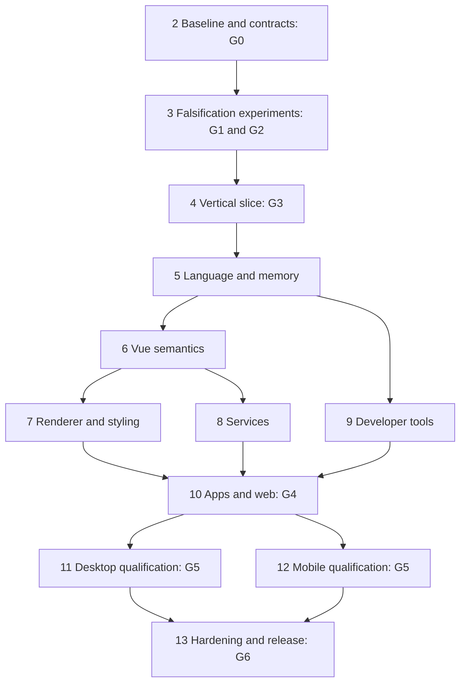

# Tasks: Vue native framework

## 1. Execution rules and dependencies

<!-- impl-note -->
> **Implementation progress (2026-10-10 (sections 2–5 follow-up)).** Annotations below were added during implementation. A box is ticked only when the task's acceptance criteria are met and a test command plus evidence artifact are linked; the workspace is not a version-control repository, so there is no commit to link (evidence = commands that pass in this checkout + artifact paths). Partly finished work is annotated, not ticked. Totals: 10 done, 25 partial, 7 blocked, 28 not started of 70 tasks. Source of truth for the annotations: `docs/dev/tasks-progress.json` (regenerate with `node tooling/status/update-tasks.mjs`); narrative status in `docs/dev/STATUS.md`.
<!-- /impl-note -->

This is a **planning backlog, not completed implementation**. All checkboxes intentionally remain unchecked, including baseline tasks that must capture repeatable evidence in the future project. The plan-writing session's actual checks are recorded in `requirements.md`.

Work packages below are bounded deliverables, not hour-sized claims about unresolved research. Split them into short implementation tickets after the relevant experiment establishes the approach. Every package includes build purpose, subsystem/files, direct dependencies, requirement/test mapping, observable completion, uncertainty, effort and expertise. Effort is **person-weeks (pw)** of focused work by the stated specialists; elapsed time includes additional coordination, hardware, review and external delays. Confidence: H = familiar bounded work, M = integration uncertainty, L = substantial unproven engineering. Estimates exclude purchases/account setup, do not sum into a guaranteed delivery date and must be re-estimated at gates. A failed experiment produces a decision, not an obligation to force the implementation through.

The 70 package ranges arithmetically total roughly **170–380 person-weeks**; G0–G3 account for roughly **25–59 person-weeks** of that range. These totals are a scale signal, not independent statistical confidence bounds or calendar estimates. Collector/renderer failures can invalidate later estimates; maintenance and ongoing platform QA add continuing cost. Staffing requires compiler/JS semantics, GC, Vue, graphics/text/accessibility, web/SSR, three desktop hosts, two mobile hosts, security and release expertise, with individuals covering multiple roles where realistic.

Only public-profile P/A/W features selected in `design.md` are implementation scope. X features require rejection diagnostics/tests, not implementation. E features stay behind explicit experimental profiles and are not prerequisites for production unless subsequently adopted through a revised contract. Public declarations must be generated from the compatibility manifest; unimplemented entries must not appear supported.

Dependencies listed per task are authoritative; phase grouping alone is not permission to skip them. Parallel execution is possible for independent work once gates pass, but this planning task does not start agents or implementation.

## 2. Establish the baseline and contract — G0

- [x] **2.1 Preserve and reproduce the two prototypes.**
  <!-- progress:2.1 -->
  - **Status (2026-10-10 (sections 2–5 follow-up)): DONE** — Both prototypes preserved byte-for-byte as immutable fixtures with a SHA-256 manifest; baseline reproduced on this Mac (counter 25 + Quick Quote 28 compiler tests; counter 4 and Quick Quote 4 Rust tests — Quick Quote only with its own target dir because both crates share a name; native and wasm32 library builds); KNOWN-BUG regressions pin the old defects (dynamic `@[click]` accepted, Rust Display numbers, tie-to-even toFixed, uncached computed).
  - **Evidence:** `node --test "tests/fixtures/prototype/*.test.mjs" "tests/fixtures/prototype/counter/tests/*.test.mjs" "tests/fixtures/prototype/quick-quote/tests/*.test.mjs"` (74 tests); `cargo test --locked --manifest-path generated/Cargo.toml`; artifacts `tests/fixtures/prototype/MANIFEST.json`, `docs/evidence/baseline/{claims-ledger.md,js-tests.txt,rust-claims.md,rust-*.txt}`.
  <!-- /progress -->
  - **Build / why / files:** create immutable counter and Quick Quote fixtures under `tests/fixtures/prototype/`, provenance manifest and reproduction instructions; retain original `compiler/`, `generated/` and ZIP source identity before changing behavior.
  - **Depends:** none. **Requirements:** R01, R24, R26.
  - **Accept:** rerun 25/28 compiler tests and the two distinct sets of four Rust tests on a provisioned machine; record unavailable runs as failures/missing evidence; exact source/lock hashes and native/WASM claims ledger retained.
  - **Tests/evidence:** T01, T24; reproduce dynamic `@[click]` acceptance and Rust formatting/numeric-input behavior against independent JS examples before later fixes.
  - **Risk / decision:** workspace and ZIP differ; do not overwrite one with the other. Rust toolchain not available in planning environment.
  - **Estimate:** 0.5–1.5 pw; **H**; compiler QA + Rust build engineer.

- [x] **2.2 Freeze the language/Vue/TS compatibility manifest.**
  <!-- progress:2.2 -->
  - **Status (2026-10-10 (sections 2–5 follow-up)): DONE** — Machine-readable manifest generated from design §8: 126 inventory rows, 446 named entries (incl. 52 native tags), all 171 runtime exports of vue@3.5.43 classified (`isShallow` confirmed exported, 40 compiler-internal helpers flagged), Options API excluded, experimental APIs labelled E, default-deny lookup; plus a 465-entry closed-world standard-library/globals manifest. Tooling pair pinned and recorded: TypeScript 6.0.3 + vue-tsc 3.3.12 (@vue/language-core 3.3.12, @volar/typescript 2.4.28); TypeScript 7 is X for tooling because its package ships no JS compiler API (design §11 line 573, K07). A probe runs the pair programmatically on .vue files and reports versions read at run time.
  - **Evidence:** `node --test "tests/profile/*.test.mjs"` (111 tests, incl. `typescript-pair.test.mjs` with negative controls for wrong installed versions and range pins); `node tooling/manifest/build-manifest.mjs --check`; `node tooling/types/probe.mjs`; artifacts `compiler/profile/{manifest.json,stdlib.json}`, `compiler/types/pair.mjs`, `docs/compatibility/`, `docs/evidence/typescript-tooling.md`.
  <!-- /progress -->
  - **Build / why / files:** `compiler/profile/`, `tests/fixtures/contracts/`, `docs/compatibility/`; turn every L/S/V/U/A/CSS inventory entry into named features/overloads with target/status/reference/test owner.
  - **Depends:** 2.1. **Requirements:** R01–R07, R12.
  - **Accept:** Vue 3.5.43 package exports and docs reconciled (including isShallow); Options API excluded; experimental APIs labeled; unknown syntax/methods default-deny; TypeScript 7 versus 6 tooling distinction explicit.
  - **Tests/evidence:** T01, T03, T12 inventory audit with source hashes and positive/negative fixture specification; inspect transitive code in representative packages without claiming it works.
  - **Risk / decision:** docs drift and broad method families; missing overload detail blocks promotion, not the whole research program.
  - **Estimate:** 1–3 pw; **M**; Vue internals + JS/TS language specialist.

- [x] **2.3 Establish research build isolation and candidate obligations.**
  <!-- progress:2.3 -->
  - **Status (2026-10-10 (sections 2–5 follow-up)): DONE** — Untrusted build steps run under a deny-default macOS `sandbox-exec` profile (workspace-only writes, no network, no inherited env); hostile npm-postinstall-style and Cargo build.rs-style fixtures prove the sentinel secret, outside writes and network are blocked while the same attacks succeed unsandboxed; dependency policy and a candidate-obligation ledger exist (13 of 15 entries honestly 'unresolved'). Limits documented: sandbox-exec is deprecated/best-effort, containers and VMs not verified.
  - **Evidence:** `node --test "tests/security/build-isolation/*.test.mjs"` (27 tests); artifacts `docs/security/build-trust.md`, `release/dependency-policy/{POLICY.md,candidates.json}`, `tooling/sandbox/run-untrusted.mjs`.
  <!-- /progress -->
  - **Build / why / files:** `docs/security/build-trust.md`, `release/dependency-policy/`, research runner configuration; make hostile-input experiments safe and filter renderer/license dead ends early.
  - **Depends:** 2.1. **Requirements:** R22, R25.
  - **Accept:** trusted/untrusted build paths separated; no signing/home secrets in research workers; selected renderer/GC licenses and source ownership recorded as cleared or unresolved; no accounts/purchases performed by this task.
  - **Tests/evidence:** T22 malicious build-script sentinel fixture; T25 preliminary exact-license review and toolchain checksums.
  - **Risk / decision:** sandbox differs per OS; a container is not assumed to isolate the host correctly without verification.
  - **Estimate:** 1–2 pw; **M**; security/build engineering + licensing reviewer.

**G0 exit:** 2.1–2.3 artifacts exist, original claims corrected, profile draft reviewed. Missing current Rust/platform evidence remains visibly missing until reproduced.

## 3. Falsify architecture assumptions — G1/G2

- [ ] **3.1 Prove AOT semantics with a small value-runtime experiment.**
  <!-- progress:3.1 -->
  - **Status (2026-10-10 (sections 2–5 follow-up)): PARTIAL** — Instead of a throw-away experiment the real AOT path was built: JS/TS → HIR → Rust calling a managed `vn-value` runtime (UTF-16 strings, V8-exact number formatting, closures via heap cells, TDZ, exceptions, cycles, async frames); no interpreter or eval. Verified differentially against Node/V8.
  - **Evidence:** `node tooling/harness/run-language.mjs` (79/79) and `--dir tests/language/lowering` (164/164); `cargo test -p vn-value`; corpora `tests/language/corpora`, `tests/language/builtins`.
  - **Not yet done:** Cost comparison against an engine-backed alternative, release-artifact size/allocation report, selected Test262 cases.
  <!-- /progress -->
  - **Build / why / files:** `experiments/aot-values/`, `tests/language/`; emit compiled Rust for captured mutable aliases, branch evaluation, UTF-16 strings, coercion, errors and cyclic objects, not just arithmetic.
  - **Depends:** 2.2, 2.3. **Requirements:** R02, R10, R23.
  - **Accept:** independent Node traces match for the selected cases; valid author code needs no manual Rust edits; code inspection establishes no hidden JS interpreter; compare static subset and engine-backed alternative costs.
  - **Tests/evidence:** T02, T10, T23 release artifact/trace/size/allocation report and minimized counterexamples.
  - **Risk / decision:** custom prototype/coercion exclusions may make ordinary code unacceptable; explicitly decide whether the narrowed profile is useful.
  - **Estimate:** 2–4 pw; **L**; compiler + JavaScript semantics + Rust runtime specialists.

- [ ] **3.2 Prove rooting, cycles and collection latency.**
  <!-- progress:3.2 -->
  - **Status (2026-10-10 (sections 2–5 follow-up)): PARTIAL** — Non-moving generation-checked heap with iterative mark-sweep run only at safepoints; cycles, escaping closures, roots/providers, native/exotic tracing and a randomized reachability-model stress test pass; GC-stress runs (collect at every safepoint) leave all scenario outputs identical.
  - **Evidence:** `cargo test -p vn-value` (kernel_gc.rs, 29 tests + stress); harness GC-stress mode (`run_scenario_with_gc_threshold`).
  - **Not yet done:** Measured p99 collection pauses under graph churn, comparison with `gc-arena`, Miri/unsafe review (the crate forbids `unsafe`).
  <!-- /progress -->
  - **Build / why / files:** `experiments/heap/`, `crates/value/` prototype; compare gc-arena integration with an alternative before committing heap/async ABI.
  - **Depends:** 3.1. **Requirements:** R02, R05, R22–R23.
  - **Accept:** escaping closures remain live, unreachable cycles collect, mutation/reentry doesn't invalidate roots, host resources explicitly close; proposed p99 collection slices measured under graph churn.
  - **Tests/evidence:** T02 random graph/root property tests, T22 Miri/unsafe review where applicable, T23 pause/allocation traces; stress suspension frames retaining objects.
  - **Risk / decision:** collector borrow discipline may not fit callbacks; fail G1 rather than switching to leaking Rc graphs.
  - **Estimate:** 2–5 pw; **L**; tracing GC and Rust ownership/unsafe expert.

- [ ] **3.3 Prove Vue scheduling and JS async interaction.**
  <!-- progress:3.3 -->
  - **Status (2026-10-10 (sections 2–5 follow-up)): PARTIAL** — Exact Vue 3.5 scheduler, watchers, nextTick and effect graph run against the real vue@3.5.43 goldens: 102/102 V0 scenarios; 403 random promise programs match V8 job ordering.
  - **Evidence:** `node tooling/harness/run-language.mjs --with-vue` (102/102); `cargo test -p vn-runtime -p vn-reactivity`; `crates/testkit/tests/promise_programs.rs`.
  - **Not yet done:** Scope-owned service cancellation and stale-completion rejection (services layer not built).
  <!-- /progress -->
  - **Build / why / files:** `experiments/scheduler/`, `tests/vue/oracle/`; trace actual Vue 3.5.43 parent/child effects, watchers, promises and nextTick against candidate runtime.
  - **Depends:** 3.1, 3.2. **Requirements:** R04–R06.
  - **Accept:** selected nested scheduling/cleanup traces match exactly; scope cancellation rejects stale service delivery while retained ordinary promise closures keep JS behavior.
  - **Tests/evidence:** T04–T06 pre/post/sync, recursive scheduling, stopped watcher, unmount-during-request and thenable cases; no oracle logic reimplemented in mocks.
  - **Risk / decision:** simple global pre/render/post buckets may fail ordering; design correct queue before expanding APIs.
  - **Estimate:** 2–4 pw; **L**; Vue reactivity + event-loop/runtime engineer.

- [ ] **3.4 Compare native renderers on one semantic scene.**
  <!-- progress:3.4 -->
  - **Status (2026-10-10 (sections 2–5 follow-up)): NOT STARTED** — Not done. A CSS parser/selector/cascade crate (`vn-css`) and a style crate (`vn-ui`, in progress) exist, but no renderer comparison (egui vs Blitz vs alternatives) was run.
  <!-- /progress -->
  - **Build / why / files:** `experiments/renderers/`, draft `crates/ui/`; adapt egui and pinned Blitz core (or justified retained candidate) to the same form/list/overlay/layout tree.
  - **Depends:** 2.2, 2.3. **Requirements:** R08–R09, R23, R25.
  - **Accept:** real desktop interactions, CSS subset layout/hit testing, focus, bidi text and AT actions demonstrated; exact missing backend work and license obligations costed; custom-drawn versus OS controls disclosed.
  - **Tests/evidence:** T08, T09, T23 comparable release traces/screens and AT findings; no use of Blitz's static HTML wrapper as proof of interactive framework behavior.
  - **Risk / decision:** beta APIs or text shortcomings may require narrower CSS/Slint alternative; do not start a browser engine fork by accident.
  - **Estimate:** 2–5 pw; **L**; native renderer + CSS/layout + accessibility engineer.

- [ ] **3.5 Prove mobile editing and accessibility on real hardware.**
  <!-- progress:3.5 -->
  - **Status (2026-10-10 (sections 2–5 follow-up)): BLOCKED** — Needs real iPhone/iPad and Android devices with VoiceOver/TalkBack and IME; none are available here (iOS simulators exist, Android has no NDK/JDK). A simulator alone cannot pass this gate.
  <!-- /progress -->
  - **Build / why / files:** `experiments/mobile-input/`, draft `hosts/{ios,android}/`; connect candidate renderer to UIKit/Android input and accessibility, including native editor surfaces if needed.
  - **Depends:** 3.4. **Requirements:** R09, R16–R17, R21.
  - **Accept:** CJK composition, RTL selection, VoiceOver/TalkBack activation, keyboard avoidance, rotation and suspend/resume work on actual iPhone and Android device; record unsupported APIs and OS constraints.
  - **Tests/evidence:** T09, T16–T17 recorded manual script + semantic tree + lifecycle logs; simulator build alone fails the gate.
  - **Risk / decision:** OS input bridge can dominate renderer choice; inaccessible or broken editing blocks production architecture selection.
  - **Estimate:** 3–7 pw; **L**; iOS UIKit, Android IME/JNI and accessibility specialists.

- [ ] **3.6 Prove Rust/WASM DOM and SSR identity boundary.**
  <!-- progress:3.6 -->
  - **Status (2026-10-10 (sections 2–5 follow-up)): PARTIAL** — Rust/WASM DOM boundary proven in headless Chrome: `WebHost` (44 imports, 38 KB wasm) + hand-written JS glue.
  - **Evidence:** `node --test "tests/platform/web/*.test.mjs"` (290 pass, 0 fail, 105 skipped with reasons); `cargo test -p vn-renderer-dom`.
  - **Not yet done:** SSR/hydration identity probe, three-engine browser run (only Chrome available), input-before-hydration test.
  <!-- /progress -->
  - **Build / why / files:** `experiments/web-dom/`, draft `crates/renderer-{dom,ssr}/`; patch real DOM from Rust and serialize/hydrate a small keyed form from the same template IR.
  - **Depends:** 3.1, 3.4. **Requirements:** R07, R09, R18, R23.
  - **Accept:** input edited before hydration survives; two concurrent SSR requests never share state; compiled client updates accessible DOM; measured bridge/load cost and mismatch behavior documented.
  - **Tests/evidence:** T18 browser execution in three engines, JS-disabled HTML and malicious payload; T23 code size/bridge samples.
  - **Risk / decision:** own hydration protocol is substantial; reject canvas as a substitute if DOM probe fails.
  - **Estimate:** 2–5 pw; **L**; WASM/DOM + SSR/compiler engineer.

- [ ] **3.7 Prove the TS/editor/source-error and native reload path.**
  <!-- progress:3.7 -->
  - **Status (2026-10-10 (sections 2–5 follow-up)): NOT STARTED** — Not done (requires installing `typescript`/Vue language tools; not yet approved).
  <!-- /progress -->
  - **Build / why / files:** `experiments/tooling/`; test actual TypeScript 6 compatibility API + Vue virtual files, source mapping and a compiled restart with safe state snapshot.
  - **Depends:** 2.2, 3.1. **Requirements:** R03, R10–R11.
  - **Accept:** exact pinned tooling pair identified; `.vue` errors and one async stack map correctly; captured closures are not serialized; code edit compile/restart latency measured against proposed budget.
  - **Tests/evidence:** T03, T10–T11 virtual-file/editor fixtures and restart trace; compare TypeScript 7 CLI where applicable.
  - **Risk / decision:** editor API drift and native debug mapping; full DWARF stepping is not assumed by minimum DX.
  - **Estimate:** 1–3 pw; **L**; Vue language-tools + compiler/debug tooling engineer.

- [ ] **3.8 Record the architecture go/no-go decision.**
  <!-- progress:3.8 -->
  - **Status (2026-10-10 (sections 2–5 follow-up)): NOT STARTED** — The G1/G2 decision record has not been written yet (evidence is accumulating in docs/dev/STATUS.md).
  <!-- /progress -->
  - **Build / why / files:** `docs/decisions/architecture-gate.md`; consolidate measured results, profile usefulness, renderer/GC choice, staffing and revised costs before broad implementation.
  - **Depends:** 3.2–3.7. **Requirements:** R01, R22–R26.
  - **Accept:** G1/G2 each explicitly pass/fail; critical unknowns have evidence or block progress; selected pins/interfaces and rejected alternatives documented; failure chooses narrower scope/engine-contract revision/stop.
  - **Tests/evidence:** T24 independent review of experiment reproductions and negative controls; no benchmarks invented to meet gate.
  - **Risk / decision:** sunk-cost pressure; no conditional “pass” on broken memory safety, IME or AT basics.
  - **Estimate:** 0.5–1 pw; **M**; architecture, platform, security, accessibility leads and engineering sponsor.

## 4. Build the smallest useful vertical slice — G3

- [ ] **4.1 Replace direct emission with source-located checked IR.**
  <!-- progress:4.1 -->
  - **Status (2026-10-10 (sections 2–5 follow-up)): PARTIAL** — Source-located versioned HIR (`hirVersion: 1`), checked emitter, identifier mangling and diagnostics with `.vue`-mapped spans replace the prototype's direct string emission; the SFC frontend reuses the official compiler so dynamic event arguments are compiled by Vue itself.
  - **Evidence:** `node --test "tests/compiler/**/*.test.mjs"` (474 tests); `node tooling/harness/run-language.mjs --dir tests/language/lowering`; `compiler/hir/README.md`, `compiler/ABI.md`.
  - **Not yet done:** Explicit regression fixture showing the old `@[click]` defect is fixed through the new pipeline; IR schema content hashes.
  <!-- /progress -->
  - **Build / why / files:** refactor `compiler/compile.mjs` into parsing/binding/HIR/MIR/emitter modules; preserve counter fixture and exact unsupported-syntax errors.
  - **Depends:** 3.8 passing. **Requirements:** R02–R03, R10.
  - **Accept:** subset programs compile through versioned IR; dynamic event argument bug is rejected or correctly resolved; Rust keyword names mangled; source spans reach diagnostics.
  - **Tests/evidence:** T01 regression failing old compiler, T10 semantic IR/diagnostic goldens and generated Rust execution, malformed source cases.
  - **Risk / decision:** source locations through macros; avoid a rewrite without behavioral checkpoints.
  - **Estimate:** 2–4 pw; **M**; compiler/frontend engineer.

- [ ] **4.2 Turn proven primitive/closure semantics into a reusable runtime.**
  <!-- progress:4.2 -->
  - **Status (2026-10-10 (sections 2–5 follow-up)): PARTIAL** — Primitive math/strings/booleans, mutable captured aliases and JS decimal formatting execute correctly natively with automatic GC roots.
  - **Evidence:** `node tooling/harness/run-language.mjs --dir tests/language/lowering` (164/164).
  - **Not yet done:** Execution of compiled scenarios on wasm32 (the crates compile to wasm and the host is tested, but compiled-app execution in the browser is still being wired).
  <!-- /progress -->
  - **Build / why / files:** `crates/value/`, generated function ABI; replace app-specific Rust field substitutions with Value/cell operations for the slice.
  - **Depends:** 4.1, 3.2. **Requirements:** R02, R10.
  - **Accept:** primitive math/string/boolean refs, one mutable captured alias and JS decimal-format fixture execute correctly native and WASM with automatic roots.
  - **Tests/evidence:** T02 positive/edge traces, T10 emitted code build; Rust formatting mismatch fixture no longer silently changes values.
  - **Risk / decision:** premature unboxing; keep dynamic implementation until qualified.
  - **Estimate:** 1–3 pw; **M**; Rust runtime/compiler engineer.

- [ ] **4.3 Implement minimal component/effect ownership.**
  <!-- progress:4.3 -->
  - **Status (2026-10-10 (sections 2–5 follow-up)): PARTIAL** — Reactivity ownership model complete (cached computed, scopes, watchers with cleanup, dependency release on stop); component instance record exists; component mounting/unmounting is being written.
  - **Evidence:** `cargo test -p vn-reactivity` (240+ tests); `node tooling/harness/run-language.mjs --with-vue`.
  - **Not yet done:** Props/emit components, keyed child removal stopping watchers, unmount/recreate leak counts through the renderer.
  <!-- /progress -->
  - **Build / why / files:** `crates/{reactivity,runtime}/`; cached computed, one watcher, prop/event field component and stable keyed children.
  - **Depends:** 4.2, 3.3. **Requirements:** R04–R06.
  - **Accept:** computed read twice evaluates once; two component instances remain independent; removed keyed child stops watcher/service; unmount/recreate has no retained subscriptions.
  - **Tests/evidence:** T04–T06 execution traces, live-object/subscription counts and cancellation race.
  - **Risk / decision:** slice must use final ownership model, not another shortcut getter implementation.
  - **Estimate:** 2–4 pw; **M**; reactive runtime engineer.

- [ ] **4.4 Connect semantic UI events to native and DOM hosts.**
  <!-- progress:4.4 -->
  - **Status (2026-10-10 (sections 2–5 follow-up)): PARTIAL** — Event/prop layer, DOM host and component rendering work over the headless DocHost and the browser host contract (143/160 real-Vue component scenarios pass); Counter and Quick Quote now run in Chrome; native desktop renderer is not done.
  - **Evidence:** `cargo test -p vn-runtime` (rtd_* tests); `node --test "tests/platform/web/*.test.mjs"`.
  - **Not yet done:** Native desktop host, end-to-end quote form on native, keyboard/AT operation.
  <!-- /progress -->
  - **Build / why / files:** `crates/ui/`, `crates/renderer-{native,dom}/`, one desktop host; text/number field, labels, button, keyed two-row list and conditional error.
  - **Depends:** 4.3, 3.4–3.6. **Requirements:** R07–R09, R18.
  - **Accept:** keyboard/AT can operate the same quote form on desktop and DOM; numeric edit buffer preserves blank/invalid values and composition; no webview or canvas DOM substitute.
  - **Tests/evidence:** T07–T09 native/browser interaction and AT; T18 DOM semantics; app assertions compare calculated values independently.
  - **Risk / decision:** input adaptations disclosed; no silent clamping copied from DragValue.
  - **Estimate:** 2–4 pw; **M**; UI/input + web engineer.

- [ ] **4.5 Deliver the slice build/check/dev workflow and G3 report.**
  <!-- progress:4.5 -->
  - **Status (2026-10-10 (sections 2–5 follow-up)): PARTIAL** — vue-native CLI check/build/create/doctor and headless apps work. Web builds now compile .vue projects into Rust/WASM, install WebHost and mount the root component. Counter and Quick Quote run full browser interactions, including defineModel, validation, watch, keyed rows and editor recreation. Browser delivery supplies event identities/kinds and drains Rust jobs in a microtask. Repeated unmount/recreate cycles keep host handles and listeners flat.
  - **Evidence:** `node --test "tests/cli/*.test.mjs"` (40/40); `node --test "tests/platform/web/*.test.mjs"` (298 pass / 109 explicit skips / 0 fail); tests/platform/web/e2e-vue-apps.test.mjs (3/3); docs/evidence/resume-web-apps.md.
  - **Not yet done:** Native desktop host and keyboard/AT qualification; measured memory/edit latency; startup distributions and optimized app size; G3 report. Browser qualification remains Chrome only.
  <!-- /progress -->
  - **Build / why / files:** extend `compiler/cli.mjs` into initial `tooling/cli/`, `examples/quick-quote-slice/`, `docs/getting-started.md`; make architecture reviewable by an app author.
  - **Depends:** 4.4, 3.7. **Requirements:** R10–R11, R23–R26.
  - **Accept:** clean supported machine builds slice without editing Rust; one async failure maps to `.vue`; measured startup/memory/edit latency, outstanding limitations and G3 pass/fail published locally.
  - **Tests/evidence:** T11 clean-room workflow, T23 raw samples, T24 gate audit, T26 form/alias/cancellation flows.
  - **Risk / decision:** only one desktop + DOM qualified for slice; persistence/SSR/full mobile remain future work.
  - **Estimate:** 1–3 pw; **M**; CLI/DX + QA engineer.

## 5. Complete the declared language and memory profile

- [x] **5.1 Lower lexical environments and control flow.**
  <!-- progress:5.1 -->
  - **Status (2026-10-10 (sections 2–5 follow-up)): DONE** — Lexical environments, TDZ, hoisting, closures, per-iteration let capture, labels/switch/loops/try-finally and evaluation order match Node.
  - **Evidence:** `node tooling/harness/run-language.mjs --dir tests/language/lowering` (164/164); `node tooling/harness/run-language.mjs` (79/79); rejects fixtures `tests/language/rejects` via `node --test "tests/compiler/frontend/*.test.mjs"`. Note: Test262 not used; correctness is checked against 243 differential scenarios.
  <!-- /progress -->
  - **Build / why / files:** `compiler/{bindings,lower}/`, `crates/value/closures.rs`; implement L01–L02 including parameter/default/rest, this, recursion, TDZ, loops and short-circuit ordering.
  - **Depends:** 4.5 passing G3. **Requirements:** R02, R10.
  - **Accept:** all selected lexical/control cases match Node, including per-iteration captures and side-effect order; excluded syntax gets spans.
  - **Tests/evidence:** T02 differential/property and selected Test262, T10 negative diagnostics.
  - **Risk / decision:** closure escape/reentry must preserve collector roots; no ownership errors leaked to app authors.
  - **Estimate:** 2–5 pw; **M**; JS compiler engineer.

- [x] **5.2 Implement objects, collections and identity.**
  <!-- progress:5.2 -->
  - **Status (2026-10-10 (sections 2–5 follow-up)): DONE** — Objects (key order, accessors, freeze/seal with V8's array rules), arrays with holes, Map/Set (mutation during iteration), Symbols and identity/aliasing match V8 on large recorded corpora; classes/prototype mutation/descriptor mutation are rejected with spans.
  - **Evidence:** `cargo test -p vn-value -p vn-testkit` (1000+ tests); corpora `tests/language/builtins/*.json` (≈14k cases, zero failures).
  <!-- /progress -->
  - **Build / why / files:** `crates/value/{object,array,map,set,symbol}.rs`, lowering; L03–L05/L10–L12 property/iteration semantics.
  - **Depends:** 5.1. **Requirements:** R02, R04.
  - **Accept:** aliases, sparse arrays, getter reentry, property order, Map/Set iteration mutations and symbol keys match reference; class/prototype/descriptor exclusions explicit.
  - **Tests/evidence:** T02 generated random mutation traces, cycle identity and selected standard-library cases; no expected values computed by runtime under test.
  - **Risk / decision:** broad built-in method surface; manifest promotion per method, not entire container at once.
  - **Estimate:** 3–6 pw; **L**; dynamic language/runtime engineer.

- [x] **5.3 Implement primitive operations, strings and standard-method registry.**
  <!-- progress:5.3 -->
  - **Status (2026-10-10 (sections 2–5 follow-up)): DONE** — Number formatting/parsing (toString radix, toFixed ties, toPrecision, parseInt/Float) and UTF-16 string semantics (lone surrogates) match V8 on 40k+ corpus cases; operators/coercions on 46k pairs; String/Number/Math/JSON builtins; closed-world standard-method manifest rejects the rest.
  - **Evidence:** `cargo test -p vn-value --test number_corpus --test string_corpus --test ops_corpus`; `crates/testkit/tests/replay_b*.rs`. Note: transcendental Math functions are within 1–2 ulp of V8 (documented); Date/Intl/RegExp/BigInt are rejected by the profile.
  <!-- /progress -->
  - **Build / why / files:** `crates/value/{number,string,coercion,json,bytes}.rs`, `compiler/profile/`; L06–L09/L18–L21 including Number formatting and UTF-16.
  - **Depends:** 5.2. **Requirements:** R02–R03, R22.
  - **Accept:** signed zero/NaN/infinity, toFixed boundaries, lone surrogates, logical operand results, JSON and byte arrays behave per manifest; unsupported Date/Intl/RegExp/BigInt methods report exact errors.
  - **Tests/evidence:** T02 selected standards/differential cases, T22 malformed/oversized strings and buffers, prototype rounding regression.
  - **Risk / decision:** correct decimal formatting may need audited reusable algorithms; Rust Display is not accepted evidence.
  - **Estimate:** 3–7 pw; **L**; numeric/Unicode + JS runtime specialist.

- [x] **5.4 Implement completions, promises and async frames.**
  <!-- progress:5.4 -->
  - **Status (2026-10-10 (sections 2–5 follow-up)): DONE** — try/finally abrupt completions, promises (all combinators, thenable assimilation, exact V8 tick counts), async functions lowered to Rust async blocks with heap frames, unhandled-rejection tracking, async watchdog; stacks to source are not yet mapped (see 9.5).
  - **Evidence:** `node tooling/harness/run-language.mjs` (promises 8/8, async 5/5, timers 5/5); `crates/testkit/tests/promise_programs.rs` (403 programs equal Node, mutation check kills 101).
  <!-- /progress -->
  - **Build / why / files:** `compiler/lower/async/`, `crates/value/{completion,promise}.rs`, `crates/runtime/jobs.rs`; L13–L15.
  - **Depends:** 5.1–5.3. **Requirements:** R02, R05, R10.
  - **Accept:** try/finally abrupt completions, arbitrary throws, promise combinators/thenables and async rejection match traces; stacks point to source; roots survive suspension.
  - **Tests/evidence:** T02/T05 nested async, thenable cycles, multiple resolve, cancellation versus ordinary promise distinction; T22 resource watchdog tests.
  - **Risk / decision:** Rust Future ordering is not JS promise ordering; no shortcut by delegating directly to executor.
  - **Estimate:** 4–8 pw; **L**; JS async/compiler + runtime engineer.

- [ ] **5.5 Implement ESM and bundled dynamic modules.**
  <!-- progress:5.5 -->
  - **Status (2026-10-10 (sections 2–5 follow-up)): PARTIAL** — Static ESM across multiple files, live bindings, cycles, re-exports, namespace objects, native module imports and `.vue` imports compile and run.
  - **Evidence:** `node tooling/harness/run-projects.mjs` (10/10); `cargo test -p vn-value --test modules_graph` etc.
  - **Not yet done:** Dynamic `import()` lowering (still VN9001), chunk graph and web chunk loading.
  <!-- /progress -->
  - **Build / why / files:** `compiler/modules/`, `crates/value/modules.rs`, `tooling/build/graph/`; L16–L17 with live bindings and prelinked module graph, including deferred dynamic-import evaluation.
  - **Depends:** 5.4. **Requirements:** R02, R10–R12, R18.
  - **Accept:** cycles/TDZ/single evaluation and literal import promise behavior match native/web; computed imports/CJS/remote native code rejected; target exports resolved deterministically.
  - **Tests/evidence:** T02 initialization/namespace traces, T11 cache graph changes, T12 incompatible dependency chain, T18 main-module/asset loading recovery.
  - **Risk / decision:** native and first web profile prelink app modules; physical WASM code splitting is excluded from this estimate and requires K19 gate if loading budgets fail.
  - **Estimate:** 2–5 pw; **M**; module linker/build systems engineer.

- [ ] **5.6 Harden the chosen heap and host-resource model.**
  <!-- progress:5.6 -->
  - **Status (2026-10-10 (sections 2–5 follow-up)): PARTIAL** — Heap limit and execution-budget watchdogs, GC safepoint discipline and stress tests exist.
  - **Evidence:** `cargo test -p vn-value` (kernel_gc, kernel_jobs).
  - **Not yet done:** Miri/ASan/FFI audit, long-churn latency tails, native-resource disposal.
  <!-- /progress -->
  - **Build / why / files:** `crates/value/heap/`, `crates/runtime/resources.rs`; convert experiment to audited collector integration with quotas, traceable roots and explicit native-resource disposal.
  - **Depends:** 5.2, 5.4–5.5. **Requirements:** R02, R05, R22–R23.
  - **Accept:** async/module/effect roots withstand long graph churn; no callbacks while heap borrowed; native handles close on explicit scope disposal; exhausted heap reports controlled failure.
  - **Tests/evidence:** T02 property stress, T22 Miri/FFI audit, T23 allocation/collection tails and leak reports.
  - **Risk / decision:** incremental barriers/latency remain critical; hold feature expansion if safety or pause gate regresses.
  - **Estimate:** 2–5 pw; **L**; GC/Rust safety specialist.

- [ ] **5.7 Complete SFC and TypeScript lowering.**
  <!-- progress:5.7 -->
  - **Status (2026-10-10 (sections 2–5 follow-up)): PARTIAL** — SFC frontend wraps the official compileScript/compileTemplate/compileStyle with profile checks, native template validation and `.vue` spans; macros come from Vue itself; TypeScript is erased at lowering; all 37 real SFC fixtures lower to Rust that passes `cargo check`.
  - **Evidence:** `node --test "tests/compiler/sfc/*.test.mjs"` (210 tests, 31 components rendered in real Vue in Chrome); `node tooling/harness/check-sfc-lowering.mjs` (37/37).
  - **Not yet done:** Type checking via a pinned TypeScript 6 + Vue virtual-file pair, imported-type props, `<style module>` (async CSS modules).
  <!-- /progress -->
  - **Build / why / files:** `compiler/sfc/`, `compiler/types/`, `compiler/macros/`; S01–S25 with official macro behavior and exact virtual-file checker pair.
  - **Depends:** 5.5, 3.7. **Requirements:** R03, R10–R11.
  - **Accept:** props/emits/models/slots/expose/options/withDefaults/destructure/generics type and runtime fixtures pass; JS without annotations works; runtime TS exclusions cannot disappear via type erasure.
  - **Tests/evidence:** T03 per-macro source/hoist/import/default cases, T10 maps across blocks, TS negative and JS/TS equivalence.
  - **Risk / decision:** imported conditional types exceed Vue macro conversion; retain documented limits and exact diagnostic.
  - **Estimate:** 3–6 pw; **M**; Vue compiler + TypeScript tooling engineer.

## 6. Complete Vue runtime and template semantics

- [x] **6.1 Implement reactivity wrappers and utilities.**
  <!-- progress:6.1 -->
  - **Status (2026-10-10 (sections 2–5 follow-up)): DONE** — reactive/readonly/shallowReactive/shallowReadonly proxies with array and Map/Set instrumentation, raw/proxy identity, toRaw/markRaw/is* utilities and ref unwrapping rules match the real package.
  - **Evidence:** `node tooling/harness/run-language.mjs --with-vue` (ref 18/18, reactive 25/25); `cargo test -p vn-reactivity`; `node tests/vue/rust/gen-expected.mjs --check` (≈230 snippets from real @vue/reactivity).
  <!-- /progress -->
  - **Build / why / files:** `crates/reactivity/{ref,proxy,collections,utilities}.rs`; V01–V05/V07–V10 and all qualified overloads.
  - **Depends:** 5.2, 5.6. **Requirements:** R04.
  - **Accept:** deep/shallow/readonly/raw identity and ref-unwrapping rules match Vue, including arrays/collections and deletion/iteration dependencies.
  - **Tests/evidence:** T04 differential traces and random mutation graphs, readonly diagnostics and proxy-cache leak checks.
  - **Risk / decision:** general user Proxy remains excluded; internal wrappers must preserve specified identity rather than flatten values.
  - **Estimate:** 2–5 pw; **M**; Vue reactivity/runtime engineer.

- [x] **6.2 Implement computed, custom refs and effect scopes.**
  <!-- progress:6.2 -->
  - **Status (2026-10-10 (sections 2–5 follow-up)): DONE** — Lazy cached computed (branching, chains, diamonds, writable, oldValue), customRef, effect scopes (nested/detached/stop order) match the real package.
  - **Evidence:** `node tooling/harness/run-language.mjs --with-vue` (computed 12/12, effect 8/8); `cargo test -p vn-reactivity`.
  <!-- /progress -->
  - **Build / why / files:** `crates/reactivity/{computed,effect,scope,custom_ref}.rs`; V06/V11–V12.
  - **Depends:** 6.1. **Requirements:** R04–R05.
  - **Accept:** lazy cached getter count, branching dependencies, writable/previous-value computed, detached scopes and custom tracking behave like oracle; disposed scopes release roots.
  - **Tests/evidence:** T04 trace getter calls/results and root counts; T05 scope-owned timer cleanup; old uncached prototype fails caching regression.
  - **Risk / decision:** unchanged-result optimization must not suppress observable side effects/order beyond Vue's behavior.
  - **Estimate:** 2–4 pw; **M**; reactive graph engineer.

- [x] **6.3 Implement full qualified watchers and scheduler.**
  <!-- progress:6.3 -->
  - **Status (2026-10-10 (sections 2–5 follow-up)): DONE** — watch/watchEffect/watchPostEffect/watchSyncEffect with all options, handles (stop/pause/resume), cleanup, the exact 3.5 job queue and nextTick over real promises; recursion watchdog fails visibly.
  - **Evidence:** `node tooling/harness/run-language.mjs --with-vue` (watch 27/27, scheduler 12/12); `cargo test -p vn-runtime` (rtb_*).
  <!-- /progress -->
  - **Build / why / files:** `crates/runtime/scheduler/`, `crates/reactivity/watch.rs`; V13–V17, depth traversal, handles and cleanup API.
  - **Depends:** 5.4, 6.2. **Requirements:** R05.
  - **Accept:** parent/child, pre/post/sync, nextTick, immediate/once/pause/resume/deep-depth and cleanup-after-await restrictions match fixtures; runaway updates fail visibly.
  - **Tests/evidence:** T05 pinned Vue ordered traces, stopped queued jobs, cyclic/deep sources and promise interleaving; explicit host-commit timing test.
  - **Risk / decision:** queue reentrancy/recursive jobs are hard; do not weaken oracle to match chosen algorithm.
  - **Estimate:** 3–6 pw; **L**; Vue scheduler/event-loop specialist.

- [ ] **6.4 Implement props, emits, slots, models and injection.**
  <!-- progress:6.4 -->
  - **Status (2026-10-10 (sections 2–5 follow-up)): PARTIAL** — Component props (casting, defaults), emits (modifiers), slots, attrs fallthrough, provide/inject, v-model/defineModel via useModel run through the real renderer; against real-Vue UI goldens: props 12/12, emits 8/8, slots 11/11, provide-inject 7/7, model 14/14.
  - **Evidence:** `node tooling/harness/run-language.mjs --with-vue --ui` (160/160 overall, 0 fail); `cargo test -p vn-runtime`.
  - **Not yet done:** two-app-root and dynamic-slot-name edge scenarios beyond the recorded 160; mergeModels/defineModel edge cases; Options API remains unsupported by design.
  <!-- /progress -->
  - **Build / why / files:** `crates/runtime/{component,props,slots,inject}.rs`, compiler template linkage; U11–U13/V24–V26.
  - **Depends:** 5.7, 6.3. **Requirements:** R06.
  - **Accept:** defaults/validation/Boolean casting, fallthrough, named/scoped slots, multiple models and injection contexts preserve parent/child ownership and identity.
  - **Tests/evidence:** T06 complete nested component apps, two app roots, dynamic slot names, undeclared events and model default edge cases.
  - **Risk / decision:** compiler macros and runtime validation must agree; no generic catch-all Rust struct substitute.
  - **Estimate:** 3–6 pw; **M**; Vue component/compiler engineer.

- [ ] **6.5 Implement lifecycle, template refs and error boundaries.**
  <!-- progress:6.5 -->
  - **Status (2026-10-10 (sections 2–5 follow-up)): PARTIAL** — Lifecycle hooks, template refs and component DOM event errors now match all recorded scenarios: lifecycle 10/10, refs 9/9, errors 7/7. Host handles expose DOM tags so Vue target classification bypasses proxies; event invokers retain their owning instance and route synchronous throws/promise rejections through errorCaptured and app errorHandler.
  - **Evidence:** `node tooling/harness/run-language.mjs --with-vue --ui` (160 pass / 0 blocked / 0 fail / 0 unexpected); `cargo test -p vn-dom -p vn-runtime -p vn-reactivity`; docs/evidence/resume-components.md.
  - **Not yet done:** Broader lifecycle/ref/error edge coverage; broader advanced-component qualification remains in 6.6.
  <!-- /progress -->
  - **Build / why / files:** `crates/runtime/{lifecycle,refs,errors}.rs`, source-stack table; V18–V23/V27–V29.
  - **Depends:** 6.4. **Requirements:** R05–R06, R09–R10.
  - **Accept:** lifecycle order/ref nulling/expose/error capture match oracle; native refs expose typed host handles; retained JS closures don't resurrect disposed UI; framework panics terminate damaged realm.
  - **Tests/evidence:** T06 setup/render/event/async errors and disposal, T09 focus through refs, T10 source stacks and FFI unwind denial.
  - **Risk / decision:** native ref type differs from HTMLElement; require explicit target errors and docs.
  - **Estimate:** 2–5 pw; **M**; runtime + host integration engineer.

- [ ] **6.6 Implement identity-dependent built-in components.**
  <!-- progress:6.6 -->
  - **Status (2026-10-10 (sections 2–5 follow-up)): PARTIAL** — All 160 existing component scenarios match real Vue: Teleport 5/5, Transition 5/5, dynamic 9/9 (KeepAlive and async components). Implemented target moves/defer/events, JS/appear/CSS hooks and out-in ordering, cached state/include/LRU/disposal, shared async loader requests/loading delay/errors/timeouts.
  - **Evidence:** `node tooling/harness/run-language.mjs --with-vue --ui` and `--gc-stress` (160/160 each, no blocked/failing/unexpected); `cargo test --workspace --no-fail-fast` (1323/1323); `node --test "tests/platform/web/*.test.mjs"` (299 pass, 109 documented skips); docs/evidence/advanced-components.md and docs/evidence/advanced-components/. Cleanup re-verification: docs/evidence/cleanup.md (three assertion-free Rust probes removed; corpus and negative-control checks retained).
  - **Not yet done:** TransitionGroup, in-out mode, CSS transition-end event shortcuts, native motion/layout, async retry/hydration hooks and broader nested/lifetime edge qualification. Unsupported async hooks and transition modes throw explicitly.
  <!-- /progress -->
  - **Build / why / files:** `crates/runtime/components/`, template IR; dynamic components, async loader, KeepAlive and Teleport per U19–U22.
  - **Depends:** 6.5, 5.5. **Requirements:** R06–R07.
  - **Accept:** keyed replacement/cache eviction disposes correct resources; async retries/timeouts/unmount races safe; overlay teleport retains logical parent; cross-window teleport rejected.
  - **Tests/evidence:** T06/T07 LRU/activation/loading/error/deferred target and stable focus scenarios.
  - **Risk / decision:** Suspense/async setup remain experimental; no dependency on unqualified experimental behavior.
  - **Estimate:** 3–6 pw; **M**; component runtime/UI engineer.

- [ ] **6.7 Complete template lowering and event/model semantics.**
  <!-- progress:6.7 -->
  - **Status (2026-10-10 (sections 2–5 follow-up)): PARTIAL** — Official-compiler template lowering plus runtime semantics verified end to end: events 13/13, model 14/14, list 11/11, conditional 7/7, fragments 5/5, directives 5/5, static 15/15 against real-Vue goldens.
  - **Evidence:** `node tooling/harness/run-language.mjs --with-vue --ui` (160 pass / 0 blocked / 0 fail / 0 unexpected); `cargo test -p vn-dom -p vn-runtime -p vn-reactivity`; docs/evidence/resume-components.md.
  - **Not yet done:** Other style shorthands beyond margin/padding, functional box values, v-html native rejection fixture in the UI corpus, custom-element/SVG breadth.
  <!-- /progress -->
  - **Build / why / files:** `compiler/template/`, `crates/ui/{events,models,reconcile}.rs`; U01–U18/U26–U32, conditional/list/fragment operations and target exclusions.
  - **Depends:** 6.4–6.6. **Requirements:** R07, R09.
  - **Accept:** each planned directive/form/event modifier has an executable positive/edge case; labels/escaping correct; dynamic events no longer silently fixed; unsupported raw HTML/DOM fields fail native.
  - **Tests/evidence:** T07 browser/Vue oracle where equivalent, native semantic events, T09 input composition; keyed moves preserve row state and focus.
  - **Risk / decision:** modifier order and number-input empty values are semantic, not visual, differences.
  - **Estimate:** 3–7 pw; **M**; Vue template + input/event engineer.

- [ ] **6.8 Implement application APIs and enforce advanced-API boundaries.**
  <!-- progress:6.8 -->
  - **Status (2026-10-10 (sections 2–5 follow-up)): PARTIAL** — createApp/mount/unmount/use/component/directive/provide/runWithContext/onUnmount implemented; advanced-API boundary diagnostics via manifest + SFC frontend.
  <!-- /progress -->
  - **Build / why / files:** `crates/runtime/app.rs`, `compiler/profile/exports/`, `packages/vue-compat/`; A01–A19 supported forms, helpers/useId/CSS helpers and explicit exclusions.
  - **Depends:** 6.5–6.7. **Requirements:** R01, R06, R12, R18.
  - **Accept:** multiple app roots/registries/plugins and config behave per profile; unsupported Options/render-function/custom-element exports produce accurate diagnostics; version metadata separates framework and Vue reference.
  - **Tests/evidence:** T01 export audit, T06 app/context/disposal, T12 incompatible plugin, T18 stable ID fixtures.
  - **Risk / decision:** global plugin mutation undermines closed-world compilation; only qualified registration patterns allowed.
  - **Estimate:** 2–4 pw; **M**; Vue API/runtime engineer.

## 7. Production renderer, style and accessibility implementation

- [ ] **7.1 Stabilize the retained renderer adapter and semantic tree.**
  <!-- progress:7.1 -->
  - **Status (2026-10-10 (sections 2–5 follow-up)): PARTIAL** — Semantic element tree exists (`vn-dom`: tree, attributes, properties with dirty flags, events with activation behaviour, focus, selectors, serialization; 284 Chrome-recorded cases). Retained native renderer adapter not started.
  - **Evidence:** `cargo test -p vn-dom`.
  - **Not yet done:** retained renderer adapter, hit testing with transforms/clipping, gestures.
  <!-- /progress -->
  - **Build / why / files:** `crates/ui/`, `crates/renderer-native/`; integrate the G2-selected pinned backend behind create/patch/reorder/measure/dispose operations, not app-specific paint code.
  - **Depends:** 6.7, 3.8. **Requirements:** R08–R09, R23.
  - **Accept:** retained nodes update only dirty regions; stable IDs survive keyed moves; transformed/clipped hit tests, pointer capture/cancel and tap/pan/pinch gesture arbitration work; egui comparison fixture remains reproducible.
  - **Tests/evidence:** T08 geometry/event/device-loss, T09 multi-touch/scroll/AT-activation deduplication; T23 redraw/invalidation trace; source review confirms no second reactive state owner.
  - **Risk / decision:** beta backend changes or GPU incompatibility; pin adapter contract and record fallback scope.
  - **Estimate:** 2–5 pw; **M**; Rust rendering/UI architecture engineer.

- [ ] **7.2 Implement the explicit CSS compatibility profile.**
  <!-- progress:7.2 -->
  - **Status (2026-10-10 (sections 2–5 follow-up)): PARTIAL** — CSS tokenizer/parser, selectors, media queries, cascade and custom properties; typed values, shorthands and computed style pass the recorded Chrome corpora. Repaired form-control defaults, disabled/checkbox appearance, bolder weights, replaced-element descendant CSSOM serialization and font-size precision. Cascade driver now mirrors the oracle head/body sibling topology; unchanged goldens: 72 fixtures / 6675 comparisons, plus negative control.
  - **Evidence:** `cargo test --workspace --no-fail-fast` (1323 passed, 0 failed); `cargo test -p vn-ui` (including cascade and values corpora); docs/evidence/advanced-components.md; independent Chrome measurements in docs/evidence/advanced-components/css-defaults-chrome.json. Cleanup re-verification: docs/evidence/cleanup.md (three assertion-free Rust probes removed; corpus and negative-control checks retained).
  - **Not yet done:** layout (Taffy), complete native painting/style integration, scoped/deep/slotted renderer breadth and further CSS value qualification.
  <!-- /progress -->
  - **Build / why / files:** `compiler/styles/`, `crates/renderer-native/style/`, `docs/compatibility/css/`; validate each selector/property/value and map supported cascade/layout to backend.
  - **Depends:** 7.1, 6.8. **Requirements:** R03, R08, R10.
  - **Accept:** scoped/deep/slotted/global/module/CSS-v-bind, inheritance/variables, flex/grid, units, responsive/dark/reduced-motion cases resolve consistently; unknown declarations have spans and alternatives.
  - **Tests/evidence:** T08 browser-subset layout/cascade comparisons, T03 SFC helpers, T10 import/cache/source maps; no silent drop of unsupported styles.
  - **Risk / decision:** shorthands, margin collapse and intrinsic sizing expand scope; exact manifest determines promises.
  - **Estimate:** 4–8 pw; **L**; CSS/layout engine + compiler engineer.

- [ ] **7.3 Implement international text editing and input adapters.**
  <!-- progress:7.3 -->
  - **Status (2026-10-10 (sections 2–5 follow-up)): NOT STARTED** — International text editing/IME not started.
  <!-- /progress -->
  - **Build / why / files:** `crates/ui/text/`, host text adapters, font asset policy; shared editing/composition/selection model with selected OS editor surfaces.
  - **Depends:** 7.1, 3.5, 5.3. **Requirements:** R08–R09, R16–R17.
  - **Accept:** CJK/Indic/RTL/emoji shaping, grapheme edits, undo/selection, clipboard, dictation and composing-model reconciliation pass; scroll/clip geometry keeps native editor aligned.
  - **Tests/evidence:** T08 Unicode/font corpus, T09 human IME/AT workflows and automated editing traces, malformed fonts and large-input bounds.
  - **Risk / decision:** AT duplicates from overlay controls; require one logical accessible editor and no silent degradation.
  - **Estimate:** 4–9 pw; **L**; text shaping/editor specialist plus platform input engineers.

- [ ] **7.4 Implement semantic accessibility and focus.**
  <!-- progress:7.4 -->
  - **Status (2026-10-10 (sections 2–5 follow-up)): NOT STARTED** — Semantic accessibility tree and focus management for the native host not started.
  <!-- /progress -->
  - **Build / why / files:** `crates/ui/{accessibility,focus}.rs`, native AccessKit adapters and DOM semantics; names/relations/actions and logical reading order.
  - **Depends:** 7.2, 7.3. **Requirements:** R09, R21.
  - **Accept:** roles/names/errors/live announcements and focus traversal/modals/virtualized lists work; hidden nodes leave AT tree correctly; high contrast and 200% text/zoom reference flows remain operable.
  - **Tests/evidence:** T09 real screen-reader/switch/keyboard workflows, WCAG criteria report for web, semantic snapshots only as supplementary checks.
  - **Risk / decision:** platform adapters have unequal features; lower target tier if core flow inaccessible.
  - **Estimate:** 3–6 pw; **M**; accessibility engineer + platform adapter specialists.

- [ ] **7.5 Implement media, transitions and rendering resilience.**
  <!-- progress:7.5 -->
  - **Status (2026-10-10 (sections 2–5 follow-up)): NOT STARTED** — Media, transitions and rendering resilience not started.
  <!-- /progress -->
  - **Build / why / files:** `crates/renderer-native/{assets,animation}/`, `crates/runtime/components/transition.rs`; safe images/SVG/icons, timeline and Transition/TransitionGroup contracts.
  - **Depends:** 7.2, 7.4, 6.6. **Requirements:** R07–R09, R22–R23.
  - **Accept:** supported animations cancel/reverse correctly, reduced motion respected, assets scale at DPI, GPU/surface recovery preserves state; decoder/network resource bounds enforced.
  - **Tests/evidence:** T07 transition hook order, T08 image/SVG/scale/device-loss corpus, T22 malformed decoding, T23 frame/idle traces.
  - **Risk / decision:** SVG/text/filter complexity and fallback GPUs; keep explicit image/animation allowlist.
  - **Estimate:** 2–5 pw; **M**; rendering/animation + asset security engineer.

## 8. Application services and persistence

- [ ] **8.1 Implement capability and service interfaces.**
  <!-- progress:8.1 -->
  - **Status (2026-10-10 (sections 2–5 follow-up)): NOT STARTED** — Not started (services layer: capability and service interfaces).
  <!-- /progress -->
  - **Build / why / files:** `packages/platform/`, `crates/services/{capability,error,scope}.rs`, config schema; typed denial/unavailable/cancellation and scope-owned delivery tokens.
  - **Depends:** 5.4, 6.5. **Requirements:** R19–R22.
  - **Accept:** TS/Rust/FFI schemas agree; unknown operations/stale handles denied; default app has no broad access; config/env cannot silently expand shipped capabilities.
  - **Tests/evidence:** T19–T22 protocol version/length/permission/revocation fixtures, stale completion and release-secret scan.
  - **Risk / decision:** in-process policy is not a sandbox against trusted native dependencies; document boundary.
  - **Estimate:** 2–4 pw; **M**; API/runtime + security engineer.

- [ ] **8.2 Implement HTTP, streaming and WebSockets.**
  <!-- progress:8.2 -->
  - **Status (2026-10-10 (sections 2–5 follow-up)): NOT STARTED** — Not started (services layer: HTTP, streaming and WebSockets).
  <!-- /progress -->
  - **Build / why / files:** `crates/services/network/`, `hosts/web/network/`; qualified client libraries and pull-based bounded stream bridge.
  - **Depends:** 8.1. **Requirements:** R05, R19, R22.
  - **Accept:** timeout/abort, redirect validation, TLS, retry/idempotency and backpressure defaults behave as documented; native/browser headers/cookies/CORS differences surfaced.
  - **Tests/evidence:** T19 controlled HTTP/TLS/WebSocket server, split UTF-8/chunks, flood/slow-consumer/offline/IPv6; T22 private-network redirect and rebinding cases.
  - **Risk / decision:** cancellation cannot undo side effects; retry non-idempotent operations only by explicit app policy.
  - **Estimate:** 2–5 pw; **M**; networking/Rust + browser engineer.

- [ ] **8.3 Implement scoped files and recovery-safe export.**
  <!-- progress:8.3 -->
  - **Status (2026-10-10 (sections 2–5 follow-up)): NOT STARTED** — Not started (services layer: scoped files and export).
  <!-- /progress -->
  - **Build / why / files:** `crates/services/files/`, platform picker/handle adapters; safe local saves, user-selected export and permission revocation.
  - **Depends:** 8.1. **Requirements:** R20–R22.
  - **Accept:** root/handle policy prevents traversal/races; atomic saves where supported preserve previous data; document-provider/browser limitations return explicit capabilities/recovery plan.
  - **Tests/evidence:** T20 kill/disk-full/permission revoked/replace-conflict, T22 symlink race and malicious dropped-file URI; real filesystem/provider integration.
  - **Risk / decision:** one rename algorithm does not work on every document provider; do not fake atomicity.
  - **Estimate:** 2–5 pw; **M**; filesystems + native/mobile storage engineer.

- [ ] **8.4 Implement SQLite access, migration and crash recovery.**
  <!-- progress:8.4 -->
  - **Status (2026-10-10 (sections 2–5 follow-up)): NOT STARTED** — Not started (services layer: SQLite access and migrations).
  <!-- /progress -->
  - **Build / why / files:** `crates/services/database/`, `tests/storage/migrations/`; serialized worker connections, parameter binding, schema journal and versioned migration/backup protocol.
  - **Depends:** 8.1, 8.3. **Requirements:** R20, R22.
  - **Accept:** transaction cancellation rules, busy timeout, corruption handling and supported-version migration paths documented; interrupted migration recovers; no UI-thread blocking or implicit downgrade.
  - **Tests/evidence:** T20 actual SQLite files with crash injection at commit/journal points, concurrent readers/writer, schema/checksum mismatch, disk-full and old-version backup restoration.
  - **Risk / decision:** WAL/filesystem assumptions; keep databases in approved local app storage.
  - **Estimate:** 2–5 pw; **M**; SQLite/durability + Rust engineer.

- [ ] **8.5 Implement web KV and optional SQL persistence.**
  <!-- progress:8.5 -->
  - **Status (2026-10-10 (sections 2–5 follow-up)): NOT STARTED** — Not started (services layer: web KV/SQL persistence).
  <!-- /progress -->
  - **Build / why / files:** `hosts/web/storage/`, SQL worker adapter; distinct IndexedDB KV and qualified SQLite OPFS capabilities.
  - **Depends:** 8.4, 3.6. **Requirements:** R18, R20.
  - **Accept:** browsers missing OPFS/VFS prerequisites receive Unavailable; no SQL-to-KV silent fallback; quotas/private mode/eviction/multi-tab conflicts have recovery/export behavior.
  - **Tests/evidence:** T18/T20 real Chromium/Firefox/Safari database upgrade, killed worker, quota exhaustion, persistence permission and offline reload.
  - **Risk / decision:** VFS/headers/browser support selected from current docs and measured; lower SQL support per browser if necessary.
  - **Estimate:** 2–5 pw; **L**; browser storage/WASM + SQLite engineer.

- [ ] **8.6 Implement settings and secure storage adapters.**
  <!-- progress:8.6 -->
  - **Status (2026-10-10 (sections 2–5 follow-up)): NOT STARTED** — Not started (services layer: settings and secure storage).
  <!-- /progress -->
  - **Build / why / files:** `crates/services/{settings,secrets}/`, OS keychain/credential/keystore bridges; separate ordinary settings from secrets.
  - **Depends:** 8.1, 8.3. **Requirements:** R20–R22.
  - **Accept:** schema validation/default recovery for settings; secret handles never enter logs/snapshots; locked/missing store errors typed; browser clearly lacks equivalent durable native secret vault.
  - **Tests/evidence:** T20 corrupt settings, keychain denied/locked, key invalidation and restore; T22 release asset/log leak scan and FFI validation.
  - **Risk / decision:** Linux Secret Service unavailable/headless cases and mobile backup semantics; no plaintext fallback under secure API.
  - **Estimate:** 2–5 pw; **M**; OS security storage + API engineer.

- [ ] **8.7 Implement navigation, deep links and desktop window services.**
  <!-- progress:8.7 -->
  - **Status (2026-10-10 (sections 2–5 follow-up)): NOT STARTED** — Not started (services layer: navigation, deep links and windows).
  <!-- /progress -->
  - **Build / why / files:** `crates/services/{navigation,windows,dialogs,menus}/`, `packages/platform/`; route state, guards, typed commands and explicit app/window store scopes.
  - **Depends:** 8.1, 6.6, 7.4. **Requirements:** R12, R21.
  - **Accept:** history/back/replace, unsaved changes, validated cold/warm deep link and multi-window closure work; browser limitations visible; route strings cannot invoke arbitrary native operations.
  - **Tests/evidence:** T21 malformed links, route cancellation/reuse, two-window shared/private state, focus return; T12 router adaptation comparison.
  - **Risk / decision:** OS menu/back conventions differ; preserve behavior rather than identical visual controls.
  - **Estimate:** 3–6 pw; **M**; application runtime + desktop/web navigation engineer.

- [ ] **8.8 Implement notifications and best-effort background jobs.**
  <!-- progress:8.8 -->
  - **Status (2026-10-10 (sections 2–5 follow-up)): NOT STARTED** — Not started (services layer: notifications and background jobs).
  <!-- /progress -->
  - **Build / why / files:** `crates/services/{notifications,jobs}/`, OS scheduler bridges; permission-aware actions, checkpointed work and cancellation.
  - **Depends:** 8.2, 8.4, 8.7, 3.5. **Requirements:** R16–R17, R19–R21.
  - **Accept:** denied/revoked permissions, OS deadlines and process death produce documented states; local notification routes work; remote push hooks require app-owned backend credentials, no hidden service.
  - **Tests/evidence:** T21 real OS job/notification delivery and killed-work recovery; T19 idempotent retries; web unsupported job states explicit.
  - **Risk / decision:** no guaranteed wake time/delivery; platform reviewers may reject invalid background mode use.
  - **Estimate:** 3–6 pw; **L**; iOS/Android background execution + desktop integration specialists.

## 9. Developer tooling and ecosystem

- [ ] **9.1 Deliver reproducible CLI and toolchain setup.**
  <!-- progress:9.1 -->
  - **Status (2026-10-10 (sections 2–5 follow-up)): PARTIAL** — `vue-native` CLI: check (diagnostics with spans, --json), build (web packaging, headless), create (2 templates), doctor (no installs); getting-started guide written from what runs. Web target for .vue projects now builds and runs both demos in Chrome; see docs/evidence/resume-web-apps.md.
  - **Evidence:** `node --test "tests/cli/*.test.mjs"`; `tooling/cli/`, `docs/guide/getting-started.md`.
  - **Not yet done:** locked toolchain setup/offline mirror, dev/test/package/upgrade commands, config schema, clean-room documentation exercise.
  <!-- /progress -->
  - **Build / why / files:** `tooling/{cli,toolchains}/`, `templates/`, config schema; create/doctor/setup/check/dev/test/build/package/upgrade commands with locked versions.
  - **Depends:** 4.5, 5.5, 8.1. **Requirements:** R10–R11, R25.
  - **Accept:** clean-machine workflow reports prerequisites before expensive build; output staging never overwrites user files; offline mirror builds without network; env/default precedence and config upgrade dry run correct.
  - **Tests/evidence:** T11 clean-room CLI, malicious paths, interrupted staging, lock mismatch, SDK missing; T25 dependency manifest.
  - **Risk / decision:** SDK downloads/license acceptance and signing stay explicit; setup cannot promise cross-build without host prerequisites.
  - **Estimate:** 2–5 pw; **M**; developer tools/build engineer.

- [ ] **9.2 Implement incremental graph/cache invalidation.**
  <!-- progress:9.2 -->
  - **Status (2026-10-10 (sections 2–5 follow-up)): NOT STARTED** — Incremental graph/cache invalidation not started (builds are full rebuilds).
  <!-- /progress -->
  - **Build / why / files:** `tooling/build/{graph,cache,watch}/`; include runtime/type/style/asset/config/SDK/env edges and atomic content cache publication.
  - **Depends:** 9.1, 5.7, 7.2. **Requirements:** R10–R11, R23.
  - **Accept:** edits to imported types/macros/styles/deps/targets invalidate exactly necessary outputs; clean and incremental outputs agree; interrupted cache never considered valid.
  - **Tests/evidence:** T11 filesystem change matrix incl case-only rename/symlink/lock updates, T10 byte determinism, T23 edit/build samples.
  - **Risk / decision:** stale cache is correctness failure; broad invalidation is acceptable before unsafe optimization.
  - **Estimate:** 2–5 pw; **M**; incremental build systems engineer.

- [ ] **9.3 Implement honest native preview and state-preserving reload.**
  <!-- progress:9.3 -->
  - **Status (2026-10-10 (sections 2–5 follow-up)): NOT STARTED** — Preview/reload not started.
  <!-- /progress -->
  - **Build / why / files:** `tooling/dev/`, `crates/runtime/dev_snapshot.rs`; data-only UI/style patching and AOT process restart for code changes.
  - **Depends:** 9.2, 6.5, 7.2. **Requirements:** R05, R11, R22.
  - **Accept:** compatible state restored, changed schema reset explained; effects/host resources not duplicated; secrets/closures/tasks omitted; preview matches release semantics within dev-only instrumentation.
  - **Tests/evidence:** T11 repeated reload + request/unmount leaks, incompatible state/version and invalid patch, T22 inspector/snapshot bounds; T23 reload latency.
  - **Risk / decision:** safe machine-code live swapping remains excluded unless new experiment passes.
  - **Estimate:** 2–5 pw; **M**; runtime/DX engineer.

- [ ] **9.4 Implement Vue editor integration and type checking.**
  <!-- progress:9.4 -->
  - **Status (2026-10-10 (sections 2–5 follow-up)): NOT STARTED** — Editor integration/type checking not started.
  <!-- /progress -->
  - **Build / why / files:** `tooling/editor/`, `packages/types/`; qualified Vue language-tools extension/virtual files, profile-specific ambient declarations and style/service completions.
  - **Depends:** 5.7, 9.1. **Requirements:** R03, R10–R11.
  - **Accept:** `.vue` diagnostics, navigation, rename, props/slot/model inference and target-only errors work in supported editor; exact TypeScript/Volar version pair documented.
  - **Tests/evidence:** T03/T11 language-server protocol cases using real virtual documents, UTF-16 spans and transitive type edits; compare CLI/editor diagnostics.
  - **Risk / decision:** upstream API breakage; don't rewrite TypeScript language server unless explicitly re-scoped.
  - **Estimate:** 2–6 pw; **L**; Vue language-tools/TypeScript specialist.

- [ ] **9.5 Implement source-level diagnostics, stacks and inspector.**
  <!-- progress:9.5 -->
  - **Status (2026-10-10 (sections 2–5 follow-up)): PARTIAL** — Compiler diagnostics carry codes, `.vue` spans (UTF-16 exact) and formatted source frames.
  - **Evidence:** `node --test "tests/compiler/frontend/*.test.mjs" "tests/compiler/sfc/*.test.mjs"`.
  - **Not yet done:** runtime source-mapped stacks, async stacks, component/effect inspector.
  <!-- /progress -->
  - **Build / why / files:** `tooling/{debug,inspector}/`, `compiler/diagnostics/`, `crates/runtime/debug/`; source maps, component/effect/event/AT inspection and optional compiled breakpoint protocol.
  - **Depends:** 9.3–9.4, 6.5, 7.4. **Requirements:** R10–R11, R22.
  - **Accept:** ordinary errors/async stacks identify `.vue` lines; generated Rust failures labeled framework bugs; inspector shows ownership/cancellation without secrets; unsupported stepping clearly labeled.
  - **Tests/evidence:** T10 mapping corpus through macros/closures/await, T11 debugging workflows, T22 authentication/release-disabled/bounded trace checks.
  - **Risk / decision:** full DWARF/PDB stepping may remain limited; minimum source-first error experience cannot be deferred.
  - **Estimate:** 3–7 pw; **L**; debugger/compiler + security engineer.

- [ ] **9.6 Qualify actual ecosystem packages and publish boundaries.**
  <!-- progress:9.6 -->
  - **Status (2026-10-10 (sections 2–5 follow-up)): NOT STARTED** — Ecosystem package qualification not started.
  <!-- /progress -->
  - **Build / why / files:** `tests/packages/`, `docs/compatibility/packages/`, resolver metadata; exact-version pure modules/composables, Pinia/Router feasibility and per-VueUse function decisions.
  - **Depends:** 6.8, 8.7, 9.4. **Requirements:** R01, R12.
  - **Accept:** each selected API has transitive syntax/capability audit and actual package execution evidence; incompatible packages fail with import-chain diagnostic; API-lookalike framework router isn't marketed as Vue Router.
  - **Tests/evidence:** T12 actual package fixture with state/error/disposal/SSR cases; distinct DOM/Node dependency rejection controls.
  - **Risk / decision:** package internals may require excluded class/reflection behavior; leave unsupported rather than expanding language without gate.
  - **Estimate:** 2–6 pw; **L**; ecosystem/compiler compatibility engineer.

## 10. Reference apps and complete web target — G4

- [ ] **10.1 Upgrade Quick Quote using ordinary framework APIs.**
  <!-- progress:10.1 -->
  - **Status (2026-10-10 (sections 2–5 follow-up)): NOT STARTED** — Quick Quote upgrade not started (a first demo form without persistence is part of the CLI work).
  <!-- /progress -->
  - **Build / why / files:** `examples/quick-quote/`, app-owned SQLite migrations; reusable forms, explicit money policy, validation, draft/history storage, JSON/CSV export and recovery.
  - **Depends:** 7.5, 8.2–8.7, 9.3–9.5. **Requirements:** R20, R26.
  - **Accept:** original sample totals preserved in legacy fixture; new decimal/cents policy independently specified; invalid/blank inputs handled accessibly; saved quote survives kill, migration and export failure; no app-specific compiler branches.
  - **Tests/evidence:** T26 workflow tests, T20 actual migration/kill/disk-full/export artifacts, T09 labels/errors; compiler source review for shortcuts.
  - **Risk / decision:** sample pricing is app data, not framework behavior; persistence schema and rounding changes require app migration notes.
  - **Estimate:** 2–5 pw; **M**; app developer + storage/QA engineer.

- [ ] **10.2 Build Fieldboard as the demanding reference app.**
  <!-- progress:10.2 -->
  - **Status (2026-10-10 (sections 2–5 follow-up)): NOT STARTED** — Fieldboard not started.
  <!-- /progress -->
  - **Build / why / files:** `examples/fieldboard/`, `tests/fixtures/stream-server/`; 100k record master-detail, virtual list, routes, draft conflicts, streaming updates, shared/window-local state and cancellation.
  - **Depends:** 7.5, 8.2–8.8, 9.3–9.5. **Requirements:** R05–R09, R19–R21, R23, R26.
  - **Accept:** rapid navigation/reorder never reuses wrong component state or displays stale search; bounded stream/list memory; offline/reconnect/checkpoint workflows and reusable components work without framework special cases.
  - **Tests/evidence:** T26 independent seeded expected records, T19 stream faults, T23 list/mobile workload and T09 virtual list focus/AT.
  - **Risk / decision:** app may conceal missing generic APIs; require small third-party-style component reuse exercise and source review.
  - **Estimate:** 3–7 pw; **M**; application/UI + async systems QA engineer.

- [ ] **10.3 Implement production SSR, SSG and hydration.**
  <!-- progress:10.3 -->
  - **Status (2026-10-10 (sections 2–5 follow-up)): NOT STARTED** — SSR/SSG/hydration not started.
  <!-- /progress -->
  - **Build / why / files:** `crates/renderer-ssr/`, `tooling/web/`, server adapter package; same template IR, request scopes, HTML/metadata/status/route output and typed hydration payload.
  - **Depends:** 6.8, 8.5, 9.2, 3.6. **Requirements:** R06, R18, R22.
  - **Accept:** meaningful no-JS content and correct links/status; request state never leaks; hydration preserves pre-load input/focus/IDs; streaming backpressure/abort and mismatch recovery safe; app secrets absent from payload.
  - **Tests/evidence:** T18 concurrent requests/locale/time/random/async prefetch, slow stream and mismatch, T22 XSS/CSP payloads and resource limits.
  - **Risk / decision:** does not claim drop-in Vue Node SSR API; Rust server protocol/version changes must be locked with client.
  - **Estimate:** 4–8 pw; **L**; SSR/WASM + compiler/security engineer.

- [ ] **10.4 Qualify browser loading, storage and accessibility.**
  <!-- progress:10.4 -->
  - **Status (2026-10-10 (sections 2–5 follow-up)): PARTIAL** — Browser host runs in headless Chrome 155 (wasm loading, events, DOM semantics) with size measured; no multi-browser, storage, offline or WCAG qualification. Compiled Counter/Quick Quote browser delivery is now verified in Chrome (3 e2e tests), including flat handle/listener counts across repeated unmounts.
  - **Evidence:** `node --test "tests/platform/web/*.test.mjs"`.
  - **Not yet done:** Firefox/Safari, mobile browsers, storage/quota/offline, accessibility audit.
  <!-- /progress -->
  - **Build / why / files:** `hosts/web/`, web release templates, `tests/platform/web/`; hashed chunk/assets, base-path deployment, offline version activation and browser capability errors.
  - **Depends:** 10.1–10.3, 8.5. **Requirements:** R09, R18–R20, R24.
  - **Accept:** both apps pass supported browser-engine/device rows; blocked WASM/chunk/CORS/quota/storage eviction gives usable recovery; SSR still meaningful; WCAG reference-flow findings resolved.
  - **Tests/evidence:** T18 real Chromium/Firefox/WebKit and mobile Safari/Chrome, T09 AT, offline/old service-worker manifest update and rollback tests.
  - **Risk / decision:** individual browsers may lack SQL/worker capability; disclose per-feature target tier instead of broad web support.
  - **Estimate:** 3–6 pw; **M**; browser QA/accessibility + web platform engineer.

- [ ] **10.5 Audit shared-profile completeness and pass/fail G4.**
  <!-- progress:10.5 -->
  - **Status (2026-10-10 (sections 2–5 follow-up)): NOT STARTED** — G4 audit not yet possible.
  <!-- /progress -->
  - **Build / why / files:** compatibility manifest/evidence reports, `docs/decisions/shared-profile-gate.md`; reconcile every planned feature, app workflow and known exclusion before platform expansion.
  - **Depends:** 5.1–5.7, 6.1–6.8, 7.1–7.5, 8.1–8.8, 9.1–9.6, 10.1–10.4.
  - **Requirements:** R01–R12, R18–R26.
  - **Accept:** every P/A entry passes its oracle/host tests or is explicitly removed from revised profile; X has rejection coverage; no critical semantics/input/AT issue hidden; app-specific shortcuts absent.
  - **Tests/evidence:** T01/T24 matrix audit, sampled independent reproductions and minimized known failures; mark G4 pass/fail with rationale.
  - **Risk / decision:** excluding a promised core requirement requires revising contract, not merely updating status to green.
  - **Estimate:** 1–2 pw; **M**; independent compatibility QA + architecture lead.

## 11. Desktop platform qualification — individual G5 gates

- [ ] **11.1 Complete Windows host and distribution.**
  <!-- progress:11.1 -->
  - **Status (2026-10-10 (sections 2–5 follow-up)): BLOCKED** — Windows needs real x64/ARM64 machines; none available.
  <!-- /progress -->
  - **Build / why / files:** `hosts/windows/`, packaging templates, `tests/platform/windows/`; x64/ARM64 host, UIA/IME, DPI/multi-window/menu/dialog integration and signed MSIX recipe.
  - **Depends:** 10.5, 8.7, 9.1. **Requirements:** R09, R13, R21, R24–R25.
  - **Accept:** real x64 and ARM64 reference flows pass debug/release; installer trust/deep links/uninstall work; device loss and mixed-DPI screens recover; exact OS/SDK/driver matrix recorded.
  - **Tests/evidence:** T13 NVDA/Narrator/IME, fresh-user install/update, window closure mid-request and GPU loss; T25 signature verification with authorized test credentials later.
  - **Risk / decision:** code-signing cost/eligibility, ARM dependencies/GPU backend; missing architecture remains experimental independently.
  - **Estimate:** 4–8 pw; **M**; Windows native/UIA + release engineer.

- [ ] **11.2 Complete macOS host and both distribution profiles.**
  <!-- progress:11.2 -->
  - **Status (2026-10-10 (sections 2–5 follow-up)): NOT STARTED** — macOS native host not built yet (this Mac is the only machine that can verify it).
  <!-- /progress -->
  - **Build / why / files:** `hosts/macos/`, bundle/entitlement/notarization recipes; Apple Silicon/Intel, menus, reopen/multi-window, secure bookmarks and sandbox profile.
  - **Depends:** 10.5, 8.7, 9.1. **Requirements:** R09, R14, R21, R24–R25.
  - **Accept:** real architecture-specific devices pass; Developer ID bundle passes local signing/notarization/stapling validation when credentials available; sandboxed Store profile tested separately; permission/bookmark revoke works.
  - **Tests/evidence:** T14 VoiceOver/IME/Retina, quit/reopen, fresh-machine launch, entitlements, updated bundle and previous data; T25 payload/signature provenance.
  - **Risk / decision:** Xcode/OS Intel support and Store policy may alter floor; no Store support inferred from notarized app.
  - **Estimate:** 4–8 pw; **M**; AppKit/Objective-C bridge + macOS release engineer.

- [ ] **11.3 Complete Linux host and distribution matrix.**
  <!-- progress:11.3 -->
  - **Status (2026-10-10 (sections 2–5 follow-up)): BLOCKED** — Linux needs real hardware and distros; none available (Docker is installed but unused).
  <!-- /progress -->
  - **Build / why / files:** `hosts/linux/`, Flatpak manifest/runtime recipes; X11/Wayland, portal/AT-SPI/input methods, distro/arch/GPU compatibility.
  - **Depends:** 10.5, 8.7, 9.1. **Requirements:** R09, R15, R21, R24–R25.
  - **Accept:** x64/ARM64 real machines and declared GNOME/KDE/compositor rows pass; portal-denied access handled; offline Flatpak install and app-data upgrade work; unsupported GPU paths show useful error.
  - **Tests/evidence:** T15 Orca/IBus/Fcitx, clipboard/drag/drop/font fallback, Mesa + selected vendor driver, sandbox file/network denial and update.
  - **Risk / decision:** Linux is a distro/compositor/driver matrix, not one checkbox; add support rows only with evidence.
  - **Estimate:** 4–9 pw; **L**; Linux desktop/Wayland/AT-SPI + packaging engineer.

Each desktop G5 requires both apps and all applicable tests, signed/installable evidence where relevant, exact prerequisites and unresolved exceptions. No publishing/account creation is part of the implementation validation package itself.

## 12. Mobile host and real-device qualification — individual G5 gates

- [ ] **12.1 Complete iOS/iPadOS host and service bindings.**
  <!-- progress:12.1 -->
  - **Status (2026-10-10 (sections 2–5 follow-up)): BLOCKED** — iOS needs physical devices, signing identities and VoiceOver; simulators only available.
  <!-- /progress -->
  - **Build / why / files:** `hosts/ios/`, generated Xcode project, Swift/ObjC bridge; UIKit scenes/Metal surface, OS editor/AT, safe area/keyboard/rotation, permissions and restoration.
  - **Depends:** 10.5, 3.5, 8.8, 9.1. **Requirements:** R09, R16, R19–R21.
  - **Accept:** lifecycle state machine separates component lifetime, app suspension and surface recreation; process kill preserves committed data; bundled AOT modules only; main-thread bridge invariants enforced.
  - **Tests/evidence:** T16 physical iPhone/iPad and simulator, T09 input/AT, T20 storage/permission, T21 background deadline/memory warning/deep link.
  - **Risk / decision:** suspension callbacks not reliable save points, safe-area/keyboard overlays and iOS SDK changes; core behavior cannot wait for packaging.
  - **Estimate:** 5–10 pw; **L**; UIKit/Metal/text accessibility + Rust FFI specialists.

- [ ] **12.2 Complete Android host and service bindings.**
  <!-- progress:12.2 -->
  - **Status (2026-10-10 (sections 2–5 follow-up)): BLOCKED** — Android needs NDK/JDK/devices; none installed.
  <!-- /progress -->
  - **Build / why / files:** `hosts/android/`, Gradle/Kotlin/JNI integration; activity/surface lifecycle, InputConnection/AT, back navigation, permissions and process restoration.
  - **Depends:** 10.5, 3.5, 8.8, 9.1. **Requirements:** R09, R17, R19–R21.
  - **Accept:** activity recreation doesn't duplicate runtime/store/tasks; process death restores drafts; IME/window insets/predictive back work; JNI handles/thread attach/detach bounded and safe.
  - **Tests/evidence:** T17 two vendors, emulator, forced recreation/process kill, permission revoke, network loss, surface/GPU reset; T22 malformed JNI inputs.
  - **Risk / decision:** GameActivity alone may not supply expected form editing; qualified host UI/input bridge required.
  - **Estimate:** 5–10 pw; **L**; Android lifecycle/IME/JNI + Rust graphics specialists.

- [ ] **12.3 Qualify iOS distribution and sustained real-device use.**
  <!-- progress:12.3 -->
  - **Status (2026-10-10 (sections 2–5 follow-up)): BLOCKED** — Depends on 12.1 and real devices.
  <!-- /progress -->
  - **Build / why / files:** `release/ios/`, `tests/platform/ios/`; archive/provisioning/entitlements/privacy manifests and upgrade/restoration evidence with authorized test identities later.
  - **Depends:** 12.1, 10.1–10.2. **Requirements:** R16, R22–R26.
  - **Accept:** signed install/upgrade on iPhone/iPad, VoiceOver/Switch Control/IME flows, notification/background constraints and 30min battery/thermal workload pass; Store submission remains separate operation.
  - **Tests/evidence:** T16, T23 mobile energy/performance, T25 entitlement/signing/old-data validation; record exact OS/SDK/device and minimum-version result.
  - **Risk / decision:** review rules/signing availability and memory pressure; simulator results cannot waive physical failure.
  - **Estimate:** 3–6 pw; **M**; iOS release + accessibility/performance QA.

- [ ] **12.4 Qualify Android distribution and sustained real-device use.**
  <!-- progress:12.4 -->
  - **Status (2026-10-10 (sections 2–5 follow-up)): BLOCKED** — Depends on 12.2 and real devices.
  <!-- /progress -->
  - **Build / why / files:** `release/android/`, `tests/platform/android/`; APK/AAB, ABI splits, current target SDK/store policy check, upload/signing key continuity and recovery paths.
  - **Depends:** 12.2, 10.1–10.2. **Requirements:** R17, R22–R26.
  - **Accept:** signed fresh install/upgrade and min/current OS vendor matrix pass; TalkBack/IME/back/permissions correct; all native libraries and APKs support 16 KiB pages; 30min thermal/battery and process-restoration tests pass; Play publishing remains separate.
  - **Tests/evidence:** T17 including real 4/16 KiB environments and ELF/APK alignment, T23 named-device samples, T25 package verification/key continuity, offline update and migration.
  - **Risk / decision:** vendor lifecycle differences, target SDK/page-size/native library requirements evolve; inspect current requirements at qualification rather than freeze guessed values.
  - **Estimate:** 3–6 pw; **M**; Android release + device/accessibility QA.

## 13. Hardening, production qualification and maintenance — G6

- [ ] **13.1 Complete security fuzzing and independent boundary review.**
  <!-- progress:13.1 -->
  - **Status (2026-10-10 (sections 2–5 follow-up)): NOT STARTED** — Security fuzzing not started (sandbox runner and resource limits exist).
  <!-- /progress -->
  - **Build / why / files:** `tests/security/`, compiler/FFI/decoder fuzz targets, `docs/security/`; exercise threat model beyond happy-path app tests.
  - **Depends:** 11.1–11.3, 12.1–12.2, 10.4. **Requirements:** R22, R24.
  - **Accept:** no unresolved critical/high exploitable issue at supported boundaries; limits produce controlled errors; untrusted build cannot reach signing/home secrets; release inspector disabled and secret logs redacted.
  - **Tests/evidence:** T22 corpus/minimized crashes, sanitizer/Miri reports, SSRF/path/HTML/update adversarial fixtures and independent unsafe/FFI review; coverage gaps listed.
  - **Risk / decision:** fuzz time is not proof of safety; new bugs trigger localized fixes and regression, not blanket waiver.
  - **Estimate:** 3–7 pw; **M**; application/FFI security + fuzz engineer.

- [ ] **13.2 Benchmark and tune measured bottlenecks.**
  <!-- progress:13.2 -->
  - **Status (2026-10-10 (sections 2–5 follow-up)): NOT STARTED** — Benchmarks not started.
  <!-- /progress -->
  - **Build / why / files:** `benches/`, `tests/performance/`, profiler instrumentation; execute each design budget on named hardware and equivalent reference apps.
  - **Depends:** 10.1–10.4, 11.1–11.3, 12.3–12.4. **Requirements:** R23, R26.
  - **Accept:** raw cold/warm/startup/memory/size/frame/input/list/text/reactive/build/energy samples retained; budgets pass or product scope formally revised; no lost semantic/AT behavior after optimization.
  - **Tests/evidence:** T23 release profiles and sustained runs; rerun T02/T04/T05/T09 for changed hot paths; handwritten chosen-renderer and Vue 3.5.43 comparisons are workload-equivalent.
  - **Risk / decision:** collection, browser load or native build budgets may fail; make go/no-go adjustment explicit before production claims.
  - **Estimate:** 3–8 pw; **L**; performance/runtime/graphics + mobile energy specialists.

- [ ] **13.3 Complete license, attribution and branding review.**
  <!-- progress:13.3 -->
  - **Status (2026-10-10 (sections 2–5 follow-up)): PARTIAL** — Dependency policy and candidate ledger exist; licence audit of the actual dependency graph not done.
  - **Evidence:** `release/dependency-policy/`.
  - **Not yet done:** licence scan of the full Rust/npm graph, SBOM, branding review.
  <!-- /progress -->
  - **Build / why / files:** `release/licenses/`, `NOTICE`, proposed root LICENSE, SBOM generator and naming review; confirm rights across sources, fonts, tests and packages.
  - **Depends:** 2.3, 11.1–11.3, 12.1–12.2. **Requirements:** R25.
  - **Accept:** every distributed dependency/asset/test fixture accounted for at exact version; unknown obligations resolved; source ownership and chosen framework license approved by rights holder; no implied Vue/Rust endorsement.
  - **Tests/evidence:** T25 artifact-to-SBOM comparison, notice/license package audit and signed-off human review; generated code license clarified.
  - **Risk / decision:** Slint/Qt/MPL/crypto/font obligations if selected; this review may require replacing a dependency before release.
  - **Estimate:** 2–4 pw; **M**; release engineer + qualified licensing/brand reviewer.

- [ ] **13.4 Implement and attack update verification/recovery.**
  <!-- progress:13.4 -->
  - **Status (2026-10-10 (sections 2–5 follow-up)): NOT STARTED** — Update verification not started.
  <!-- /progress -->
  - **Build / why / files:** `crates/services/updater/`, `release/update/`, web version-manifest activation; TUF-style direct-distribution metadata and platform Store update separation.
  - **Depends:** 8.4–8.6, 11.1–11.3, 12.3–12.4. **Requirements:** R20, R22, R25.
  - **Accept:** tampered/expired/replayed/unauthorized downgrade artifacts rejected; interrupted activation preserves known-good executable/readable data; key rotation and operator-authorized rollback rehearsed.
  - **Tests/evidence:** T25 signed local fixture feed, power-loss points, revoked key, schema-incompatible rollback and mismatched web assets; no real release published.
  - **Risk / decision:** valid signature doesn't mean acceptable old version; Store rules forbid using generic updater indiscriminately.
  - **Estimate:** 3–6 pw; **L**; update security + platform release/storage engineer.

- [ ] **13.5 Build reproducible release artifacts and signing recipes.**
  <!-- progress:13.5 -->
  - **Status (2026-10-10 (sections 2–5 follow-up)): NOT STARTED** — Reproducible release artifacts not started.
  <!-- /progress -->
  - **Build / why / files:** `release/`, CI release workflows; locked per-OS builders, unsigned payload comparison, provenance/checksums/SBOM and isolated signing steps.
  - **Depends:** 13.1, 13.3–13.4, 9.1–9.2. **Requirements:** R11, R22, R25.
  - **Accept:** two clean builds reproduce unsigned payload; final signature/notarization variability documented; verified signatures match expected identity; clean install and offline mirror build succeed.
  - **Tests/evidence:** T11 offline commands, T25 hash/provenance/signature/install reports and failed signing/tampered cache controls; no secrets in CI logs/artifacts.
  - **Risk / decision:** available authorized credentials/hardware constrain real signing evidence; missing evidence blocks production tier, not silently replaced by unsigned build.
  - **Estimate:** 2–5 pw; **M**; release/supply-chain + CI engineer.

- [ ] **13.6 Automate qualification and dependency upgrade policy.**
  <!-- progress:13.6 -->
  - **Status (2026-10-10 (sections 2–5 follow-up)): PARTIAL** — Differential scoreboards with ratchet ledgers (`tests/language/status.json`, `tests/vue/status.json`) fail on regressions or unexpected passes; no CI matrix.
  - **Evidence:** `node tooling/harness/run-language.mjs [--with-vue]`.
  - **Not yet done:** CI matrix, tier evidence automation, dependency-upgrade rehearsals.
  <!-- /progress -->
  - **Build / why / files:** CI matrix and `tests/qualification/`, `docs/support/`; connect feature tests, OS/build-mode lanes, reference upgrades and tier evidence.
  - **Depends:** 13.1–13.2, 13.5, 10.5. **Requirements:** R01, R24–R25.
  - **Accept:** each support row resolves to fresh immutable evidence; a deliberately failed target/test lowers or blocks tier; Vue/TS/Rust/renderer upgrade runs differential/offline/install matrix before lock update.
  - **Tests/evidence:** T24 matrix completeness and negative gate exercise, T25 dependency bump/rollback rehearsal; no invented “all tests green” aggregation hiding skips.
  - **Risk / decision:** CI cannot automate full AT/device validation; retain explicit human sign-off and expiration policy.
  - **Estimate:** 2–5 pw; **M**; test infrastructure/compatibility QA engineer.

- [ ] **13.7 Finish author docs, migration and maintenance runbooks.**
  <!-- progress:13.7 -->
  - **Status (2026-10-10 (sections 2–5 follow-up)): PARTIAL** — Compatibility and architecture docs exist (`docs/compatibility`, `docs/dev`).
  - **Not yet done:** Author guide, migration guide, runbooks.
  <!-- /progress -->
  - **Build / why / files:** `docs/{guide,compatibility,migration,security,support}/`, examples; source-first workflow, config/defaults/env, unsupported features, version policy and staffed security response.
  - **Depends:** 9.6, 13.4–13.6. **Requirements:** R01, R11–R12, R25–R26.
  - **Accept:** new author builds both apps without Rust edits; prototype migrations explain computed/number/CSS differences; current/previous support window has named owners; security key/incident/upstream-abandonment procedures rehearsed.
  - **Tests/evidence:** T11 clean-room documentation exercise, T25 incident/deprecation/key-rotation tabletop and link/API correctness audit; exact support constraints visible.
  - **Risk / decision:** maintenance commitments require staffing; do not publish unstaffed LTS/security response promises.
  - **Estimate:** 2–5 pw; **M**; technical writer/DX + maintainers/security owner.

- [ ] **13.8 Make the production go/no-go decision.**
  <!-- progress:13.8 -->
  - **Status (2026-10-10 (sections 2–5 follow-up)): NOT STARTED** — Production go/no-go cannot be made yet.
  <!-- /progress -->
  - **Build / why / files:** `release/qualification/<version>/`, final compatibility/risk ledger; independent review of every requirement and target evidence before production label.
  - **Depends:** 13.1–13.7, all target G5 gates. **Requirements:** R01–R26.
  - **Accept:** all applicable ACs trace to passing independent evidence; critical security/semantic/AT issues closed; platform exceptions reflected as unsupported/preview tiers; budgets/licenses/ownership/recovery accepted. A failed gate defers or narrows the release.
  - **Tests/evidence:** T24 full traceability audit, T26 both apps on all claimed target modes, T25 release/rollback simulation; public publishing/accounts remain separate authorized actions.
  - **Risk / decision:** six-platform maintenance economics may demand fewer production tiers; no unconditional all-platform promise.
  - **Estimate:** 1–3 pw; **M**; independent QA, accessibility/security leads, release owner and engineering sponsor.

## 14. Requirements → tasks → tests traceability

Every requirement's ACs inherit the detailed feature/target cases in the cited design section. The following lists primary owners; final qualification 13.8 audits every row. This is a plan for evidence, not evidence that tests already exist. Interface and exclusion changes must update all three columns before implementation merges.

| Requirement | Design owner / inventory | Primary task IDs | Test family and acceptance evidence |
|---|---|---|---|
| R01 evidence/contract | Profile manifest, §8 inventory, §17–18 risks/gaps | 2.1–2.2, 3.8, 6.8, 9.6, 10.5, 13.6 | T01 version/feature ledger + T24 gate audit; no row promoted from compile-only result |
| R02 language | Value heap/MIR, L01–L21 | 3.1–3.2, 4.1–4.2, 5.1–5.6 | T02 independent JS differential values/identity/errors/jobs; GC stress and negative profile cases |
| R03 SFC/TS | Frontend/types/macros, S01–S25 | 2.2, 3.7, 4.1, 5.7, 7.2, 9.4 | T03 macro/type behavior + source maps and JS/TS equivalence |
| R04 reactivity | Reactive graph, V01–V12 | 3.3, 4.3, 6.1–6.2 | T04 computed execution counts, proxy/collection identity, scope leaks |
| R05 scheduler/async | Runtime queues, V13–V17, L13–L17 | 3.3, 4.3, 5.4, 6.3, 8.2, 9.3 | T05 ordered Vue/promise/cleanup traces, cancellation/stale completion and reload disposal |
| R06 components | Instances/scopes, V18–V29, U11–U22 | 4.3, 6.4–6.6, 6.8 | T06 props/emits/slots/injection/lifecycle/keys/ref/error behavior and live-resource counts |
| R07 templates | Template IR/events, U01–U32 | 4.4, 6.6–6.7, 7.5 | T07 directive/model/modifier/built-in scenarios, escaped text and unsupported DOM cases |
| R08 styles/media | Renderer/style/text, §9 | 3.4, 7.1–7.3, 7.5 | T08 browser subset layout, DPI/bidi/media/malformed assets and recovery |
| R09 accessibility/input | Focus/editor/semantic trees, §9.3 | 3.5, 4.4, 7.3–7.4, 10.4, 11.1–12.4 | T09 real keyboard/AT/IME/RTL/touch/large-text flows and web WCAG report |
| R10 compiler | Source-located HIR/MIR/emitter, §3 | 3.1, 3.7, 4.1, 5.7, 9.2, 9.5 | T10 diagnostics/goldens/generated execution/determinism/fuzz; source stack provenance |
| R11 DX/builds | CLI/build/editor/debug, §12 | 3.7, 4.5, 9.1–9.5, 13.5, 13.7 | T11 clean/offline create/check/dev/build/upgrade and editor/reload workflows |
| R12 ecosystem | Resolver/manifest, §8.6 | 2.2, 5.5, 6.8, 8.7, 9.6 | T12 actual pinned dependency API cases and transitive incompatibility diagnostics |
| R13 Windows | Windows host, §10 | 11.1 | T13 physical x64/ARM64 UIA/IME/DPI/window/package tests debug/release |
| R14 macOS | macOS host, §10 | 11.2 | T14 Apple Silicon/Intel VoiceOver/input/bundle/sandbox/notarization evidence |
| R15 Linux | Linux host, §10 | 11.3 | T15 architecture/compositor/distro/GPU/Orca/portal/Flatpak matrix |
| R16 iOS | UIKit host, §10/§11 | 3.5, 7.3, 8.8, 12.1, 12.3 | T16 real phone/tablet lifecycle/input/AT/signing/restoration/energy |
| R17 Android | Android host, §10/§11 | 3.5, 7.3, 8.8, 12.2, 12.4 | T17 two-vendor device matrix, activity/process/IME/back/signing/energy |
| R18 web/SSR | DOM/HTML/hydration, §10.1 | 3.6, 5.5, 8.5, 10.3–10.4 | T18 three browser engines + mobile, no-JS HTML, hydration/isolation/loading/quota/offline |
| R19 network | Services/network, §11 | 8.1–8.2, 8.8, 10.2 | T19 controlled endpoint TLS/streams/WebSocket/backpressure/abort/retry |
| R20 files/data | Services/storage, §4/§11 | 8.1, 8.3–8.6, 10.1, 13.4 | T20 real filesystem/SQLite/web stores; migration/revoke/crash/backup/rollback |
| R21 host services | Scope/capability/nav/window/jobs, §11 | 8.1, 8.7–8.8, 11.1–12.4 | T21 permission/lifecycle/link/menu/dialog/window/job/notification workflows |
| R22 security | Threat boundaries, §13 | 2.3, 5.6, 8.1–8.6, 9.5, 13.1, 13.4–13.5 | T22 hostile build/input/FFI/SSRF/path/secret/DoS; update attack controls |
| R23 performance | Budgets/benchmarks, §14 | 3.1–3.4, 4.5, 7.1, 9.2–9.3, 12.3–12.4, 13.2 | T23 named-device raw release samples, baselines/thermal/energy and explicit gate decisions |
| R24 qualification | Test families/target modes, §7/§10.3 | 2.1, 3.8, 10.5, 11.1–12.4, 13.6, 13.8 | T24 traceability, upgrade/offline/sign/install/update/rollback + human AT evidence |
| R25 maintenance/release | License/support/updater, §13/§15 | 2.3, 11.1–12.4, 13.3–13.8 | T25 exact obligations, SBOM/provenance/reproducibility/signature/key/rollback/incident drills |
| R26 apps/gates | Quick Quote/Fieldboard and G0–G6, §16 | 2.1, 3.8, 4.5, 10.1–10.2, 10.5, 13.2, 13.8 | T26 both apps' independent expected behavior, no shortcuts, every claimed platform |

### Deliverable location index

| Requested deliverable | Location |
|---|---|
| A executive summary / verdict | `requirements.md` §1; `design.md` §1 |
| B compatibility matrix | `design.md` §8–9, status/exclusion legend |
| C architecture / alternatives | `design.md` §1–5, §9.1, diagrams |
| D task backlog | This file §2–13 |
| E platform qualification | `design.md` §10, tasks §11–12 |
| F security / performance / releases | `design.md` §13–15, tasks §13 |
| G unresolved decisions / risks | `design.md` §17 and every task risk field |
| H first milestone | `design.md` §16; tasks §2–4 through G3 |
| I traceability | This section plus test ownership `design.md` §7 |
| J gap review | `design.md` §18; qualification audit 13.8 |

## 15. Out of scope and definition of done

No implementation is authorized by producing this backlog. No product code changes, publishing, purchases or accounts are part of the present planning task. Future implementation tasks must not quietly add webviews, an engine fallback, arbitrary npm compatibility, full CSS/browser behavior, Options API, remote executable updates or untrusted native plugins. Experimental APIs require separate profile gates. Go/FTS/vector/chat infrastructure is not part of this repository or plan.

**Planning completion:** exactly `requirements.md`, `design.md`, `tasks.md`; all R01–R26 have acceptance criteria and task/test owners; source links beside decisions; estimates distinguish uncertainty; unsupported/provisional claims visible; original product file hashes unchanged.

**Planning verification performed:** 26 unique requirements, 70 unchecked work packages with all seven required field groups, 245 valid dependency references to earlier work packages, 26 traceability rows, balanced code fences and consistent Markdown table columns. Exactly three planning files exist. Hash comparison confirms all 19 inspected product files remain unchanged. This document audit is distinct from the existing JavaScript suites rerun during inspection and does not qualify any future framework feature.

**Implementation completion:** all selected profile ACs pass at their owning boundary; counter/ZIP regressions preserved; both reference apps pass all claimed platform/build-mode rows; security/accessibility/durability defects resolved; performance budgets measured and accepted; license/release/update/support responsibilities staffed; G6 passes. A task checkbox must link to commit, test command and evidence artifact before being marked complete. Release/account/publishing approval is a separate concrete action after this evidence exists.

Recommended next work is **only G0–G3**. The rest is the dependency map for a full production program, conditional on those gates. Preserve the useful official-parser frontend, replace direct code generation and uncached runtime shortcuts, and sell only the compatibility actually qualified.
